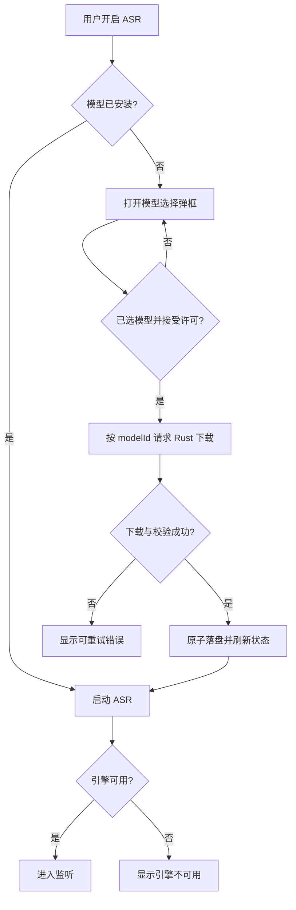

# AI 语音回复共享化执行计划

## 目标与边界

- 实用目标：免费版和会员版都能打开 AI 助手、配置模型、生成口语化回复并通过独立语音队列播放；会员过期不得阻断 AI。
- 禁止解读：不新增发送 B 站弹幕的 UI、命令或任务；不改变自动管理的会员限制；不把通用 TTS 播放状态与 AI 队列状态合并。
- 来源：`spec/spec.md` 全文、`design/architecture-design.md` 的 ownership map 与 dependency rules、PRD 5.5/5.6/7.3/8.1。

## 变更链路审查

1. 入口：`src/renderer/platform/desktop/channel.*.ts` 与导航组装。
2. 前端运行时：`useMemberRuntime` -> AI store bootstrap/listeners -> AI view/components -> desktop command adapter。
3. 后端运行时：Tauri invoke handler -> `ipc/member.rs` AI commands -> `AppState.member()` -> `AiState` -> repository/provider。
4. 权限与打包：`build_channel.rs` 命令清单、Tauri capability permissions、free/member feature builds。
5. 测试仅作为适配面，不作为保留旧会员归属的依据。改动后用 `rg` 复查 AI 路由、store 启动、`state.member()?.ai` 和 capability 校验已清理。

## 任务

### T1 用测试锁定共享边界

- 业务行为：免费与会员渠道均暴露 `/ai` 与 `/ai/logs`；会员过期只禁用 moderation。
- 编辑：渠道路由/导航单测、Rust free/member 命令清单测试、AI 文本归一与队列状态单测。
- 先执行目标测试并记录失败，再进入生产代码。
- 验收：失败原因正好是旧会员门禁/缺少共享命令或新规则尚未实现。
- product-content delta：路由权限、开关默认关闭、模型前置条件、首次音频确认、回复文本规则均来自 approved spec。

### T2 迁移前端共享所有权

- 数据契约：将 AI DTO/command/event map 从 member contract 移入独立 `contracts/ai.ts`，字段在 adapter 归一，不在组件中解释后端 DTO。
- 运行时：新建共享 `useAiRuntime`，由应用根层在两个渠道启动/释放；从 `useMemberRuntime` 移除 AI bootstrap/listener/dispose。
- 导航与路由：把 AI 路由和导航项放到共享渠道组装，不再读取会员 capability 或 expiry。
- 清理：删除只为旧会员归属服务的 import/export/mock；保留 moderation 会员链路。
- 验收：TypeScript 类型检查通过；两渠道单测均找到 AI 路由且免费渠道没有 moderation。
- product-content delta：共享可见性来自 spec 2.1/3.1；纯技术拆分为 none。

### T3 迁移 Rust 命令与应用状态所有权

- 应用状态：增加与会员状态平级的 `AppState.ai()` owner，free/member 均初始化 AI repository/provider/state。
- 命令：AI config/generate/log/ASR 命令改用 `state.ai()`，删除 membership capability 参数和校验；moderation 仍走 `state.member()`。
- 打包：free/member invoke handler、`build_channel.rs` 与 Tauri permissions 均包含 AI 命令，但 free 不包含 membership/moderation 命令。
- 异常：未配置模型、provider 不可用、超时和 ASR 错误保持显式失败，不用默认成功遮盖。
- 验收：`cargo test` 及 free/member feature check/build 通过；`rg` 不再找到 AI 命令查询会员 capability。
- product-content delta：权限语义来自 spec 3.1/3.2；其余为 none。

### T4 完成 AI 语音回复工作台

- 页面：移除会员过期提示，保留上下文/人设/ASR 复用，新增语音回复开关、就绪状态、独立队列的暂停/继续/跳过/清空。
- 模型配置：按 spec 实现多 profile 列表、默认 profile、测试连接；本地/聚合/云服务/自定义 OpenAI-compatible 共用同一精确类型契约。
- 激活规则：开关默认关闭；无默认可用模型时阻断；首次开启弹出音频路由确认，确认后记录到当前配置。
- 文本规则：展示与 TTS 使用同一 normalized text；去 Markdown/列表/多余客套/自称 AI，按长度上限截断。纯规则函数与 invoke/store 副作用分开。
- 组件：按已批准设计抽取 `AiModelProfilesDialog` 与 `AiVoiceReplyControl`，页面内保留单次手动生成。样式只使用 Tailwind utility classes。
- 状态：显式处理 loading、empty、error、disabled 和队列正在播放/已暂停。
- 验收：组件/store/normalizer 测试通过；免费和会员开发页面在桌面与移动视口无重叠、无溢出。
- product-content delta：所有字段、开关、状态、错误、队列操作与文本规则来自 spec 4-9。

### T5 端到端验证与闭包清理

- 运行定向单测、全量前端测试、TypeScript check/build、Rust test/check，并分别验证 free/member channel。
- 启动本地开发服务，使用 Playwright 检查桌面和移动视口；检查首屏可用、对话框、队列和开关交互。
- 用 `git diff --check`、`rg` 与未使用导出检查做人工评审前自检，不纳入无关用户改动。
- 验收：所有证据写入 `execution/changelog.md` 和 verify 产物；任务板无未完成项后进入 verify。
- product-content delta：none。

## 依赖与顺序

`T1 -> T2 -> T3 -> T4 -> T5`。共享契约、运行时和 Rust 命令之间存在直接依赖，默认串行。

### T6 移除手动生成区并补齐 ASR 模型下载闭环

- 目标：落实 2026-10-23 用户澄清，页面只保留自动结果；ASR 缺模型时可选择并下载可信模型。
- 前端：先补失败测试，再删除上下文/输入/生成/重新生成/清空结果控件；保留只读最新结果与复制。下载弹框消费模型数组，单选模型并确认许可。
- 契约：增加 `asr_model_list`；下载请求仅含 `modelId` 和许可确认。DTO/TS 类型包含模型 ID、大小、来源、许可、安装状态。
- Rust：ASR provider 拥有 tiny/base/small 白名单、官方地址、SHA-1 完整性值、应用数据目录、`.part` 临时文件和原子重命名；未知 ID、网络失败、校验失败均显式失败。
- 状态：bootstrap 同时加载 ASR 状态与模型目录；下载成功后刷新两者。模型缺失与引擎不可用用不同错误码。
- 测试：覆盖页面旧控件缺失、模型选择/许可门槛、契约不接受 URL/路径、未知 ID 拒绝、已安装识别、原子下载语义。
- 风险：模型文件较大且下载耗时，操作 pending 只锁定弹框下载按钮；失败可重试，不删除已完成模型。

### T8 移除模型档案代理 URL

- 目标：落实 2026-10-23 用户澄清，模型档案新增/编辑界面不再显示或接受代理 URL。
- 测试：先在 AI 页面契约测试中断言模型档案组件不包含“代理 URL”、`draft.proxyUrl` 或由草稿生成的代理值，并要求保存负载固定为 `proxyUrl: null`。
- 前端：删除档案草稿中的 `proxyUrl`、编辑态回填和表单项；保留类型契约的兼容字段，在提交边界显式传递 `null`。
- 兼容：不改数据库结构、Rust DTO 或历史记录读取，避免把局部 UI 调整扩展成数据迁移；重新保存旧档案时清除旧代理值。
- 验收：定向测试、类型检查、前端测试、free/member 构建通过，并重新生成 Windows NSIS 安装包。

### T9 用推理强度替换模型温度

- 测试先行：更新前端页面/adapter 契约测试，要求出现 `推理强度` 与七个枚举值且不再出现温度；更新 Rust repository/IPC/provider 测试，锁定迁移默认值、非法值拒绝和 `reasoning_effort` 请求字段。
- 前端契约：在 `contracts/ai.ts` 定义 `AiReasoningEffort` 联合类型，将 profile/writable 的 `temperature` 改为 `reasoningEffort`；adapter 使用闭集枚举校验。
- 表单：`AiModelProfilesDialog.vue` 将数值 stepper 替换为 Element Plus select，新建默认 `medium`、编辑回填档案值、保存原值。
- Rust 契约：增加对应 DTO enum，将 `AiModelProfileRecord.temperature` 改为 `reasoning_effort`，IPC 映射必须双向穷尽并拒绝未知 JSON 值。
- 持久化：新增 `0005_ai_model_reasoning_effort.sql`；repository 查询、映射、校验和 upsert 使用 `reasoning_effort`。旧 `temperature` 列只在新插入时写兼容常量 `0.7`，不得再进入运行时模型。
- Provider：`OpenAiCompatibleLlmProvider` 请求 JSON 删除 `temperature`，增加 `reasoning_effort`；连接测试和真实生成共享同一路径。
- 清理：仅移除模型档案链路的 temperature；旧 `AiConfigRecord.temperature` 与历史 `t_ai_config` 不属于本次 profile UI，不做无关迁移。复查生产链路无 profile temperature 残留。
- 验收：前端定向/全量 free/member 测试、TypeScript、lint、Rust free/member、格式检查、双渠道 web build、浏览器抽屉检查和 Windows NSIS 打包全部通过。

## Code-review checklist contract

- 正确性：free/member 一致可用 AI，会员过期不影响 AI，moderation 仍受限。
- 契约：Rust DTO -> TypeScript contract -> adapter -> store -> component 字段一致，`null`/缺省值语义明确。
- 异常：配置缺失、连接失败、超时、ASR/TTS 失败、队列空状态都有显式处理。
- 性能：不因高频弹幕重建全页，监听器在 unmount/dispose 释放，队列只保留必要快照。
- 安全：API key 不回传明文、不记日志；自定义 endpoint 输入显式校验。
- 可维护性：无反向依赖、无重复 writable state、无死代码/过期 mock，组件抽取仅限已批准边界。
- 技术栈：Vue 3 + Pinia + TypeScript strict + Tailwind utilities + Tauri/Rust，不引入新 UI 框架或非必要抽象。

## 回退条件

- 如果实施发现 approved spec 与已有数据库/密钥保存能力冲突，停止编码并回到 spec/architecture-design，不以明文存储或单 profile 假装完成。
- 如果 free build 因 member 模块的物理依赖被迫引入会员命令，回到 architecture-design 拆分 Rust AI module，不放宽 free 命令面。
- 如果 UI 实现需要 spec 未定义的字段或默认值，回到 spec，不在 execute 中自行发明。
