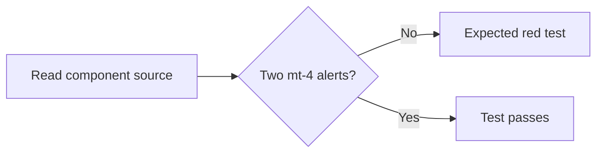
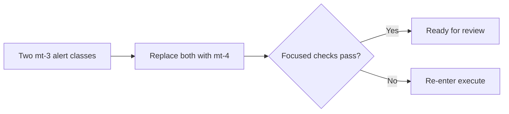

# Plan: AI Voice Reply Warning Spacing

## Summary

Make one local Tailwind spacing change in both alert branches, protected by a focused source-contract test. No architecture, state, or API work is involved.

## Task T1: Add Failing Contract Assertion

- Goal: prove both prerequisite alerts use the requested larger spacing.
- Scope: `views/ai/ai-page.test.ts` only.
- Product-content delta: none; verifies `SRC-1`.
- Test: count two `class="mt-4"` occurrences and reject remaining warning `mt-3` usage.

## Task T2: Increase The Gap

- Goal: change both warning branches from `mt-3` to `mt-4`.
- Scope: `AiVoiceReplyControl.vue` only.
- Preserve: conditions, copy, outer padding, queue margin, behavior, responsive layout.
- Pattern: Level 0 direct code; keep inline, no abstraction or new file.

## Verification And Review Contract

- Run focused Vitest, scoped ESLint, TypeScript type-check, member web build, and diff check.
- Review exact changed hunks for unrelated style churn, altered conditions/copy, and state-dependent spacing drift.
- Styling remains an inline Tailwind utility; no performance, memory, async, cleanup, API, nullability, or error-state change applies.
- Self-healing: logic/style/test blockers return to execute; maximum loop limits and no-progress stop rules remain in force.
