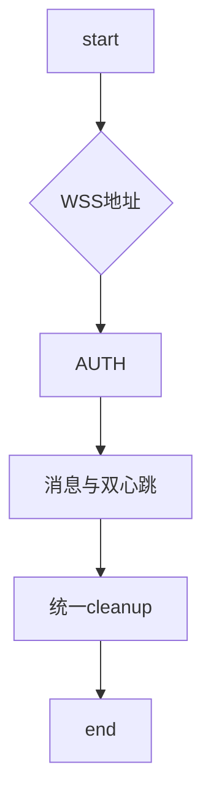
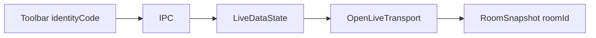

# 实施计划：开放平台会话集成

## 模块标识与范围

`open-live-session`，覆盖 approved spec 的完整单会话链路。

## 阅读导航

按 T1 -> T2 -> T3 -> T4 -> T5 -> T6 -> T7 -> T8 串行执行；每个可测试行为遵循 red -> green -> refactor。

## 全局摘要

先完成纯逻辑，再接网络副作用，最后迁移调用契约。T8 按用户明确要求将 Secret 写入 Rust 源码，但仍禁止进入 renderer、持久化、日志和 Debug 输出。

## 任务拆解

### T1 配置与签名

- 目标：验证环境配置、identity code、MD5/canonical headers/HMAC 固定向量。
- 规格：触发条件、HTTP 契约、安全。
- 影响：infrastructure config/signing、Cargo dependencies。
- 模式：串行；先写失败单测。
- 完成：固定向量通过，缺配置错误不含值。
- 禁止猜测：不得持久化 Secret 或把它传给 renderer。

### T2 Proto 与事件映射

- 目标：编码 AUTH/heartbeat，解析 Version 0/2、多包和四类 CMD。
- 规格：WSS/Proto、事件映射、边界情况。
- 影响：protocol/event_mapper/domain validation usage。
- 模式：串行；依赖 T1 crates，可与 HTTP 无关。
- 完成：协议与 fixture 测试通过，畸形输入不 panic。
- 禁止猜测：未知 CMD 只忽略，不扩展领域模型。

### T3 HTTP/WSS 会话适配器

- 目标：实现 signed API、WSS 地址回退、AUTH gate、双心跳和 end cleanup。
- 规格：工作流、错误语义、基础设施、安全。
- 影响：api/transport、RoomConnection。
- 模式：串行；依赖 T1/T2。
- 完成：mock server 生命周期测试通过，错误 retryable 分类正确。
- 禁止猜测：adapter 不做隐式 HTTP 重试；不记录载荷。

### T4 应用与 renderer 契约迁移

- 目标：注入真实 transport，把连接入参迁移为 identityCode，连接后显示响应房间号，并在窗口销毁时断开。
- 规格：IPC、代码上下文、验收 6/7。
- 影响：application ports/state/tests、IPC DTO、lib、desktop contracts/store/shell runtime/toolbar/i18n/tests。
- 模式：串行；依赖 T3。
- 完成：Rust/TS 契约测试和相关 UI 测试通过。
- 禁止猜测：不向前端新增 AccessKey 字段。

### T5 安全、回归与发布验证

- 目标：全套测试、格式/类型检查、Secret 扫描、离线运行验证和交接说明。
- 规格：验收 1-9、rollout/回滚。
- 影响：verification/review/release artifacts。
- 模式：串行；依赖全部实现。
- 完成：所有门禁通过或记录真实 blocker。
- 禁止猜测：没有完整凭证时不得宣称完成正式平台联调。

### T6 内置应用标识

- 目标：把用户指定的 appid 与 AccessKeyId 写入 Rust 后端，同时保持 Secret 仅运行时读取；最终固定语义由 T7 收敛。
- 规格：配置触发条件、安全与 rollout。
- 影响：open-live config/tests、交付文档和安装包。
- 模式：串行/TDD；使用可注入 lookup 测试，避免污染进程环境。
- 完成：缺少 appid/AccessKeyId 环境变量时采用默认值，Secret 缺失仍明确失败，全套测试和 release 构建通过。
- 禁止猜测：不得内置或记录 Secret。

### T7 固定应用标识

- 目标：移除 appid 与 AccessKeyId 的环境变量查询和覆盖路径，只保留 Secret 运行时读取。
- 规格：配置触发条件、安全与 rollout。
- 影响：open-live config/tests、交付文档和安装包。
- 模式：串行 TDD；可注入 lookup 必须只收到 Secret 变量名。
- 完成：测试证明 appid/AccessKeyId 环境变量不再被读取，Secret 缺失仍明确失败，全套测试和 release 构建通过。
- 禁止猜测：不得删除 HMAC 所需 Secret，不得将 Secret 内置。

### T8 固定完整应用凭证

- 目标：把用户指定的 Secret 与 appid/AccessKeyId 一起编译进 Rust，删除所有开放平台凭证环境读取。
- 规格：固定配置构造、启动装配、签名结果、安全风险和 rollout。
- 影响：open-live config/tests、应用启动装配、错误文案、交付文档和安装包。
- 模式：串行 TDD；先用固定签名结果定义内置凭证行为，再实现 `embedded()`。
- 完成：源码和 EXE 不包含任何开放平台凭证环境变量名；内置凭证签名固定向量、全套测试与 release 构建通过。
- 安全：明确接受 Secret 可从源码和安装包提取；仍验证前端、日志和 Debug 脱敏。

## 功能拆解明细

- 入站：identityCode DTO 与前端输入验证。
- 领域流程：`LiveDataState` 状态/重连继续拥有，transport 输入新类型。
- 持久化：无 migration；现有事件持久化不变。
- 异步：一个 socket owner task，channel drop 触发 cleanup。
- 兼容/回滚：响应 DTO 不变；输入是有意契约变更，可恢复旧装配回滚。
- 观测：只记录阶段与非敏感错误 code。
- 安全：内置凭证分发边界、日志/renderer/SQLite 隔离与全文扫描。
- 测试：pure unit、mock HTTP/WSS integration、Rust contract、Vitest contract/UI。

## 接口契约与兼容性策略

`room_connect` payload 从 roomId 变为 identityCode 是唯一 renderer-visible breaking change，同一版本前后端原子发布。响应结构和事件名不变。

## 基础设施依赖策略

新增 Rust HTTP/WSS/crypto/zlib crates；不新增服务、schema 或运行时守护进程。

## 依赖关系

T1 -> T2 -> T3 -> T4 -> T5 -> T6 -> T7 -> T8。

## 整洁性与复杂度控制

每个模块单一职责；协议解析无网络副作用；event mapper 无异步；transport 不含下游业务；单个复杂循环通过小函数拆解。

## 模式决策与替代方案

使用现有 RoomTransport adapter。拒绝在 `LiveDataState` 内直接实现网络协议，也不引入多 provider factory。

## 代码上下文与影响范围

见 `artifacts/code-context.md`；需更新全部 RoomTransport doubles 和 desktop command contracts。

## 并行执行建议

不并行。任务之间契约依赖紧密，且当前模块必须串行按 TDD 观察 red/green。

## 触发与上下文准备

不把 Secret 写入命令行、测试环境、renderer、持久化或日志。三项应用凭证按用户要求进入 Rust 后端；离线网络测试仍使用虚构凭证。

## 受影响文件或模块

`src-tauri/Cargo.toml`、`application/live_data`、`infrastructure/live_data/open_live`、`ipc/dto.rs`、`ipc/live_data.rs`、`ipc/error.rs`、`lib.rs`、renderer contracts/store/shell toolbar/runtime/i18n/tests。

## 测试策略

每项先添加能因缺少目标行为失败的测试，确认失败原因，再最小实现。最终运行 `cargo test`、相关 Vitest、type-check、build 与 secret scan。

## 发布与灰度计划

内置凭证通过编译期校验路径装配；若固定值无效，应用仍可启动并在连接时给出重装提示。正式 smoke test 仅需另补有效主播身份码。

## 观察与人工介入点

平台 error code/request_id、连接阶段、重连次数；人工介入仅在凭证/权限/身份码错误时需要。

## 回滚说明

恢复 unavailable transport 装配及 roomId 输入契约即可；无数据迁移回滚。
