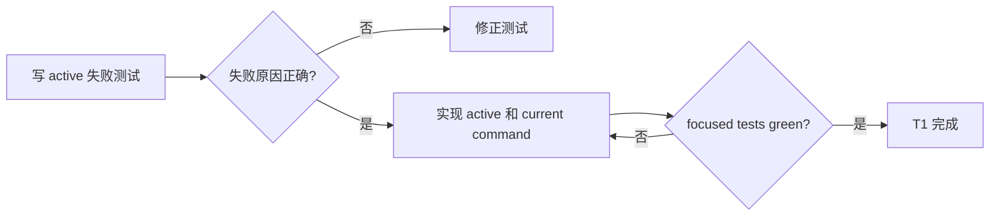
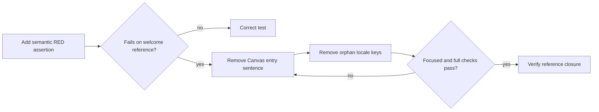
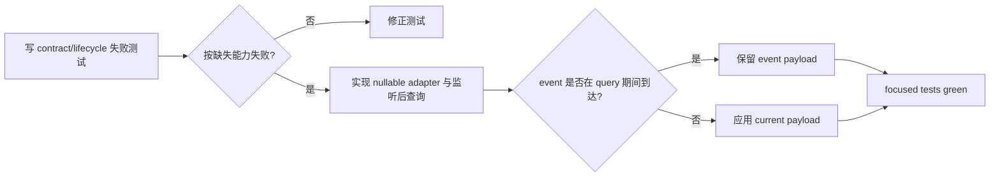
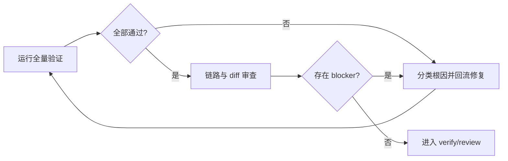
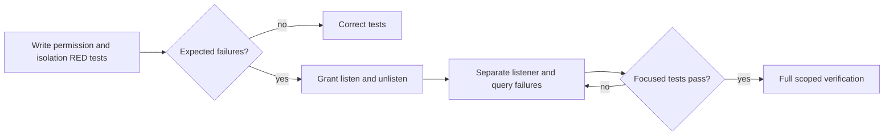

# 实施计划

## 交付单元标识

`captain-effect-window-empty`，3 个串行任务，S2 scoped。

## 阅读导航与全局摘要

主线：Rust active read model -> nullable IPC contract -> Vue listen-then-query -> 全量验证。高风险是 query/event 竞态和 active 清理。前置条件：spec 已批准，ADR-1/2 已完成。

## 用户意图与来源边界

U1 要求特效窗口不为空，实际目标是首次打开稳定显示。禁止延时重发、静态背景掩盖和只修第二次触发。所有任务 `product-content delta: none`；只恢复既有显示，不新增产品内容。

## 业务功能与状态规则

- BF1 预览：队列项成为 active 后，窗口查询获得 `isPreview=true` payload；结束清理。
- BF2 直播：active 保留真实 audience/action/level/config，`isPreview=false`。
- BF3 窗口挂载：先 listen，再 query；query 期间若收到 event，event 优先。
- 无 active 返回 `null`；query rejection 保持透明并执行正常 cleanup；无自动重试。
- touched 展示字段不改变格式、精度、空值、可点击性或视觉状态。

## 执行效率与上下文预算

仅读取 effects/state/IPC/lib、desktop media contract/adapter、EffectWindowRoot 和相邻 tests。无需扫描其他页面、样式或 media 能力。若发现必须改通用 event bus 或 gift/tts，升级 S3 并回退架构设计。

## 执行可用性合同

`ready for execute`。类型、owner、null 语义、时序、文件、测试和回退均已确定；无产品 blocker。governing TS 配置沿用 package 的现有 type-check/Vitest/Vite 配置及 `@/` alias，不扫全仓声明。

## T1 Rust Active Payload（串行）

- 规格：AC1-AC3，ADR-1；label `code-fact-backed`。
- RED：在 `application/media/tests.rs` 添加 preview active、live audience、结束清理测试；生产缺失 `active_effect` 时必须编译失败或断言失败，确认失败原因。
- GREEN：在 `effects.rs` 给队列状态增加 `ActiveCaptainEffect`；`EffectItem` 保留 live audience，preview 使用明确 synthetic audience；worker 与 `snapshot.current` 同临界区设置/清理 active，并暴露只读 clone 查询。
- IPC：在 `ipc/media.rs` 复用现有 audience/action/level/config mapper 构造 current payload；新增 nullable command；`lib.rs` 注册。为 `effect-*` capability 增加仅允许该只读命令的窄 permission，不授予 `foundation` 整体权限。event contract 保持不变。
- 约束：application 不依赖 IPC；无 class/cache/manager；null 与 rejection 分离。
- 验证：focused Cargo test，再运行 media/IPC contract tests。

## T5 2026-09-23 Captain Purchase Semantic Cleanup

- Source/spec: U2, AC9-AC12; authorized product delta is removal of the contradictory entry sentence only.
- RED: extend `src/renderer/components/media/media-pages-contract.test.ts` to assert that the captain surface does not reference `captainEffect.welcome`, while retaining action, level, and username rendering contracts; require failure before production edits.
- GREEN 1: remove the `t('captainEffect.welcome')` Canvas draw call from `CaptainEffectSurface.vue` without altering geometry, animation, payload handling, or accessible announcement.
- GREEN 2: remove only the orphan `welcome` keys from `zh-CN.json` and `en-US.json`; do not introduce replacement copy or rename page/menu keys.
- Verification: focused media-page contract test, i18n runtime test, type-check, lint, full Vitest, and web build. Desktop/Rust code is unchanged, so reuse the fresh packaged-desktop evidence from T4 and run no unnecessary Rust rebuild for this locale/Canvas-only deletion.
- Change-chain closure: search for `captainEffect.welcome`, the Chinese/English entry sentence, and captain surface callers after the edit; expected remaining references are none for the removed key and unchanged purchase/renewal contracts.
- Review contract: no new files, abstractions, styles, payload fields, event routes, or copy; every hunk maps to removal, orphan-locale cleanup, or test adaptation.
- Robustness/maintainability/performance: no external input or async boundary changes; preserve existing null handling, animation cleanup, and render cadence; avoid repositioning or speculative visual changes.
- Technology anchor: Vue 3 SFC, existing i18n JSON, Vitest source-contract convention, current alias/directory patterns; no dependency or stack change.

## T2 Renderer 首帧恢复（串行，依赖 T1）

- 规格：AC4，ADR-2；label `code-fact-backed`。
- RED：在 media contract/adapter tests 与窗口 root 测试中定义 `captain_effect_current: CaptainEffectPayload | null`、nullable adapter、listen-before-query、event-wins；确认缺少命令/逻辑导致失败。
- GREEN：扩展 desktop command map 和 adapter；`EffectWindowRoot.vue` 先 await listener，再 invoke current；使用本地 revision/flag，只有查询期间没有更新事件才应用结果；unmount 后忽略结果并 unlisten。
- 约束：复用 `adaptCaptainEffectPayload`；SFC 本地编排，不新增 helper 文件/store/component；不改 surface/template style。
- 验证：focused Vitest + type-check。

## T3 回归、构建与审查（串行，依赖 T2）

- 规格：AC5 与 completion bar；label `code-fact-backed`。
- 运行 Rust fmt/check/tests、Vitest、type-check、ESLint、free build；可行时运行桌面打包测试。
- 复查链：preview/live -> active -> command/event -> adapter -> root -> surface；确认无孤立 command、重复 DTO builder、旧 active 泄漏、未清理 listener。
- diff 审查：每个 hunk 映射 T1/T2/测试适配；排除模板视觉、无关格式化、debug/dead/stale/unused 内容。
- 失败分类并按 self-healing 回流 execute/plan/spec/architecture-design。

## API 与类型策略

Rust `Option<CaptainEffectPayloadDto>` 对应 TS `CaptainEffectPayload | null`。raw non-null 必须经 `adaptCaptainEffectPayload`；命令调用位于 desktop wrapper/lifecycle 边界。preview synthetic identity 是 runtime 技术数据，不改变画面字段（仅 username 为现有“用户A”）。

## 变更链路与清理

操作前已确认：preview 无 publish，live publish 早于窗口创建，surface 在 null payload 返回。操作后以 symbol search 确认命令注册/映射/调用闭合、active 设置和清理成对、event 仍有生产调用方。测试引用仅作为适配面。

## 架构复用、局部性与模式

落实 ADR-1/2；复用 IPC mapper 和 renderer adapter。DTO builder 两个同语义入口在 IPC 内私有复用；SFC race guard 单调用方就近。gift 保持分离。模式为 Level 2 existing command/adapter/lifecycle，无新扩展层。

## 生产质量与评审预检

- robustness：nullable command、malformed DTO、rejected invoke、unmount guard、effect capability 最小权限。
- maintainability：worker 只管理生命周期，DTO builder 只转换，SFC 只编排；函数不混合绘制。
- performance：一次挂载查询，无 debounce/cache；监听释放。
- conventions：Vue 3 setup、typed desktop wrapper、Rust ports/mutex、现有 alias/test 风格。
- human review：不得改技术栈、样式、模板数据、其他 media 功能；提供 commands 和结果。

## 自愈闭环

execute 后必须 verify -> review。检查 requirement/plan/architecture/logic/type/runtime/organization/maintainability/debt；默认可恢复问题回 execute，结构问题回 architecture-design，合同问题回 spec。iteration <=7，同 blocker 同 stage <=2、总 <=3；无新证据或修复则 blocked。完成要求两项 self-healing pass 且 blocker none。

## 并行与触发

任务紧密依赖，不启用并行或子代理。用户反馈触发，仓库代码与工件提供上下文，最终由用户通过桌面窗口复测交接。

## 回滚说明

可整体移除 current command、active read model 和 root query，恢复原 event-only 行为；不涉及数据迁移或持久化格式。

## T4 2026-09-23 Reopen: Permission And Startup Isolation

- Source/spec: reopen evidence, AC6-AC8; `product-content delta: none`.
- RED 1: update `src-tauri/tests/foundation_contracts.rs` so `effect-*` must contain `captain-effect-current`, `core:event:allow-listen`, and `core:event:allow-unlisten`; run the focused Rust contract test and require failure against the current capability.
- RED 2: update `src/renderer/components/media/media-pages-contract.test.ts` to require separate listener-registration and current-query functions, listener-before-query ordering, and isolated error handling; run the focused Vitest and require failure against the current combined `try` block.
- GREEN 1: add only `core:event:allow-listen` and `core:event:allow-unlisten` to `src-tauri/capabilities/effect.json`; do not grant `core:event:default`, emit rights, or `core:default`.
- GREEN 2: keep listener registration before current query in `EffectWindowRoot.vue`, but isolate their `try/catch` boundaries so a subscription denial still reaches `captain_effect_current`; preserve event revision, unmount guard, adapter validation, and cleanup.
- Verification: focused Vitest, focused Rust contract test, type-check, lint check, renderer build, then native Tauri build if the scoped checks pass.
- Review contract: no new helper file/component/store, no canvas/template/style change, no swallowed current-query promise outside an explicit local boundary, and every changed hunk maps to AC6-AC8.

