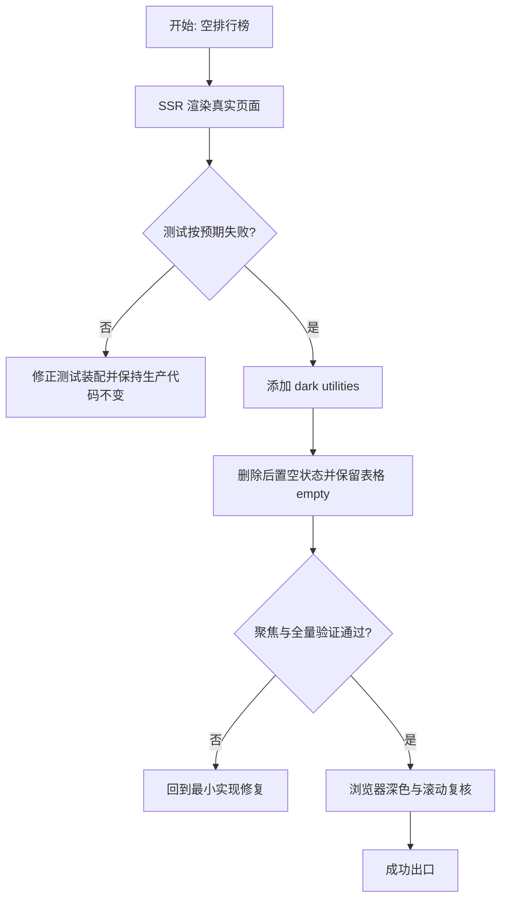

# Plan: 深色排行榜主题与唯一空状态

## 交付单元标识

`dark-ranking-theme-empty-state`

## 阅读导航

- 目标：修正排行榜深色表面并收敛为一个空状态。
- 任务：1 个串行 TDD 任务；无并行任务；风险为 SSR 测试装配和 Element Plus 实际 empty 输出。
- 依赖：approved spec、排行榜 SFC、Vue SSR/Pinia、现有 Tailwind/Element Plus dark 链。

## 全局摘要

先用真实 Vue SSR 渲染排行榜空数据状态建立 RED，再对单个 SFC 补深色 utility、删除后置空状态，最后执行聚焦/全量检查和运行时截图。禁止通过裁剪滚动或强制主题规避根因。

## 用户意图合同承接

- 字面要求：深色页面协调、滚动后不出现两个“暂无数据”。
- 实际目标：主题视觉连续，空结果只表达一次。
- T1 负责全部实现；V1-V4 验证 class、实际 SSR 文案数量、滚动截图和无行为漂移。

## 来源锚定与禁止扩展边界

- T1：`source-backed` U1-U4；product-content delta：深色视觉状态修正、空状态从两个收敛为一个。
- 测试/构建：`code-fact-backed`；product-content delta: none。
- 禁止扩展：其他页面、数据/store/IPC、布局、字段、交互、文案重写、主题状态架构。

## 业务功能与逻辑明细

- F1 主题表面：根 `.dark` 为真时 section 使用 `zinc-900`，header/footer 边框 `zinc-800`，标题 `zinc-100`，页脚元数据 `zinc-400`；浅色 class 保留。
- F2 唯一空态：`rankPending=false` 且 `rows=[]` 时由 `el-table` 显示一次“暂无数据”；加载中由表格 loading 接管；有数据时不显示 empty。
- 无权限、校验、提交或新状态流；现有查询失败提示不变。

## 字段展示语义与视觉状态

- “暂无数据”：当前榜单结果为空、只读、不可点击、无 hover/focus/active 状态；精确文案不变。
- 标题：主文字；页脚：次级元数据。统计格式和更新时间精度不变。

## 执行效率与上下文预算

`S1 local` / compact。execute 只读排行榜页、analytics/room store 必要装配、相邻测试和 TS/Vite 配置；不扫描后端或其他业务页。若需要共享主题或跨页修改则停止并升级 S2。

## 自愈闭环计划

execute 后进入 verify -> review。检查 requirement mismatch、plan/architecture gap、logic/type/runtime/organization/maintainability/technical-debt blocker；默认可修实现问题回 execute，合同缺口回 plan/spec。iteration <= 7，同 blocker 同阶段连续 <= 2、总计 <= 3；无新证据/修复/更窄诊断则 blocked。完成需 compliance/assessment pass 且 blocker none。

## 执行可用性合同

`ready for execute`。目标生产文件、测试文件、样式值、删除分支和验证命令均已明确；无产品未知项。TypeScript 由 `tsconfig.eslint.json`/`tsconfig.json` 严格模式治理，测试不新增宽类型或 mock DTO。

## T1：SSR 回归测试与排行榜模板修复

### 任务目标

用真实 SSR 输出证明空状态重复和主题 class 缺失，然后最小修改页面模板使测试通过。

### 规格映射

Spec F1/F2、A1-A4；来源 U1-U4；product-content delta 如 allowlist。

### 范围与影响面

- 新增：`src/renderer/views/rankings/rankings-page.test.ts`。
- 修改：`src/renderer/views/rankings/index.vue` template。
- 保留：script、stores、query/export/drawer、表格列和高度。

### 前置条件

先以 Vue SSR + Pinia 渲染空数据页面；不 mock Element Plus empty 行为。确认测试因两个 empty 文案和缺少 dark classes 失败。

### 实现子项

1. RED：断言 SSR 输出只有一个“暂无数据”；断言页面根/标题/边框/页脚具备指定 dark classes。
2. GREEN：给 `el-table` 明确 `empty-text="暂无数据"`；删除表格后的自定义 empty `div`。
3. GREEN：section/header/title/footer 分别添加 spec 指定 Tailwind dark utilities。
4. REFACTOR：仅格式整理；不提取 helper、常量、组件或样式文件。

### 交互与状态约束

loading/empty/data owner 都保持在表格；禁止隐藏 overflow 或改变高度。浅色 class 和所有用户操作保持不变。

### API、架构与副作用边界

不改 API/type/store/side effect。Level 0 direct code；复用 Tailwind dark variant 和 Element Plus empty API。Vue 组件保持 inline，真实生产调用方 1，无抽取理由。

### 测试与验证

- RED/GREEN：`pnpm vitest run --mode free src/renderer/views/rankings/rankings-page.test.ts`。
- 回归：全量 Vitest、`pnpm type-check`、`pnpm lint:check`、`pnpm build:web:free`。
- 运行时：深色 `/rankings` 截图，检查滚动前后空状态计数。

### 风险与回退

若 SSR 无法装配现有自动导入组件，只调整测试装配，不为测试改生产结构；若 Element Plus SSR 行为与浏览器不同，保留组件级输出断言并以浏览器 DOM 计数补证据。回退为还原两个 scoped 文件。

## 功能拆解明细

表格列、排序、筛选、TOP 限制、滚动和数据来源均不变。仅 empty state 从双 owner 改为单 owner；深色变体只补在页面表面和文本边界。

## 项目脚手架与初始化策略

不适用：既有页面修复。

## API 对接与类型策略

不适用：无 API 或类型合同变化；SSR 测试复用现有 store 类型。

## 依赖关系

RED -> GREEN -> scoped/full checks -> runtime screenshot，严格串行。

## 变更链路审查

变更前已确认 `/rankings` -> SFC -> `rows` -> `el-table` 与后置 empty div。删除后复查“暂无数据”、`rows.length === 0` 和相关 imports；表格仍是空态 owner，无 orphan helper/import/state/test。

## 整洁性与复杂度控制

只改模板和一份测试；不新增函数/状态/常量；不做宽格式化或相邻页清理。

## 局部性与文件抽取决策

生产修改留在 owning SFC；测试同目录。无 helper/file extraction。

## Vue 组件抽取决策

`keep inline`；没有新组件候选，抽取会形成单调用方透传层。

## 前端专家级工程约束

保持状态所有权、async 生命周期、交互与性能边界；实际浏览器验证 empty/loading 和深色输出。

## 前端架构质量约束

不适用：无架构变更；验证不得意外引入新 owner 或依赖。

## 生产代码质量约束

无新类型/函数/null 语义。Element Plus 明确处理 empty/loading；不添加缓存、watcher 或 class。

## 代码评审预检合同

- 健壮性：不改外部数据与异步边界。
- 可维护性：删除重复 owner，保留单一清晰模板路径。
- 性能/内存：无新 listener/watch/render fan-out，no optimization。
- 栈一致性：Vue SFC + Element Plus + Tailwind utilities；禁止换库、加 CSS 或新依赖。

## 人工评审可通过性约束

每个 hunk 映射 T1；自审无 debug/dead/stale/unused 内容，无 unrelated formatting。证据包含 RED/GREEN、全量测试、type/lint/build 和运行截图。

## 架构复用与公共逻辑抽取

不适用：复用既有主题机制和表格 empty owner，不新增公共逻辑。

## 函数式编程约束

不适用：不改转换或副作用。

## Tailwind 样式约束

只增加短小、相邻的 `dark:*` utility；不添加 style/CSS/class 常量/helper。

## 模式决策与替代方案

Level 0 direct code / none。无结构变化信号；wrapper/component/theme adapter 都比直接修正单页 owner 更重，execute 不得现场引入。

## 代码上下文与影响范围

见 `artifacts/code-context.md`；影响仅排行榜模板和同目录测试。

## 并行执行建议

不启用 workflow 并行；TDD 步骤紧密依赖且改动极小。

## 触发与上下文准备

用户原复现步骤触发；上下文为目标 SFC、主题入口、现有 package scripts。人工介入点为最终截图复核。

## 受影响文件或模块

`views/rankings/index.vue`、`views/rankings/rankings-page.test.ts`、本请求工件。

## 测试策略

真实 SSR 行为优先；无 mock 断言。Mutation check：删除任一 dark class 或恢复后置 empty div，应至少使一项测试失败。

## 观察与人工介入点

浏览器中检查深色首屏与滚动到底部；若仍存在白块或第二空态，自动回到 execute，不交给用户发现。

## 回滚说明

生产回滚只需撤销排行榜模板的 scoped hunks；无 schema、状态或数据迁移。

