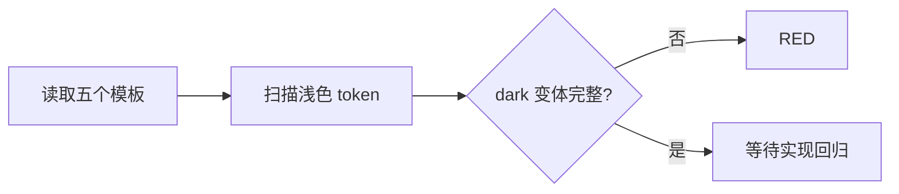
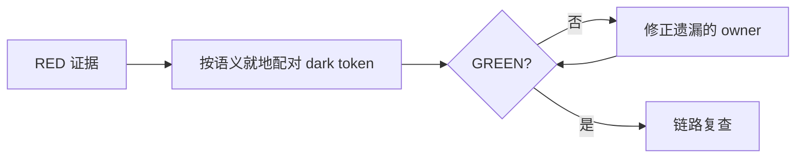
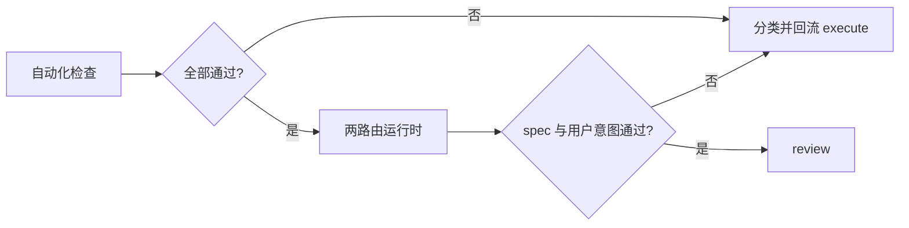

# 计划：dark-theme-tts-recording-contrast

## 全局摘要

以 TDD 串行完成：先扩展契约测试并观察 RED，再在五个现有 Vue owner 上增加精确 `dark:` utility，最后完成工程与两路由验证。`product-content delta: none`。

## T1 契约测试 RED

- 来源：U1；spec AC1-2。
- 文件：`media-pages-contract.test.ts`。
- 实施：将 TTS/录制五个模板纳入深色配对契约；断言 gray/red/amber 文字、gray 200/300 边框和 gray-50 背景的指定深色变体。
- 验证：运行单测试文件，预期因现有缺失而失败。
- 禁止：不修改业务断言或以放宽正则伪造通过。

## T2 模板样式 GREEN

- 来源：U1；spec AC1-5。
- 精确文件：`tts/index.vue`、`TtsQueuePanel.vue`、`recording/index.vue`、`RecordingStatusBand.vue`、`RecordingSettingsDialog.vue`。
- 颜色映射：
  - gray 900 -> zinc 100；gray 800 -> zinc 200；gray 700/600 -> zinc 300；gray 500 -> zinc 400。
  - amber 700 -> amber 400；red 700/600 -> red 400。
  - border gray 200 -> zinc 800；kbd border gray 300 -> zinc 700；bg gray 50 -> zinc 900。
- 保留：原浅色 token、DOM、Element Plus、props/emits、store、事件、条件分支与副作。
- 形态：Level 0 `direct code`；仅就地 Tailwind token，不新增抽象或 CSS。
- 验证：相同契约测试 GREEN，并用 `rg` 反向确认无遗漏。

## T3 验证与评审

- 来源：spec AC3-6。
- 自动化：相关 Vitest、`type-check`、`lint:check`、`build:web:free`、`git diff --check`。
- 运行时：在 `.dark` 下访问 `#/tts` 与 `#/recording`，检查页标题、队列/状态文字、警告/错误、数值、边框和快捷键表面的 computed style 与截图；检查控制台错误。
- 链路：复查 `.dark -> Tailwind -> DOM`；确认无 store/IPC/语音/录制链路变化。
- 污染控制：仅评估本请求 hunks；保留并隔离工作区既有改动；清除构建引入的无关生成噪音。

## 依赖与执行方式

`T1 -> T2 -> T3` 串行；任务紧密耦合，不使用并行 agent。

## Code Review Checklist 合同

- 健壮性：无外部数据/API 变更；现有空/loading/error 分支不动。
- 可维护性：不新增函数、常量、文件或抽象；每个 class hunk 映射到明确可见层级。
- 性能/内存：静态 utility 无新运行时成本、订阅或 cleanup。
- 项目规范：Vue 3 + Tailwind + Element Plus + Vitest；不改技术栈、目录或 import 方式。
- 展示忠实性：只改深色默认态颜色，不用 hover 替代业务强调。

## Human Review Readiness

执行记录必须标明任务所有 hunks，确认无格式化噪音、debug/dead/stale 代码、unused import 或生成文件残留；证据覆盖测试、类型、lint、构建、运行时和未运行范围理由。

## 自愈闭环

实现后按 requirement-mismatch、plan-gap、architecture-gap、logic-error、syntax-type-error、runtime-error、code-organization-error、maintainability-error、technical-debt-blocker 分类。可修复项回流 owning stage；单元最多 7 轮，同 blocker 同 stage 最多 2 次、总计 3 次；无新证据/修复/更窄诊断时停止。完成要求验证和 review 所有适用 verdict 均 pass。

## Execute Readiness

- 文件、token 映射、禁止变更、测试入口和运行时路由已明确。
- 无需 execute 猜测字段语义、业务分支、API、状态、类型或样式方案。
- blocker：none。
