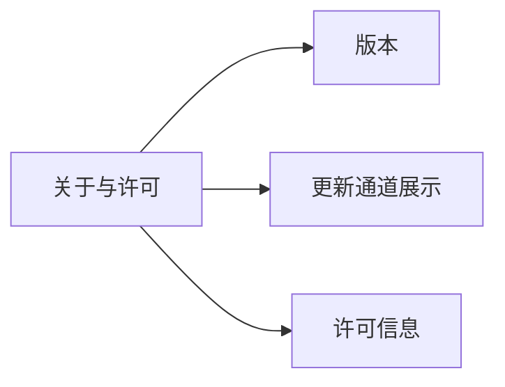

# 计划：关于与许可隐藏更新通道

## Delivery Unit And Scope

- `hide-update-channel-about`，`S0 trivial`，串行单任务。
- Source：U1；product-content delta：删除一个指定展示项，不新增内容。
- In scope：设置页合同测试、关于模板、两份 locale。
- Out of scope：release store/类型/IPC/Rust、检查更新行为、版本和许可内容。

## Task T1: RED -> GREEN -> Verification

1. 编辑 `views/settings/settings-shell-contract.test.ts` 的 about/update 用例：保留更新检查断言，并新增 `page.not.toContain('settings.aboutInfo.channel')`、`page.not.toContain('release.about?.channel')`。先运行该测试，预期 RED。[source-backed: U1]
2. 编辑 `views/settings/index.vue`：只删除 channel 的 `<dt>` 与 `<dd>`；保留版本行、检查更新按钮、分隔线和许可区域。[source-backed: U1]
3. 编辑 `locales/zh-CN.json` 与 `en-US.json`：删除 `settings.aboutInfo.channel` 键，修复前一键的 JSON 逗号；不改其他文案。[code-fact-backed cleanup]
4. 重跑 focused test 取得 GREEN，并用 `rg` 确认展示引用和 locale 键归零，同时确认 release 模型中的 channel 仍存在。
5. 运行相关 release/store 测试、`type-check`、`lint:check`、`build:web:free`、`git diff --check`。

## Change Chain And Cleanup

只移除 C 及其两个 locale 文案键。`release.about.channel` 的数据生产与更新检查链路不删除，因为仍由 release 合同拥有；测试引用是适配面，不是生产 owner。

## Pattern, Quality And Review Contract

- Level 0 `direct code`，pattern `none`；原位删除四个小 hunk，不新增抽象。
- 无类型/null/异常/异步/性能/内存或副作用变化；无需新增 guard、缓存或 cleanup。
- 遵循 Vue SFC、vue-i18n、Vitest 既有组织；不格式化整文件、不改无关 imports、不新增 CSS。
- Pre-review：每个 hunk 必须映射到 U1、测试适配或 locale 清理；检查无 dead/stale/debug/unused 内容。
- 回滚触发：若 channel 被其他可见页面或业务逻辑依赖，则保留对应合同，只调整本页引用；不得扩大删除范围。

## Acceptance And Evidence

- AC1-3：focused contract + `rg`。
- AC4：现有 update check 断言、release 测试和模板静态检查。
- AC5：type/lint/build/diff check。
- 全仓测试不作为 S0 默认项；若 scoped evidence 暴露共享影响，再升级范围。

