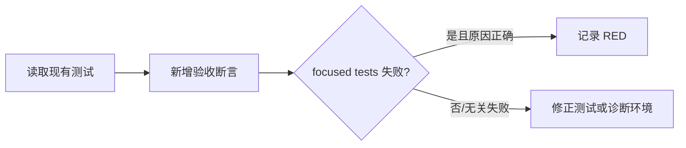
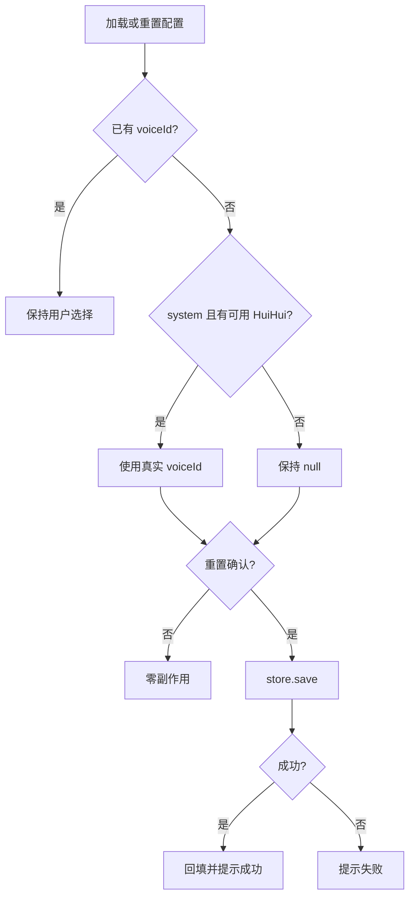
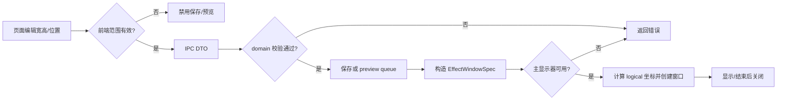
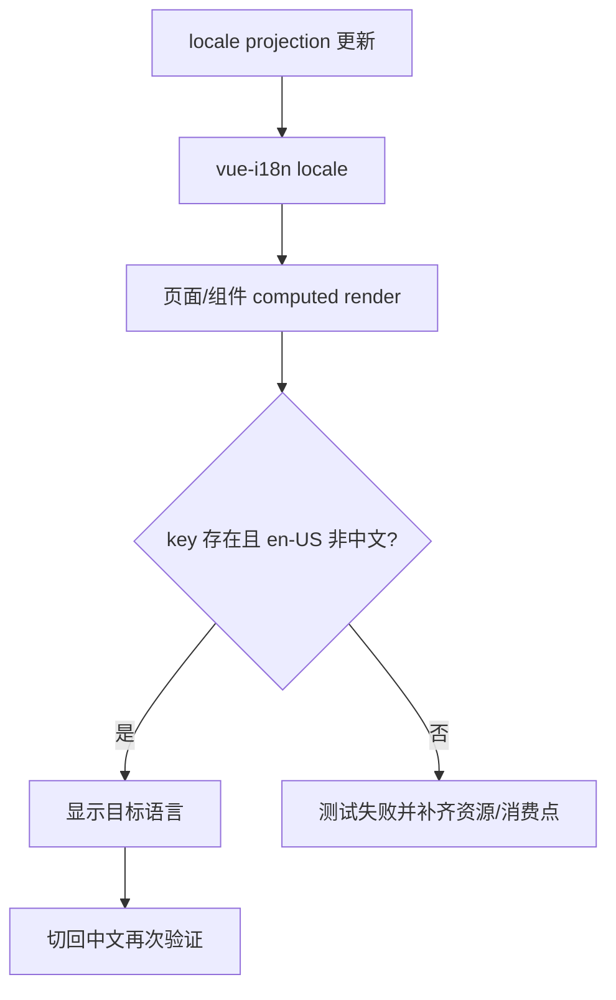

# 实施计划

## 验证回流计划修订（2026-09-22）

- TTS 首选音色规则实现于同 feature 目录的 `voice-selection.ts`，并由 `voice-selection.test.ts` 以无 DOM 方式覆盖已有选择、HuiHui 匹配和无匹配三条分支。
- 保持页面为唯一生产调用方，验证时检查无 shared export、无第二生产调用方。

## 摘要

按 TDD 串行完成四个任务：契约测试、TTS 行为、特效窗口配置链、免费版页面国际化。保持 vue-i18n、Pinia desktop invoke、Rust port/adapter 既有技术栈，不做无关格式化或重构。

## 任务 1：建立失败测试与变更链基线

### 目标与来源

- source: U1-U5；spec 全部验收条目。
- product-content delta: none（测试和基线证据）。
- practical goal：测试必须能区分真实全链修复与表面控件修改。

### 范围与步骤

1. 扩展/新增 renderer contract test：locale key parity、免费页面 `useI18n`/禁止关键硬编码、HuiHui 解析与 reset 保存/反馈、CaptainEffectConfig width/height adapter。
2. 扩展 Rust domain/IPC/application/infrastructure tests：旧 JSON serde 默认、范围校验、DTO 字段、EffectWindowSpec 使用配置、五位置坐标。
3. 在生产代码修改前运行 focused tests，记录 RED 失败与对应验收项。

### 状态与异常

- 测试只能因缺失目标行为失败；基础设施或既有脏工作区导致的无关失败单独记录。

### 流程

### 验证

- `pnpm vitest run --mode free <focused files>` 预期目标断言失败。
- `cargo test <focused modules>` 预期新 contract/geometry 断言失败或先编译失败。

## 任务 2：修复 TTS 默认与重置反馈

### 目标与来源

- source: U2、U3；spec “TTS 默认音色/重置”。
- product-content delta: Microsoft HuiHui 默认选择、重置成功/失败 locale 文案。
- forbidden: 写死系统 voice id、覆盖已有选择、只改草稿。

### 文件与符号

- `views/tts/index.vue`：`resolvePreferredVoiceId` local pure helper、`applyConfig`、`handleEngineChange`、`handleReset`、locale 文案。
- `components/media/TtsQueuePanel.vue`：队列文案国际化。
- locale JSON：TTS keys。
- 页面/媒体 contract tests：已有选择、可用匹配、不可用/无匹配、取消、save success/failure。

### 数据与状态

- 输入 snapshot/voices 不可变；draft 显式复制。
- `selectedVoiceId=null` 仅表示未选择；只有 system + available displayName 匹配才派生 id。
- reset pending 使用 store `save` operation；成功使用返回 snapshot，失败不伪造成功。

### 流程

### 验证

- focused Vitest GREEN；type-check。

## 任务 3：实现特效窗口宽高与位置全链路

### 目标与来源

- source: U4、U5；spec 尺寸与位置合同。
- product-content delta: 窗口宽度/高度两个字段及其中英文标签。
- forbidden: 只改 Canvas、只保存不消费、错误时回退左上角。

### 文件与符号

- TS：`contracts/media.ts`, `adapters.ts`, adapter/contract tests, `views/captain-effect/index.vue`。
- Rust domain：`models.rs`, `rules.rs`, `state.rs`, domain tests。
- IPC：`dto.rs`, `media.rs`, contract tests。
- application：`ports.rs::EffectWindowSpec`, `effects.rs` 与 tests。
- infrastructure：`window.rs` 私有纯坐标函数及 module tests；相关 fixtures。

### 数据合同与迁移

- 先新增 width/height 类型；所有 constructors/fixtures 显式更新。
- domain serde missing-field defaults 560/280；DTO 请求仍要求字段。
- adapter integer/range 校验；page formValid 同一范围。
- repository JSON 无 schema migration，serde 兼容旧值。

### 副作用与性能

- monitor/window 调用只在 Tauri adapter。
- 坐标函数纯计算；无监听器、轮询或新增资源，无 debounce/throttle 需求。
- window 每次 effect 结束仍 close，cleanup owner 不变。

### 流程

### 验证

- `cargo fmt --check`, focused/domain/all Rust tests。
- renderer adapter/contract tests、type-check。
- Windows 预览实际检查尺寸和 center/四角位置。

## 任务 4：完成免费版页面国际化并闭环验证

### 目标与来源

- source: U1；spec 国际化范围。
- product-content delta: 现有 UI 文案的 en-US 对应值，不新增业务项。
- forbidden: DOM 后处理翻译、fallback 到中文、翻译用户业务数据。

### 页面与组件

- 页面：connection、danmaku-list、dashboard、rankings、sensitive-words、blacklist、captain-effect、gift-reminder、gift-sound、tts、recording、gift-list、logs；确认 plugin-manager/settings/update-log 已使用 locale。
- 组件：`components/live-data/*`、`components/media/*` 中上述页面使用的用户可见文案。
- router/App：route title key 与 locale/route 响应更新。
- locale JSON：按 feature 分组、两语言键结构严格一致。

### 实施规则

- script 中 options 变为 computed 或在 template 使用 `t`；不创建镜像可变 label 状态。
- 动态插值使用命名 placeholder，兼容现有 CSP-safe compiler。
- 默认 TTS 用户模板属于配置值，不因 UI locale 自动改写；只翻译字段/按钮/提示。
- 不抽取新组件，不新增 CSS；新增布局只使用已批准 Tailwind utility。

### 流程

### 验证

- locale parity/硬编码扫描/页面 contract tests。
- 全量 Vitest、type-check、lint、web free build。
- 运行时在 English 下遍历免费导航并抽查弹窗、tooltip、空态、状态；再切回中文。
- 完整 Tauri build 和 NSIS 安装包。

## 依赖与执行顺序

`任务1 -> 任务2 -> 任务3 -> 任务4 -> verify -> review`。不使用并行 agent；locale/contract 文件共享且本仓库工作区有重叠未提交修改，串行增量编辑风险最低。

## 变更链与清理合同

- 编辑前已确认三条完整链，见 `artifacts/code-context.md`。
- 编辑后用 `rg` 检查 CaptainEffectConfig constructors、EffectWindowSpec constructors、旧中文字面量和 locale key references。
- 删除 TTS reset 的本地-only 路径，不保留重复默认 config 分支。
- 测试 fixture 全部适配新字段；测试引用不作为保留旧行为依据。

## Code Review Checklist 合同

- 健壮性：external snapshot/voice/monitor 均判空和合法性检查；所有 async save/window errors 显式返回/提示。
- 可维护性：页面只做编排，adapter/domain/window owner 清晰；避免新增 >150 行混责函数。
- 性能/内存：无新高频 subscription；现有 onUnmounted/dispose、window close、animation cleanup 保持。
- 技术栈：Vue 3、vue-i18n、Element Plus、Tailwind、Pinia desktop wrapper、Rust port/adapter 不变。
- 业务 UI：宽高单位/range、voice null、用户内容不翻译的语义不得漂移。

## Human Review Readiness

- 只按当前文件内容增量 patch；不回滚用户已有修改。
- 禁止全仓 formatter、无关 import 重排、顺手重构。
- 执行记录映射每个文件到任务 1-4，并保留 RED/GREEN 与实机证据。
- pre-review 清除 debug/dead/stale/unused，并运行 diff check。

## 自愈闭环

- verify/review 按 requirement-mismatch、plan-gap、architecture-gap、logic/type/runtime/organization/maintainability/debt 分类。
- 可修复项自动回到 owner 阶段，同轮继续；最多 7 次，每同 blocker 同阶段 2 次、总计 3 次；无新证据/修复立即阻塞。
- 只有全部适用 verdict pass、实机行为与安装包构建完成才允许 complete。

## 回滚面

- locale 迁移可按单 SFC/key 对回滚。
- effect config 字段若失败必须同时回滚 TS/Rust contract 和 fixtures，不能保留半链。
- 不删除旧 persisted config；serde compatibility 确保升级可恢复。

## Execute-Readiness 自检

通过：所有字段、默认、范围、owners、异常、文件、符号、清理、测试命令和禁止解释均已明确，无需 execute 补产品决策。
