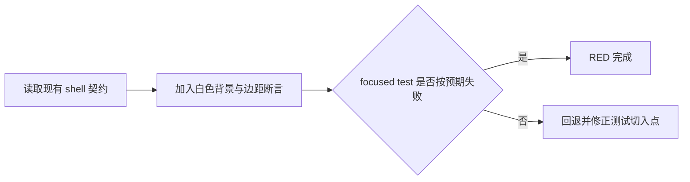
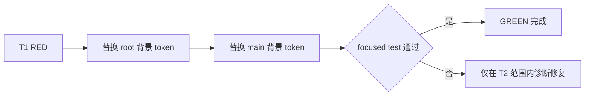
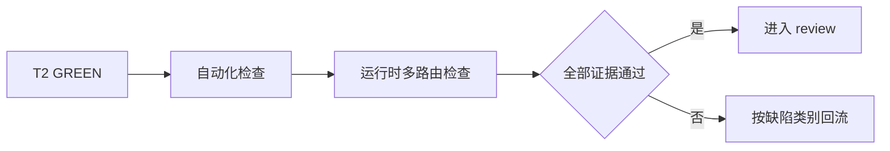

# Plan: page-content-spacing-background

## 交付单元标识

`page-content-spacing-background`

## 阅读导航

目标：统一浅色内容背景并保留共享边距。共 3 个串行任务，0 个并行任务；最高风险是共享 shell 影响全部路由。关键依赖：T1 -> T2 -> T3。

## 全局摘要

先用现有 shell contract test 写出会失败的背景/边距断言，再只替换 `App.vue` 根 shell 与 `<main>` 的两个浅色背景 token，最后完成回归、构建、运行时视觉检查和 changed-hunk review。全部页面通过共享 owner 一次生效。

## 用户意图合同承接

字面要求与实际目标均由 T1/T2 落实：白色连续背景、真实响应式边距、全路由同步。T3 证明没有通过删边距、逐页补丁、卡片化或业务改动规避问题。

## 来源锁定与禁止扩展边界

权威来源为 approved spec、clarifications、page-design、U1-U5 与 `App.vue`/router 代码事实。三个任务均为 `product-content delta: none`；不得修改字段、文案、控件、交互、状态、路由、API 或页面内部布局。无 missing-source。

## 业务功能需求点与业务逻辑明细

- BF1 连续浅色背景：任一路由在浅色主题下，root 与 main 均使用白色；成功结果是 padding 和页面底部不再露灰。
- BF2 响应式边距：main 小视口使用 `p-3`，`sm` 及以上 `p-5`；禁止删除或逐页重复。
- BF3 主题保护：深色仍使用 `dark:bg-zinc-950`；无状态转移、权限、校验、错误或数据分支变化。
- 验收映射：BF1/BF2 由静态契约和 1280x800 视觉检查验证；BF3 由契约测试、dark-theme 回归与 diff review 验证。

## 字段显示语义与交互视觉状态合同

不适用：无 touched 字段、列、链接、状态色或交互视觉状态。

## 执行效率与上下文预算

`S1 local`、compact。execute 仅需读 `App.vue`、shell contract test、相关 dark-theme/page tests、package scripts 与本计划；无需扫描 store/request/adapter/backend。若发现独立 shell owner、API/状态变化或必须逐页改动，停止并回退 spec。

## 自愈闭环计划

execute 后必须进入 `verify -> review`。验证包括 focused Vitest、相关回归、type-check、lint、web build、1280x800 运行时检查和 diff 审查。缺陷按 requirement-mismatch/plan-gap/logic-error/syntax-type-error/runtime-error/code-organization-error/maintainability-error/technical-debt-blocker 回流 spec/plan/execute；单交付单元 self-healing iteration <= 7，同 blocker 同 owner 连续失败 <= 2、总失败 <= 3。无新证据或更窄诊断时停止并标记 blocked。完成要求：compliance pass、assessment pass、remaining blockers none。

## 执行可用性合同

`ready for execute`。精确 owner、文件、token、测试和回滚条件均已确定；无数据契约、状态、API、输入语义或产品问题需要猜测。

## 任务拆解

### T1 壳层回归契约（RED）

- 目标：在 `shell-components-contract.test.ts` 增加断言，要求浅色 root/main 为白色、main 保留 `p-3 sm:p-5` 与 `dark:bg-zinc-950`，并拒绝 `bg-zinc-100`。
- 规格映射：BF1-BF3、Acceptance 1-3；source-backed U1-U5 + code-fact-backed shell test。
- 范围：只编辑该测试文件；不改生产代码。product-content delta: none。
- 前置/完成：先确认断言针对模板 class；运行 focused test 必须因当前灰色 token 失败，从而证明回归有效。
- 风险/回退：若失败原因不是预期 token mismatch，修正测试表达而不扩大生产范围。

### T2 共享 shell 修复（GREEN）

- 目标：在 `App.vue` root grid 与 `<main>` 中把浅色 `bg-zinc-100` 替换为 `bg-white`。
- 规格映射：BF1-BF3、UI/UX contract、Tailwind constraints；source-backed U1-U5 + code-fact-backed App.vue。
- 范围：仅两个 class token；保留 `overflow-y-auto p-3 sm:p-5 dark:bg-zinc-950`，不改页面 SFC、DOM、状态、事件或脚本。product-content delta: none。
- 实现：直接 Tailwind utility，Level 0 direct code；不新增 wrapper、helper、constant、CSS 或组件。
- 完成：T1 focused test 通过，定向检索确认 `App.vue` 不再含 `bg-zinc-100`，dark token 未变。
- 风险/回退：任何业务/布局附带 diff 均撤销该 hunk；若共享 owner 证据被推翻，回退 spec。

### T3 验证与审查

- 目标：证明共享修复、深色保护、构建健康和用户视觉目标均成立。
- 规格映射：Acceptance 1-5、self-healing completion bar；source-backed U1-U5 + approved spec。
- 范围：运行 focused/related tests、type-check、lint、web build；启动 free web dev server，在 1280x800 检查弹幕面板和至少一个其他路由，确认白色连续背景与边距；审查 exact diff。
- 完成：命令通过、视觉证据符合、changed hunks 全映射 T1/T2、无无关变更与 blocker。
- 风险/回退：测试/构建/视觉失败回流 T2；需求或设计解释不成立回流 spec。

## 功能拆解明细

唯一功能单元是 shared content surface：root 处理未覆盖高度，main 处理 padding 区与滚动，route page 保持原样。浅色分支为白色，dark variant 覆盖为 `zinc-950`；无失败 UI、重试、取消或状态终点变化。

## 项目脚手架与初始化策略

不适用：既有应用局部修复。

## API 对接与类型策略

不适用：无 API、DTO、protobuf、adapter 或类型改动。现有 tsconfig 仅作为 type-check/build 治理来源。

## 依赖关系

T1 必须先于 T2 以保留 TDD 证据；T2 必须先于 T3。无需并行 agent 或 workflow。

## 变更链路审查

入口为侧栏路由，链路为 `App.vue root -> main -> router-view -> route SFC`。owner 是 root/main class；页面 SFC、store、service、adapter、事件、computed/watch 和请求只是邻近影响面且不修改。变更后重查 class、路由共享关系、测试与 diff，无 orphan symbol 或删除闭包。

## 整洁性与复杂度控制

仅两处 token 和局部断言；禁止整文件格式化、新依赖、新文件级抽象、性能优化和技术栈替换。

## 局部性与文件抽取决策

样式留在 `App.vue` owner；不新增 helper/hook/mapper/utility。

## Vue 组件抽取决策

shared wrapper 候选 `keep inline/no extraction`：通用 pass-through 且无独立状态/交互边界，现有 shell 已拥有该职责。

## 前端专家级工程约束

保留用户旅程、所有状态 owner、异步/数据生命周期、键盘/焦点、render scope 和回滚面；T3 以多路由视觉与自动化证据确认。

## 前端架构质量约束

不适用：`architecture-design_required=false`，ownership、state/data topology、依赖方向和公共 API 不变。

## 生产代码质量约束

无新类型、可空/异常路径、函数、class、性能优化或边界状态。实现必须是可读的直接 class token 变更，禁止 magic indirection。

## 代码评审预检合同

健壮性：无外部数据/异步变化；可维护性：共享 owner 单点修复；性能/内存：无事件、watcher 或资源；规范一致性：沿用 Vue + Tailwind 与现有测试。execute 不得自行改变技术栈或范围。

## 人工评审可通过性约束

允许文件仅为 `App.vue`、shell contract test 和本请求工件。每个 hunk 映射 T1/T2/T3；执行前后记录命令证据，清除 debug/dead/stale/unused 内容，并明确工作区其他改动不属于本任务。

## 函数式编程约束

不适用：无转换、规则、派生状态或副作用。

## Tailwind 样式约束

只改 inline utility，class 保持 formatter 可读，不新增 CSS 或通过变量隐藏 class。

## 模式决策与替代方案

`Level 0 direct code`，pattern `none`。无适配、选择、编排、副作用或状态分支信号；逐页修复和 wrapper 抽取均比共享 owner token 替换更重且更易漂移。

## 代码上下文与影响范围

生产影响覆盖所有主 `router-view` 路由，但代码改动仅在 `App.vue`。测试影响为 shell contract；邻近 dark-theme/page tests 用于防回归。

## 并行执行建议

不并行。TDD 和验证存在严格串行依赖，拆并行会破坏 RED/GREEN 证据且无延迟收益。

## 触发与上下文准备

触发是用户缺陷请求；执行前确认现有 dirty worktree 并只操作精确 hunk。观察点是测试失败/通过、class 检索、浏览器视觉和 git diff；完成后交接修复摘要、验证证据与本地 URL。

## 受影响文件或模块

- `packages/bilibili-live-tool/src/renderer/App.vue`
- `packages/bilibili-live-tool/src/renderer/components/application-shell/shell-components-contract.test.ts`
- `docs/requests/page-content-spacing-background/**`

## 测试策略

先 RED 后 GREEN；随后运行 shell contract、dark-theme surface、dashboard/rankings 相关测试、type-check、lint、`build:web:free`，最后 1280x800 浏览器检查。未执行项必须记录原因和替代证据。

## 观察与人工介入点

自动推进无需用户审批。只有运行时证据要求新增产品行为、逐页布局变更或与 dirty worktree 冲突到无法隔离时才停止并请求方向。

## 回滚说明

回滚只需恢复两个背景 token 与对应测试断言；不涉及数据迁移、配置、API 或用户数据。
