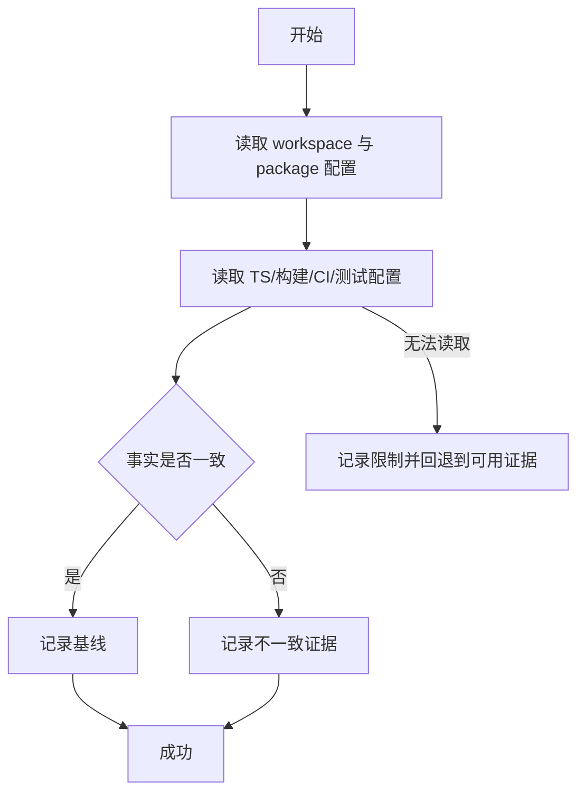
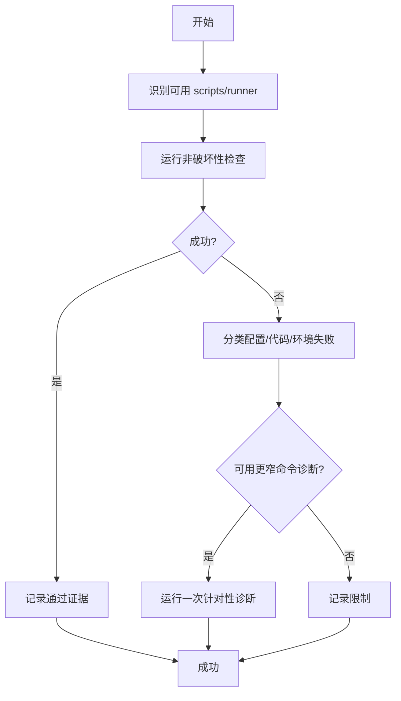
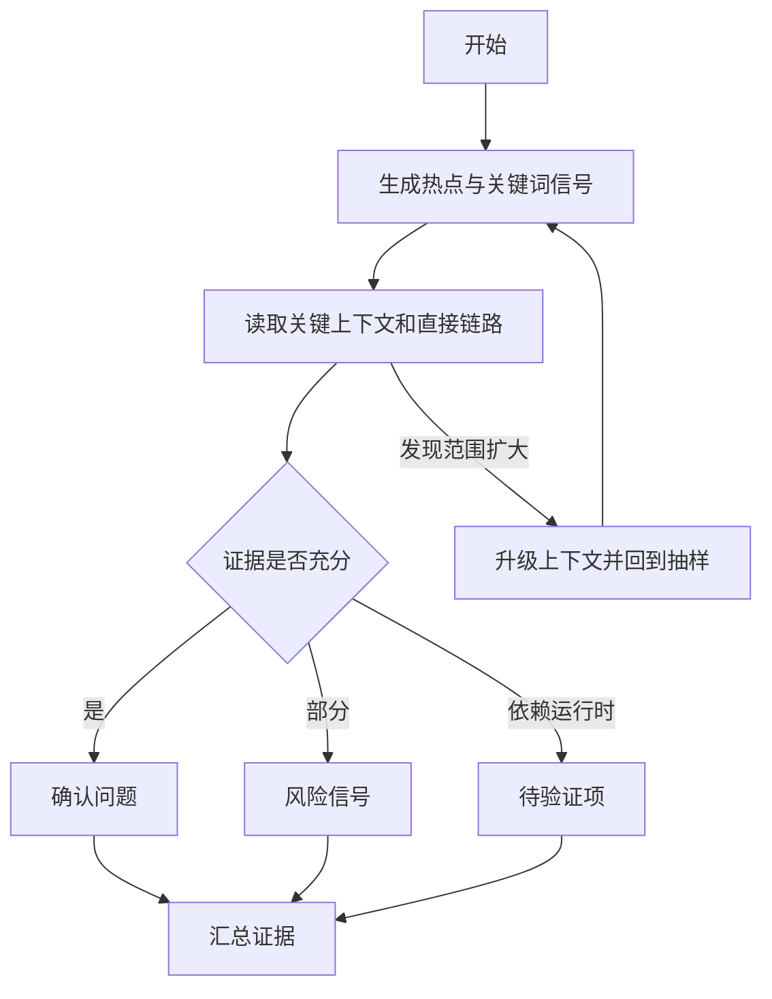
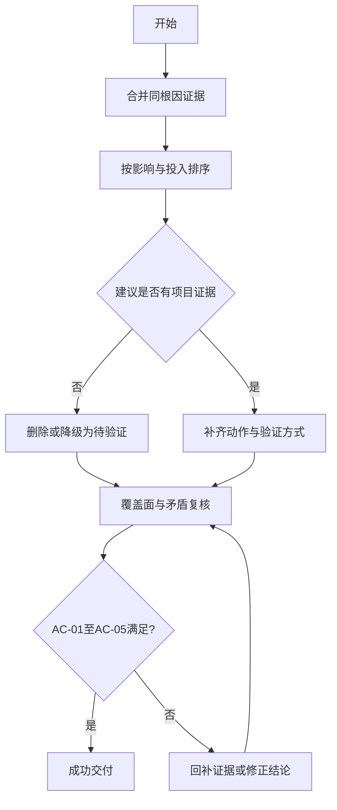

# 项目优化评估执行计划

## 交付单元标识

`project-optimization-assessment`（请求级、非代码变更）

## 阅读导航

- 目标：形成基于仓库事实、可供排期的优化建议报告。
- 任务：4 个串行主任务；其中任务内独立只读检查可并行。
- 高风险：命令失败归因错误、把抽样风险写成确认缺陷、误触用户已有工作树改动。
- 主线：工程基线 → 质量命令 → 风险驱动抽样 → 建议报告。

## 全局摘要

本计划仅新增当前请求目录内的评估、验证和审查工件，不修改生产代码、测试或工程配置。先识别 workspace、package、TS、CI、构建与测试基线，再运行非破坏性命令；之后依据命令结果和热点搜索抽样 Electron 进程边界、IPC、类型、安全、性能与维护性风险，最后按优先级整理建议。

## 用户意图合同承接

- 字面要求：根据当前项目提出优化建议。
- 实际目标：得到能指导真实排期的针对性清单。
- 成功标准：P0/P1 建议包含证据、影响、动作、投入和验证。
- 禁止解释：不直接改代码；不堆砌无项目证据的最佳实践；不把风险信号描述为确认缺陷。
- T-01～T-04 共同负责 intent compliance；verify 抽查证据和结论强度。

## 来源锚定与禁止扩展边界

| 任务 | spec 映射 | 标签 | product-content delta |
| --- | --- | --- | --- |
| T-01 工程基线 | function-complete 1、in scope 1～4 | source-backed + code-fact-backed | none |
| T-02 质量命令 | function-complete 2 | source-derived + code-fact-backed | none |
| T-03 风险抽样 | function-complete 3～5 | source-derived + code-fact-backed | none |
| T-04 建议报告 | function-complete 6、AC-01～AC-05 | source-backed + source-derived | none |

禁止纳入：新产品字段、文案、控件、状态、权限、API 语义或业务功能；相邻模块的可选能力只能作为比较线索，不能成为产品建议授权。

## 业务功能需求点与业务逻辑明细

本请求无产品业务逻辑变更。评估规则如下：

1. 可直接定位到文件、配置或已运行命令的结论标为“确认问题”。
2. 静态信号提示风险但未通过运行时/完整链路证实的结论标为“风险信号”。
3. 依赖凭据、桌面环境、外部服务或未执行基准的结论标为“待验证项”。
4. 优先级按影响排序：质量反馈/发布/安全边界阻断优先，其次为架构与测试可维护性，最后为体验性工程改进。
5. 同一根因合并为一项建议，避免重复计数。

## 字段展示语义与交互视觉状态合同

不适用：不修改任何产品展示字段或交互视觉状态。

## 执行效率与上下文预算

- speed profile：`S3 broad`；跨 workspace、两个 package、Electron 三进程、测试与 CI。
- artifact density：full。
- 最小闭包：根/package 配置、TS/Vite/ESLint/CI、主进程入口与 IPC/preload、代表性 renderer store/service/view、测试配置和命令输出。
- 不做：全仓逐行审查、node_modules 扫描、完整桌面/外部服务联调。
- 命令策略：先 scoped/已有 scripts，再根据失败收窄；不重复运行未变更的失败命令。

## 自愈闭环计划

execute 后进入 verify、review。分类 requirement-mismatch、plan-gap、architecture-gap、logic-error、syntax-type-error、runtime-error、code-organization-error、maintainability-error、technical-debt-blocker；工件问题回 execute，计划缺口回 plan，规格缺口回 spec。单交付单元最多 7 次；同 blocker 同 stage 连续最多 2 次、总计最多 3 次；无新证据/修复/更窄诊断即 blocked。完成要求 self-healing 两项 verdict 为 pass 且 remaining blockers=none。

## 执行可用性合同

`ready for execute`。

- 允许新增：`artifacts/code-context.md`、`execution/changelog.md`、`verification/*`、`review/review.md`。
- 允许更新：本请求 `state.json` 与 plan 工件。
- 禁止修改：`packages/**`、`tests/**`、根工程配置及用户已有工作树改动。
- 已批准技术选择：使用定向搜索、文件统计、package scripts 和有限源码抽样；均可逆且不改变产品语义。
- 验证合同：记录命令、退出状态、关键输出与未运行原因；引用路径必须可定位。

## 任务拆解

### T-01 工程基线与结构事实

- 目标：确定 workspace、package、脚本、TS、构建、CI、测试和文档基线。
- 范围：根 `package.json`、workspace、两 package、`.github/workflows`、TS/Vite/ESLint 配置、README、目录统计。
- execute-readiness：ready；缺口 none。
- 串行属性：第一步；只读发现可并行。
- 完成条件：形成可复核的基线与不一致清单。

### T-02 运行质量与构建命令

- 目标：验证 lint、type-check、test、build 的真实闭环。
- 命令候选：根 scripts、package scripts、测试运行器探测、homepage build；优先窄命令。
- 约束：失败先诊断，不对未变更命令盲目重跑；环境性失败与代码性失败分开记录。
- 完成条件：每类命令有成功、失败或未运行原因。

### T-03 风险驱动源码与交付抽样

- 目标：依据热点信号检查 Electron 安全边界、IPC 合同、宽类型、超大文件、调试输出、资源清理、依赖与发布元数据。
- 范围：main/preload/renderer 关键入口与直接引用；大文件排名；`any`、`@ts-ignore`、`console`、TODO、事件/定时器等定向信号。
- 禁止：仅凭关键词数量下结论；必须读取关键上下文。
- 完成条件：每个候选结论分为确认问题/风险信号/待验证项并附证据。

### T-04 编写排序建议与执行记录

- 目标：在 `execution/changelog.md` 交付建议报告。
- 每项结构：状态分类、优先级、证据、影响、建议动作、相对投入、验证方式、依赖/风险。
- 覆盖：工程闭环、架构/安全、测试、依赖/构建、文档。
- 完成条件：AC-01～AC-05 全部可验证，且无产品范围扩张。

## 功能拆解明细

不适用表单、表格、页面交互和业务流程。唯一流程为审计证据生命周期：发现 → 定位 → 分类 → 建议 → 验证引用。

## API 对接与类型策略

不修改 API 或类型。Electron IPC/API 合同仅作为审查对象；TypeScript 上下文以 `packages/bilibili-live-tool/tsconfig.json`、`tsconfig.eslint.json` 和 scoped declarations 为依据。

## 依赖关系

`T-01 → T-02 → T-03 → T-04`。T-01/T-03 内部独立只读搜索可并行，生命周期与工件写入保持串行。

## 变更链路审查

不适用：不修改或移除既有代码。

## 整洁性、局部性、组件、架构复用、函数式、Tailwind 约束

不适用：不新增生产实现、helper、Vue SFC、共享抽象、转换逻辑或样式。

## 模式决策与替代方案

- 任务：一次性仓库评估。
- 候选信号：无运行时选择、适配、创建、状态或副作用编排变更。
- 深度：Level 0。
- 决策：direct code / none；使用命令与 Markdown 工件。
- 拒绝：新增 manager、审计框架或脚本没有当前复用需求且会扩大范围。

## 代码上下文与影响范围

只读影响范围覆盖 workspace、两个 package、Electron 三进程、tests 与 CI。实际 diff 必须局限 `docs/requests/project-optimization-assessment/`。

## 测试策略

- 配置/脚本：实际运行 package scripts。
- 结论：抽查路径和命令证据。
- 报告：逐项对照 AC-01～AC-05。
- 不适用 TDD：本请求不改变可执行行为；以可复现命令和证据复核替代。

## 并行执行建议

不启用 workflow-scale 并行；只并行独立只读发现和无副作用命令，以降低等待时间。

## 触发、观察与人工介入点

- trigger：当前用户指令。
- context：仓库文件和本地命令结果。
- observation：todo、request state、execution/verification/review 工件。
- handoff：用户收到排序建议后选择实施批次。
- 人工介入：只有需要外部凭据、运行环境或产品决策时；本次风险项可降级标注，不阻塞报告。

## 回滚说明

本请求不改生产代码。若工件结论错误，回滚为删除/修正本请求目录内对应 Markdown；不得触碰用户已有工作树改动。
