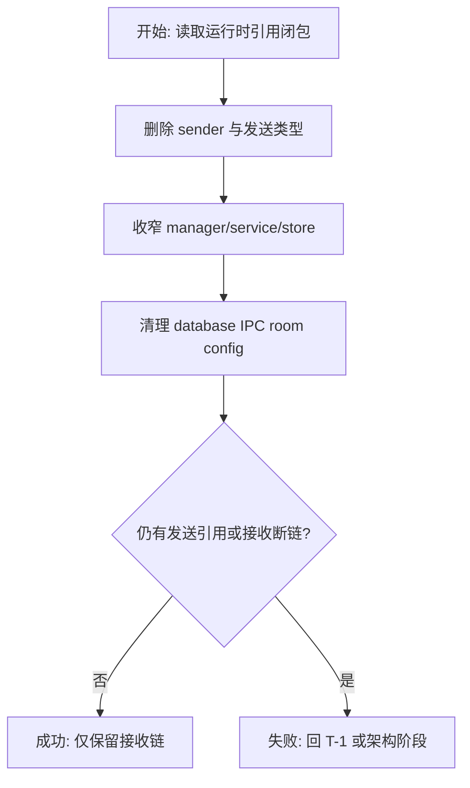
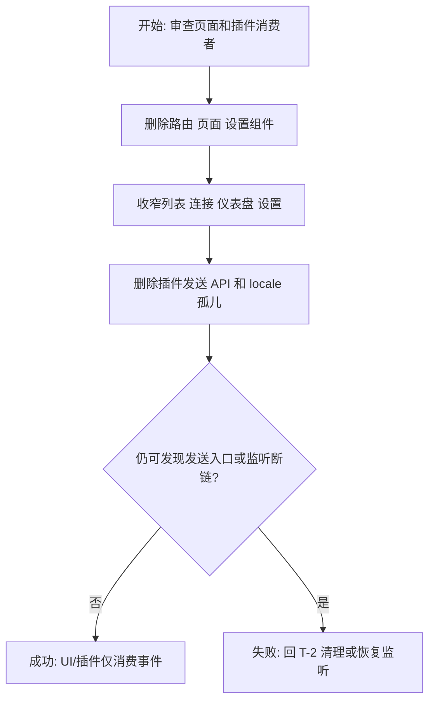
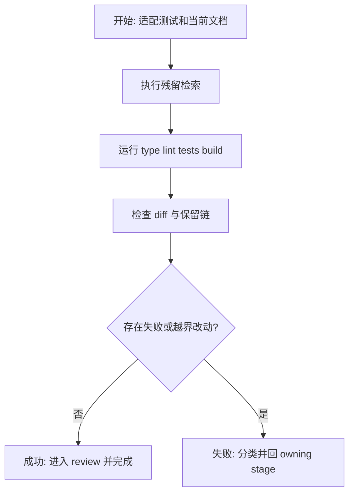

# 移除主动发送弹幕能力执行计划

## 交付单元标识与阅读导航

- request id：`remove-outgoing-danmaku`
- speed profile：`S2 scoped`，full artifact density
- 任务：3 个串行任务；高风险任务为 T-1、T-2
- 主线：先删除发送运行时和持久化 owner，再删除 UI、插件和配置消费者，最后适配测试/当前文档并完成验证。
- 来源：用户原始指令（SRC-1）、已审批 `spec/spec.md` S-1 至 S-6、`design/architecture-design.md` ADR-1 至 ADR-3、仓库代码事实。

## 全局摘要

本计划删除主播账号主动发送弹幕和互动面板弹幕指令的完整依赖闭包，包括手动、定时、随机、触发词、角色、礼物/舰长感谢、插件发送、弹幕池、发送凭证/频控配置、发送统计和当前产品宣称。弹幕/礼物接收、展示、统计、TTS、录制、高光和黑名单保持原有 owner 与数据流。

实现不提供 feature flag、兼容壳、旧路由重定向或替代发送 API。历史 electron-store 键不迁移，只停止读取和写入；`description-doc/`、历史 request 工件和历史 changelog 不修改。

## 用户意图与来源边界

| 项目 | 合同 |
| --- | --- |
| 字面要求 | 移除“以主播账号发送弹幕”和“互动面板弹幕指令”功能。 |
| 实际目标 | 产品中不存在可发现、可调用或隐藏保留的主动发送路径。 |
| 禁止解释 | 不得只隐藏菜单、只删 HTTP 请求、换名迁移到插件、保留 deprecated/空实现。 |
| product-content allowlist | 仅删除发送按钮/弹窗、Cookie/CSRF 展示、弹幕池入口/页面、发送设置、发送统计、插件发送 API 和当前能力宣称。 |
| out of scope | 接收链路行为改造、页面视觉重设计、历史资料追溯改写、持久化数据破坏性迁移。 |
| missing source | none。 |

## 业务功能与逻辑合同

| 功能点 | 角色/入口 | 前置与触发 | 成功终态 | 失败/回退 | 验收 |
| --- | --- | --- | --- | --- | --- |
| F-1 删除主动发送 | 主播；弹幕列表、自动事件、插件 | 任意发送入口或事件触发 | 无入口、无请求、无发送状态或副作用 | 编译/搜索发现引用则回 T-1/T-2 | AC-1、AC-2 |
| F-2 删除弹幕池与指令宣称 | 主播；菜单、路由、设置、文档 | 导航或读取当前能力说明 | 页面/路由/存储/API/宣称均不存在 | 发现孤儿引用则回所属任务 | AC-3、AC-5 |
| F-3 保留只读消费 | 主播/观众；连接、列表、仪表盘 | 官方开放平台连接和事件到达 | 接收事件继续进入 store、数据库和视图 | 类型/测试/build 失败则回 execute | AC-4、AC-6 |

业务规则：发送行为优先全部删除，不存在权限、开关、重试或 disabled 分支；礼物/舰长事件仍发出但不得产生回复；所有列表弹幕均为接收数据，排行直接统计接收列表；旧发送配置输入可被宽松导入结构读取，但必须被 `AppConfig` 合并结果忽略。不可达状态包括 `sent/success/failure` 弹幕、发送 loading、自动发送 timer 和插件发送 promise。

字段语义：删除 `Danmaku.type/success/message`、`DanmakuPoolItem`、`DanmakuOptions`、Cookie/CSRF、发送频率/开关/计数。保留接收弹幕的时间、用户、内容字段及原格式、精度、空值和只读状态；本次不改变 formatter、点击状态、视觉强调或列表空态。没有新增表单字段或数据归一逻辑。

## 执行可用性合同

- 结论：`ready for execute`；产品问题与技术 blocker 均为 none。
- TypeScript：先遵守 `tsconfig.json`/`tsconfig.eslint.json` 的 `strict`、unused 检查、bundler resolution 和 `@/*` alias；复用现有本地接收类型，不使用 `any`/断言掩盖残留。
- API：删除 `api.live.bilibili.com/msg/send` 非正式集成；保留 `live-open.biliapi.com` 与 WebSocket 接收合同；不新增 adapter、mapper 或 request wrapper。
- 状态：删除发送 writable/derived state、timer 和事件；保留 room connection、received danmaku/gift state。无新 loading、retry、cancel、race 或缓存语义。
- 样式：只删除对应结构/现有样式，不新增 authored styling，不做布局重设计。
- 实施：T-1 → T-2 → T-3 串行；任何新增产品选择回 `spec`，owner/依赖不成立回 `architecture-design`，遗漏文件/命令回 `plan`。

## T-1 核心运行时、状态与持久化闭包

### 任务合同

- 目标：删除发送原语、自动/事件回复、弹幕池状态和 main/renderer 持久化闭包，同时保持接收事件链。
- 规格映射：S-1、S-3、S-4、S-5；AC-1、AC-2、AC-3、AC-6；source-backed + source-derived-safe + code-fact-backed。
- product-content delta：none（纯技术闭包清理）。
- context：`modules/danmaku/{sender,manager,types}.ts`、`services/{danmaku-service,database-service}.ts`、`stores/{danmaku,room,config}.ts`、`main/{database,ipc-handlers}.ts` 及直接 imports/callers。
- 删除：`sender.ts`；manager 的 sender、pool、timers、send/reply/thank 方法与事件；service 的发送/pool/频控 API；store 的 pool、发送计数/排行过滤；database/IPC 的 pool 与发送配置；room 的 Cookie/CSRF 发送凭证；相关类型、imports、exports、注释。
- 保留：parser/client 连接、manager 接收/emit/黑名单/录制触发、service 接收写 store/database、gift/guard emit、received ranks。
- 数据/副作用：不迁移磁盘旧键；不得让礼物或连接事件调用任何发送 promise；timer/listener cleanup 只保留真实接收 owner。
- pattern：Level 0 `direct code` / `none`，在既有 owner 就地收窄；不新增 helper、wrapper、manager、adapter 或兼容层。
- 完成条件：删除文件和全部直接引用；TypeScript 静态引用闭包可编译；接收链符号仍有生产调用方。
- 风险/回退：误删接收处理时按 Git diff 恢复该接收 hunk；发现架构 owner 不符则回 architecture-design。

## T-2 UI、插件、导航与配置闭包

### 任务合同

- 目标：用户和插件均无法发现或触发发送能力，页面只呈现保留的接收内容。
- 规格映射：S-1、S-2、S-3、S-4、S-5；AC-2、AC-3、AC-4；source-backed + source-derived-safe + code-fact-backed。
- product-content delta：删除 allowlist 中的发送控件、配置、状态、统计、导航和插件 API；不新增文案/控件。
- context：`views/danmaku-list`、`views/danmaku-pool`、`views/connection`、`views/dashboard`、`views/settings`、`router/index.ts`、`App.vue`、locales、`plugins/{types,plugin-api,plugin-sandbox}.ts` 及直接 consumers。
- 删除文件：`views/danmaku-pool/index.vue`、`settings/components/AutoSendSettings.vue`、`settings/components/DanmakuSettings.vue`。
- 就地删除：发送按钮/弹窗/loading/样式，Cookie/CSRF 控件，发送/感谢统计，弹幕池路由/菜单，发送设置 tabs/import/handler，插件 `DanmakuOptions`/`sendDanmaku`/sandbox global，专属 locale keys。
- 保留：列表总数/清空/接收项，连接状态/房间/人气，仪表盘接收与礼物统计，过滤/TTS/AI/录制设置，插件 `onDanmaku`。
- 交互/视觉：剩余布局自然收敛；不新增卡片，不改变剩余字段格式或状态；删除的发送 dialog 不需要替代反馈。
- Vue 边界：只删除全属发送能力的 SFC；不抽取或重构剩余组件。样式只移除失去 DOM owner 的规则。
- 完成条件：旧 `/danmaku-pool` 不匹配路由且无 redirect；插件类型/实现/沙箱一致；所有发送文案和 UI 状态消失。
- 风险/回退：若 locale key 有接收侧真实调用方则保留该 key；若插件监听受影响，恢复 `onDanmaku` 链。

## T-3 测试、当前文档与验证闭环

### 任务合同

- 目标：测试和当前产品文档反映删除后的能力，并用静态、测试、构建证据完成验收。
- 规格映射：S-2、S-4、S-5、S-6；AC-1 至 AC-7；source-backed + code-fact-backed。
- product-content delta：删除当前产品文档的发送/互动指令宣称；测试改动为 none。
- 文档范围：`README.md`、`docs/plugin-development.md`、当前 `docs/requirements`、`docs/architecture`、`docs/implementation` 和 homepage 当前能力说明。禁止修改 `description-doc/`、其他历史 request、历史 changelog。
- 测试适配：`tests/danmaku-types.test.ts` 删除发送字段与 `DanmakuPoolItem` 断言；`tests/settings-config-io.test.ts` 删除 `enableAutoSend` fixture/期望。测试引用不构成保留生产 API 的理由。
- 残留检索：生产和当前文档检查 `/msg/send`、`sendDanmaku`、`DanmakuSender`、`DanmakuPoolItem`、发送开关/间隔、`/danmaku-pool`、Cookie/CSRF 发送字段；允许范围必须仅为排除的历史资料。
- 验证命令：`pnpm --filter @monorepo/bilibili-live-tool type-check`、`pnpm --filter @monorepo/bilibili-live-tool lint:check`、仓库现有相关 test 命令、`pnpm --filter @monorepo/bilibili-live-tool build`，并按 homepage 修改情况运行 homepage build。
- 自审：检查 `git diff --check`、changed hunks 映射、无 debug/dead code/unused imports/stale comments/宽泛格式化，确认用户已有 `pi-code-agent.zip` 删除和其他 request 目录未被触碰。
- 完成条件：所有 AC 有证据；未运行命令记录原因与替代证据；remaining blockers 为 none。

## 依赖、质量与评审合同

- 依赖方向：views → service/store → manager → official receive client；plugins → event API。禁止 renderer → `/msg/send`、plugins → send API、receive owner → pool/sender state。
- 健壮性：本次不新增外部输入；保留的事件解析判空、错误边界和连接失败处理不得削弱。
- 可维护性：删除混合职责，不重写剩余长函数；不新增魔法常量或单调用方文件抽象。
- 性能/内存：删除 timers 和发送响应式 fan-out；接收高频事件策略不变，无新增 debounce/cache/watch。
- 项目一致性：Vue 3、Pinia、Element Plus、现有 service/store/import 风格不变；禁止技术栈、组件库、请求层替换。
- 函数式边界：确定性排行/过滤继续在 store 派生，I/O 保持 service/database 边界；不直接 mutate props、DTO 或导入常量；本次不新增 mapper。
- 人工评审：每个 hunk 对应 T-1/T-2/T-3；无无关格式化、顺手重构、未批准重命名、临时兼容路径。
- frontend architecture quality：变更后发送能力无 owner/状态/副作用；接收链保持单一 writable owner、既有 data lifecycle 和允许的依赖方向。

## 执行效率、并行与观察点

- 最小上下文闭包为 architecture-design 已列的目标文件、直接 callers、相关 tests、当前产品 docs 和 governing tsconfig；不扫描无关 app、所有 `.d.ts` 或历史快照。
- 三个编辑任务强依赖，串行执行；只读搜索和互不写同一路径的验证命令可并行。不启用 subagent/workflow 并行。
- profile 升级信号：发现跨包正式发送 API、接收链依赖发送凭证、共享类型被其他生产 app 使用，届时回 plan/architecture-design。
- 人工介入仅限真正的产品来源冲突或环境权限 blocker；普通类型、lint、测试和 review 缺陷由自愈循环处理。

## 自愈闭环与完成条件

execute 后必须进入 `verify -> review`。缺陷分类及回流：logic/runtime/type/lint/test/dead-code → execute；plan 命令/文件遗漏 → plan；行为或范围缺口 → spec；owner/依赖失效 → architecture-design；来源冲突 → 前置确认门。

单交付单元 iteration 不超过 7；同一 blocker 在同一 owner 连续失败不超过 2 次、总失败不超过 3 次。若一轮没有新证据、新修复、更窄诊断或升级则 blocked。每次修复后复跑相关搜索、type/lint/test/build，并复查 diff、删除闭包、保留链与技术债。仅当 `self-healing loop compliance: pass`、assessment pass、全部 AC pass、remaining blockers `none` 时完成。

## 回滚

使用 Git 按文件/changed hunk 恢复本次删除；不执行运行时双路径或数据迁移回滚。回滚不得覆盖用户已有无关变更。
