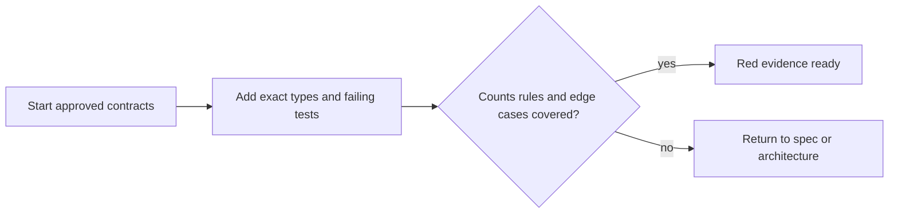
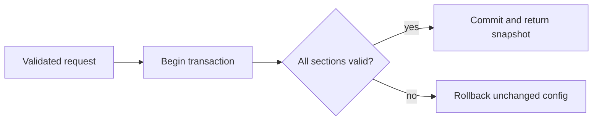
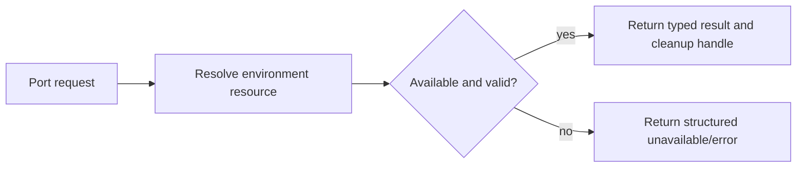
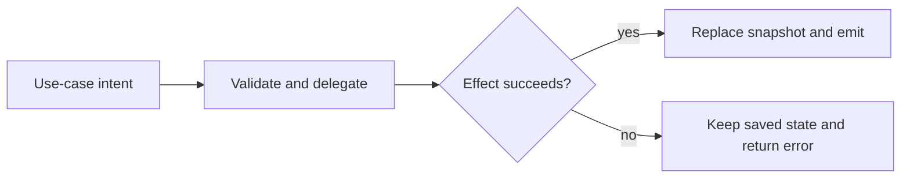
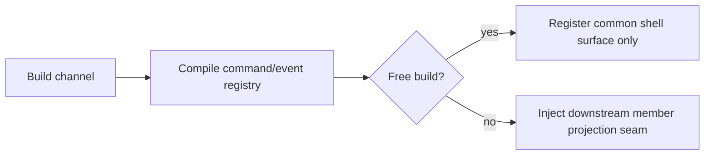
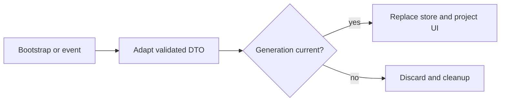
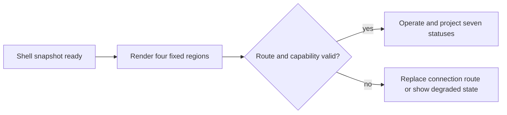
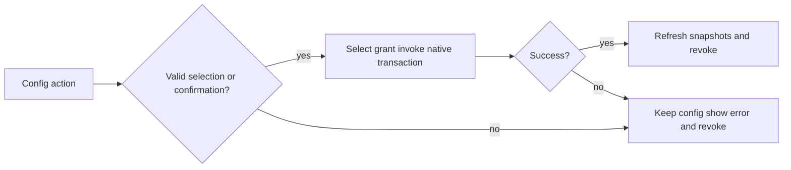
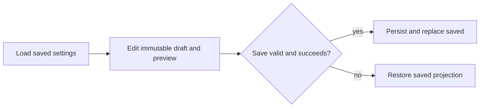
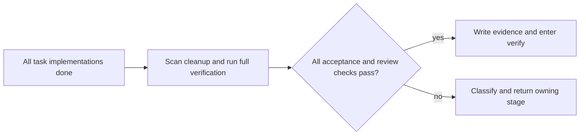

# Application Shell 执行计划

## 交付单元标识

- request: `tauri-rust-refactor`
- module: `application-shell`
- stage: `plan`
- self-healing iteration: `7`
- speed profile: `S3 broad` / `full`
- plan status: framework approval candidate

## 阅读导航

- 目标：完成四区桌面壳、动态导航、七项状态、配置管理、双语与界面布局设置。
- 任务：10 个，全部串行；T01-T09 先红测后实现，T10 负责删除闭包与全量证据。
- 高风险：配置导入原子性、免费包会员表面物理缺席、UI 预览回滚、系统指标采样、根监听清理。
- 关键依赖：approved spec/page-design/architecture、现有 room/recording stores、PathGrantStore、typed desktop gateway。

## 全局摘要

执行主线固定为：合同与纯规则 -> Rust 仓储/系统端口 -> 应用状态 -> IPC -> TS adapter/store/runtime -> 四区壳 -> 设置工作台 -> i18n/旧链清理 -> 双通道验收。保存状态只由 Rust `ApplicationShellState` 与 SQLite 拥有；Pinia 只保存经适配的最新快照和异步状态；页面只保存草稿。所有用户可见内容严格来自 approved spec，不实现会员业务、通知内容、插件、更新或完整灾备。

## 用户意图合同承接

- 字面要求：继续按指定 PRD 重构项目。
- 实际目标：已有迁移能力通过一个准确、可用、可恢复的桌面应用壳协同工作，而非新增几张孤立页面。
- 成功标准：AS-A01..AS-A16 全部有自动化或可复查证据，免费/会员双构建可安装，配置/locale/UI 均由原生边界持久化。
- 禁止解释：仅改外观、运行时隐藏会员、保留浏览器下载/粘贴 JSON/localStorage 权威、伪造会员/通知成功、删减已有免费流程。
- 落实任务：T01-T09；证明任务：T10 的 bundle/source scan、状态链检查、截图与双构建。

## 来源锚定与禁止扩展边界

| 范围 | 标签 | 权威来源 | 允许 product-content delta |
| --- | --- | --- | --- |
| 四区壳、工具栏、导航、状态 | source-backed | PRD 8；spec AS-F01..04 | spec closed-world labels/fields/actions only |
| 配置管理 | source-backed | PRD 9.17；spec AS-F05 | location/backup/scopes/open/export/import/reset/confirm only |
| locale | source-backed | PRD 9.20；spec AS-F06 | zh-CN/en-US/system/save/fallback only |
| interface/layout | source-backed/source-derived | PRD 8/9.21；spec AS-F07 | approved fields/defaults/fixed-region size editing only |
| Rust/TS topology | code-fact-backed | architecture AS-ADR-01..08 | none |
| member/notification seams | missing-source/downstream | spec AS-F08 | no content or success flow |

相邻 AI/ASR/moderation/member/payment/plugin/update/logger 业务不进入任务。代码事实只能决定文件、类型、适配器和清理位置，不能增加文案、状态、权限、字段、交互或 API 语义。

## 业务功能需求点与业务逻辑明细

| ID | 目标/角色/入口 | 成功 | 失败、回退与验收 |
| --- | --- | --- | --- |
| BF-AS01 | 操作者从根窗口使用稳定四区壳 | 1280x800 默认、1024x680 最小，无重叠 | bridge 不可用保持几何并显示真实降级；AS-A01/A06 |
| BF-AS02 | 工具栏连接房间并进入设置/通知 | room trim 后 1-20 ASCII digits；pending 去重 | invalid 阻断，失败可重试；通知仅触发下游 seam；AS-A02 |
| BF-AS03 | 通过 build/member 能力导航 | 当前项高亮，不可用当前路由回到 connection | free 无任何会员内容；unavailable 不伪装 logged-out；AS-A04/A05/A06 |
| BF-AS04 | 扫描七项状态 | room/rate/audience/recording/memory/CPU/connection 准确稳定 | 缺失显示 `--` 或已批准降级文本，不伪造 0；AS-A03 |
| BF-AS05 | 配置查看、导出、导入、重置 | grant-id-only、成功原子提交并刷新快照 | cancel 无副作用；损坏/不兼容/部分失败保持旧配置；AS-A07/A08 |
| BF-AS06 | 即时预览并保存语言 | zh/en/system 生效并持久化 | 不支持/缺包/缺 key 回退中文；失败恢复持久态；AS-A09 |
| BF-AS07 | 即时预览并保存界面 | approved defaults/values 生效，固定四区可调尺寸 | invalid fail-fast；cancel/保存失败回滚；损坏布局恢复默认；AS-A10/A11 |
| BF-AS08 | 壳接收下游会员/通知输入 | 只投影已验证输入/触发 open-focus | 没有 producer 时明确 unavailable，不创造业务；AS-A16 |

判断优先级：build-time free exclusion > native DTO validation > capability/member projection > route/status view mapping > template rendering。任何 invalid DTO 不得通过 `??` 伪装为空值；任何写操作在成功响应前保持 persisted snapshot 不变。

状态流：`idle -> loading -> ready | degraded/error`；写操作为 `idle -> pending -> success | error`，重复 pending 被去重，`finally` 结束 loading。预览使用 `saved -> draft -> preview`; save 成功替换 saved，cancel/reset-failure/save-failure 投影 saved。Grant 流为 select -> grant -> invoke -> revoke(finally)，cancel 在 select 结束。

## 字段展示语义与交互视觉状态合同

| 字段 | 格式/空值 | 默认与交互状态 |
| --- | --- | --- |
| room id | 原样数字；空为 `--` | 输入可编辑；connecting 时 action disabled；错误与字段关联 |
| connection | 已连接/重连中/断开 | 绿/黄/红加文本；状态栏不可点击 |
| danmaku rate | 非负整数 `条/秒`；空 `--` | 等宽数字，只读 |
| online | locale integer；空 `--` | 等宽数字，只读 |
| recording | 未录制/录制中/暂停/批准降级 | 图标+文字+状态色，不闪烁、不可点击 |
| memory | binary unit，至多一位小数；空 `--` | 等宽数字，只读 |
| CPU | 0..100%，至多一位小数；空 `--` | 等宽数字，只读 |
| config location | native display path；空 `--` | 只读，打开目录为独立按钮 |
| last backup | locale datetime to seconds；空 `--` | 只读，不用当前时间代替 |
| locale/UI fields | spec 枚举/默认值 | preview 立即；save pending；failure 恢复 saved |
| navigation/member | spec exact labels | active 默认强调；hover/focus 辅助；free 完全缺席 |

按钮不使用 visited 状态。颜色永远有文字/图标冗余。Element Plus 语义控件、`aria-current`、focus restore、键盘 layout edit 和稳定 disabled/loading geometry 为硬合同。

## 执行效率与上下文预算

- `S3 broad/full` 是最低安全档：跨 Rust domain/application/infrastructure/IPC、TS contracts/adapters/store/runtime、router/App/settings/i18n/build。
- 每任务读取目标文件、直接 caller/consumer、对应测试、approved spec/page-design/ADR；不加载相邻业务内部实现。
- API、状态、权限、adapter、删除闭包或共享语义扩张时保持 S3 并回到 owning plan/spec/architecture，不现场扩范围。
- 先跑 focused tests，再 type/lint/Rust checks，T10 才跑完整双构建与截图，避免无信息的大范围重跑。

## 自愈闭环计划

- execute 后强制进入 `verify -> review`。检查 requirement-mismatch、plan-gap、architecture-gap、logic/type/runtime/organization/maintainability 与 technical-debt blocker。
- requirement mismatch 回 `spec`；结构 owner/依赖错误回 `architecture-design`；任务缺口回 `plan`；可按批准合同修复的问题回 `execute`。
- 单交付单元迭代不超过 7；同 blocker 同 owning stage 连续失败不超过 2、总失败不超过 3；没有新证据/修复/更窄诊断即 blocked。
- 修复后复查 focused/full tests、type/lint/build、功能链、diff、依赖闭包、监听/定时器/grant cleanup。
- complete 条件：`self-healing loop compliance: pass`、`self-healing loop assessment: pass`、remaining blockers `none`。

## 执行可用性合同

- 结论：`ready for execute`；产品级 blocker: none。
- 固定 surface：13 commands 与 3 events，名称/语义严格按 spec；不允许增加兼容 alias。
- 类型：Rust serde DTO 为权威，TS readonly mirror 经 adapter fail-fast；`null` 表示批准的 unavailable，缺字段/非法枚举为错误。
- 技术假设：`sysinfo 0.30.13`、`default-features=false`、单实例差分采样；不兼容只允许 metrics unavailable 并留下证据，不换库。
- 文件和符号以 architecture file map 为准；禁止泛 manager/schema renderer/shared utils/全局 event bus。
- TDD、清理和验证命令已逐任务锁定；execute 不得补猜字段、文案、状态、格式、交互、错误或权限。

## 任务拆解

### AS-T01 合同、纯规则与红测

- 目标：先定义 Rust/TS DTO、13/3 surface、UI/locale/layout/status/navigation 纯规则及失败测试。
- 映射：AS-F01..08、AS-A02..05/A09..12；`source-backed + code-fact-backed`；product delta: approved fields/states only。
- 范围：domain types、desktop contract maps、fixtures、adapter/navigation/status/validation focused tests；不接 I/O。
- 子项：精确 enums/newtypes/null semantics；room validator；defaults/bounds；archive V1；free/member matrices；malformed DTO red tests。
- 完成：测试因缺实现按预期失败，surface exact-count test 存在；风险回退为缩回 spec/ADR，不改语义。

### AS-T02 Rust 持久化规则与配置事务

- 目标：实现 UI/locale/archive domain rules 与 `ShellRepository` 原子读取/写入/导入/重置。
- 映射：AS-F05..07、AS-A07..12、AS-ADR-01/03/04；product delta: none。
- 范围：typed config scopes、`ConfigArchiveV1`、SQLite transaction、last backup metadata；复用 pool，typed rules 与媒体配置保持分离。
- 子项：validate-before-write；unknown version/scope/schema rollback；one migration read only if exact localStorage value later supplied；no secret/raw schema export。
- 测试：temp DB defaults/roundtrip/atomic rollback/incompatible/partial failure/reset/import refresh fixtures。

### AS-T03 系统指标、文件与目录端口

- 目标：落地 `SystemMetricsPort`、`ConfigArchiveFilePort`、`DirectoryOpenerPort` 的 fake/unavailable/production adapters。
- 映射：AS-F01/F04/F05、AS-A03/A07/A13；AS-ADR-06；product delta: none。
- 范围：single retained sysinfo System、1s current-process sample、grant resolution、direct OS process args；无 shell interpolation/raw path IPC。
- 状态：warm-up/unavailable 返回 null，不把 fabricated zero 标为 ready；shutdown 停止 sampler；file/OS failure 结构化返回。
- 测试：fake clock/sample、grant purpose、read/write failure、directory arg construction、shutdown/idempotence。

### AS-T04 ApplicationShellState 与用例

- 目标：以一个 Rust state 编排 saved UI/locale/config metadata、preview rollback、metrics lifecycle 和 13 个用例。
- 映射：AS-F01/F04..08、AS-A03/A07..13/A16；AS-ADR-01/04/06；product delta: none。
- 范围：short use cases、immutable validated snapshots、targeted event sink、shutdown；room/media domain 状态不得复制进入 state。
- 分支：save success 替换 saved/event；failure 恢复 persisted projection；metrics bounded；downstream member/notification input fail-closed。
- 测试：dedupe/stale/order/rollback/event target/shutdown/no fake success。

### AS-T05 Tauri IPC、能力与双通道注册

- 目标：注册正好 13 commands/3 events，合并 capabilities/bootstrap，保证免费包无会员 surface。
- 映射：AS-A04/A05/A12/A15/A16、AS-ADR-02/05；product delta: none。
- 范围：Rust IPC DTO mapping、command handlers、lib bootstrap、free/member registry/capability tests；handler 仅 validate/map/delegate。
- 安全：config import/export 只收 grant id；events targeted；无 Electron alias/browser fallback；直接 compile-time branch。
- 测试：exact name/order/count、serde/error、capability parity、free source/registry/member string negative scan。

### AS-T06 TypeScript adapter、store 与 root runtime

- 目标：实现 DTO fail-fast adapters、`useApplicationShellStore` 与单一 `useApplicationShellRuntime` listener/projection owner。
- 映射：AS-F01/F03/F04/F06/F07、AS-A03/A06/A09..14；AS-ADR-01/04/05；product delta: none。
- 范围：readonly DTO/VM、navigation/status/formatters、locale/UI projections、async state/dedupe/latest-generation/dispose；复用 desktop error/transport。
- 数据流：DTO -> adapter -> immutable snapshot -> pure VM/projection；computed 只局部派生，组件不碰 raw DTO/Tauri。
- 测试：malformed/null/formatter/matrix/stale/finally/late listener cleanup/projection rollback。

### AS-T07 四区壳、toolbar、navigation 与 status

- 目标：重构 App root 为 toolbar/nav/content/status 四区并接入 T06 intents/snapshots。
- 映射：AS-F01..04/F08、AS-A01..06/A13/A14；page-design；product delta: approved shell labels/actions/fields only。
- 组件：抽取 `AppShellToolbar`、`AppShellNavigation`、`AppShellStatusBar`，单调用方例外来自内聚区块、独立交互/测试和 root 可读边界；App 保持 orchestration。
- UI：Element Plus + Tailwind utilities；fixed geometry/min-width-0；status extreme zoom horizontal scroll；no nested cards/scoped CSS/hidden class constants。
- 测试：room validation/pending、free/member nav matrices、route replacement、seven fields/a11y/focus、1024x680/1280x800 screenshots。

### AS-T08 配置管理面板

- 目标：实现 overview、scope selection、open/export/import/reset 原生工作流并删除浏览器文件链。
- 映射：AS-F05、AS-A07/A08/A13；product delta: approved config fields/actions/errors only。
- 组件：`ConfigManagementPanel` 独立生命周期/事务边界；settings category selection 保持页面内联。
- 交互：export 至少一 scope；select cancel no-op；grant always revoke in finally；reset 二次确认；pending 禁重；success refresh affected snapshots。
- 清理：Blob/createObjectURL/anchor/pasted JSON/raw path/localStorage config owner、相关 state/helper/import/test/mock/comment 全闭包。

### AS-T09 语言、界面与布局设置

- 目标：实现 locale/UI saved-draft-preview-save-reset 以及 fixed-region custom layout editor。
- 映射：AS-F06/F07、AS-A09..11/A14；product delta: approved locale/UI fields/defaults/copy only。
- 组件：adapt existing `LanguageSettings`，抽取 `InterfaceSettingsPanel` 与 `LayoutEditorDialog`；dialog 的单调用方例外为 drag/keyboard/focus/cancel 生命周期与独立 reducer test。
- 规则：theme light/dark/system；accent canonical hex；opacity [0,1] two decimals；font 12/14/16; layout bounds 176-280/48-64/28-40；danmaku booleans/max positive bounded integer。
- 测试：preview/save failure rollback、system locale fallback、missing key placeholder、pointer/keyboard/cancel/DPI/corruption/defaults。

### AS-T10 i18n、删除闭包与全量验收

- 目标：完成 zh/en inventory、迁移旧 owner、运行完整验证并形成 execution evidence。
- 映射：AS-A01..16、AS-ADR-08；product delta: approved bilingual/error/validation copy only。
- 清理：hard-coded shell/menu/status、broad settings store、browser/localStorage/Electron chains、stale routes/events/watch/computed/tests/mocks/comments；保留 helper 必须列真实 production callers。
- 验证：Vitest/type/lint；Rust fmt/free+member tests/strict Clippy；free/member Web+Tauri MSI/NSIS；source/bundle scans；browser degraded screenshots + actual Tauri/manual evidence where available。
- 禁止：通过删测试、放宽类型/lint、假成功或 runtime-only hiding 获得通过。

## 功能拆解明细

- Root shell：toolbar/nav/content/status 固定顺序；loading/error/degraded 保持同几何；central content 唯一默认滚动区。
- Config form：location、last backup 只读；免费 scope 精确为房间、敏感词、黑名单、礼物音效、界面布局、录制、插件，会员包再由编译期分支加入 AI、禁言；export 至少一项；import native JSON；reset confirm；所有 pending 在 success/failure/cancel 后结束。
- Locale form：auto switch + zh/en select + Save；auto on 显示 native-derived locale；即时 preview，失败回 saved。
- Interface form：theme/accent/opacity/font/layout/show-level/show-medal/show-time/max-count；spec defaults 回填；Save/Reset；custom layout dialog drag/keyboard/Cancel/Save。
- Notification/member：toolbar trigger与validated projection seam only，无 history/content/login/payment implementation。

## 项目脚手架与初始化策略

不适用：在既有 Vue 3/Tauri 2 workspace 内重构，不创建新 app/package/surface；执行不得换脚手架或技术栈。

## API 对接与类型策略

- 契约来源：approved spec `API And Data Contracts` 与 Rust serde DTO；无外部服务 API。
- Command surface：`shell_status`, `config_overview`, `config_open_directory`, `config_export`, `config_import`, `config_reset`, `locale_get`, `locale_set_auto`, `locale_save`, `ui_get`, `ui_preview`, `ui_save`, `ui_reset`。
- Events：`shell_status_changed`, `locale_changed`, `ui_preferences_changed`。
- Rust names remain authoritative, TS readonly mirror uses exact camelCase and boundary adapter; no generated service type exists to reuse.

## 依赖关系

`T01 -> T02 -> T03 -> T04 -> T05 -> T06 -> T07 -> T08 -> T09 -> T10`。配置/UI/locale share state surface but panels stay separate. No workflow-style parallel execution: shared contracts/state/root/settings make merge and stale-context risk higher than latency benefit.

## 变更链路审查

- 前置扫描：App/router/settings/i18n -> store/runtime -> desktop contracts -> Rust IPC/state/repository/files, including imports/exports/callers/events/watch/computed/tests/mocks.
- Owned：shell/config/locale/UI chains；neighbors：room/feed/recording stores are consumed, never rewritten; membership/notification only seams。
- 后置扫描：no browser Blob/createObjectURL/anchor/pasted JSON/localStorage config authority, no Electron shell chain, no duplicate route/status/config owner, no orphan symbol/test/mock/comment。

## 整洁性与复杂度控制

- Rust/TS public surfaces and file budgets follow architecture: no >150-line mixed function, mega DTO/store/service, registry or generic settings renderer。
- type-first/fail-fast/strict null; pure validators/mappers/formatters; effects only repository/port/IPC/store/lifecycle/event handlers。
- no magic variables/hidden long class constants/debug/dead/stale code; comments only security/transaction/order/platform reasons。

## 局部性与文件抽取决策

采用 architecture inventory：room handler/category selection/panel field handlers remain local；shell runtime、DTO adapters、navigation builder、projection owner、named formatters are separate for approved lifecycle/contract/multi-caller reasons；layout reducer stays dialog-local unless same-file test boundary requires colocated export。禁止 `utils.ts`/`helpers.ts`。

## Vue 组件抽取决策

- Extract: toolbar/navigation/status（内聚区域+独立测试）；config/interface panels（独立表单/事务生命周期）；layout dialog（drag/keyboard/focus lifecycle）。
- Adapt existing: `LanguageSettings`。
- Keep inline: settings category selection、single-use field handlers、root orchestration。
- Props are normalized readonly VM; emits are user intents; no backend DTO/form model passthrough and no wide optional props。

## 前端专家级工程约束

完整覆盖 entry/loading/success/error/retry/cancel/handoff；saved/source state、draft/form state、derived VM、async state owner 不重叠；request dedupe/latest-generation/finally/dispose 明确；keyboard/focus/aria/disabled/confirm 可操作；min-size/high-DPI/bundle/reactive fan-out 有证据。

## 前端架构质量约束

T02-T06 落地 AS-ADR-01..06；T07-T09 落地 ADR-07；T10 落地 ADR-08。依赖方向只允许 component -> store -> adapter/transport -> IPC -> application -> domain/port；反向 import、page Tauri import、cross-store writable copy 均阻断。结束执行 cycle scan、surface count、listener count 与 complexity budget 检查。

## 前端架构质量计划

Ownership map、state topology、DTO 生命周期、dependency matrix、extension seams 与 migration cleanup 分别落实到 T02-T10；每项 focused test 加 T10 cycle/surface/build 扫描共同形成 `frontend architecture quality compliance` 证据。

## 生产代码质量约束

type-first、fail-fast、strict null、pure transformation、precise naming 与 boundary UI states 对 T01-T09 全部生效；配置常量位于最窄 domain owner，不使用展示兜底掩盖非法数据。

## 代码评审预检合同

- Robustness：DTO/storage/grant/files/OS/locale/UI input 全部 validate/catch；promise rejection、partial failure、unavailable、stale、cancel 显式。
- Maintainability：orchestration/request/transform/render/effect/validation 分离；bounds/defaults 在最窄 owner；无一次性 wrapper。
- Performance/memory：1s bounded metrics；root listener single owner；所有 listener/timer/grant/process handle 在 finally/dispose/shutdown 清理；无无依据优化。
- Project fit：Vue 3/Pinia/Vue Router/vue-i18n/Element Plus/Tailwind-style/Tauri 2/Rust/SQLite 不变；禁止引入第二图标库或新框架。

## 人工评审可通过性约束

每个非显然 hunk 映射 AS-Txx/source/cleanup；不做无关重命名、宽泛格式化或相邻模块重构。提交 verify 前检查 unused imports/exports、debug/dead/stale comments/tests/mocks、隐藏风险转移，并记录测试、类型、lint、build、截图与未执行实际桌面/外部场景原因。

## 架构复用与公共逻辑抽取

复用 `normalizeDesktopError`、typed transport、PathGrantStore、Pinia/runtime conventions。抽取 feature-local navigation builder 与 projection module（3+ targets）；named status formatters 同文件但不统一为 `formatValue`；pending/error flows、Rust/TS validators 与 distinct status units 保持分离。No new broad shared API, so no JSDoc promotion outside feature owner。

## 函数式编程约束

defaults/validation/navigation/status/format/archive payload/layout reducer/DTO mapping are pure and immutable。I/O only in ports/repository/IPC/store actions/lifecycle/event handlers。No functional library, point-free, currying or long reducer chain。

## Tailwind 样式约束

仅 visible utility classes；不新增 scoped CSS/CSS modules/Sass/Less/inline style object/semantic styling class。长 class 通过组件结构拆分而非常量/map/computed/helper 隐藏；业务 active/status/danger 强调依据 spec，不能降成 hover-only。

## 模式决策与替代方案

Level 2 reuse：ports/adapters/facade/observer/state-owner；Level 1：typed records、pure reducers/component boundaries；closed variants 用 direct match/object map。拒绝 manager/DI container/provider registry/global bus/RBAC/generic schema renderer/factory/command class。Execute 不得改 pattern depth。

## 代码上下文与影响范围

核心闭包：`src/App.vue`, router, settings, i18n, desktop contracts/adapters, shell store/runtime/components；`src-tauri` domain/application/infrastructure/ipc/lib/Cargo/config/tests；邻接 room/feed/recording stores read-only consumption。结构事实已记入 `artifacts/code-context.md`。

## 并行执行建议

全部串行。虽然 Rust 与 Vue 文件可局部并行，但 contract/state/feature surface 是连续冻结链，当前不启用 workflow-style parallelism。

## 触发与上下文准备

触发为当前 `state.stage=execute`；每个任务读取 approved artifacts、上项 evidence、目标链直接调用方和 focused tests。失败按自愈分类交接 owning stage，不向用户转移缺陷发现。

## 受影响文件或模块

允许：application-shell Rust/TS 新文件、现有 common contract/bootstrap/App/router/settings/i18n/Cargo/Tauri config 与相关 tests。保留且只消费：live-data/media stores。禁止：PRD、membership/payment/AI/ASR/plugin/update/logger 业务实现。

## 测试策略

- TDD focused：Rust domain/repository/ports/state/IPC；TS adapters/navigation/status/projections/store/runtime；Vue toolbar/nav/status/config/locale/interface/layout。
- Static：type-check、lint zero errors、Rust fmt、strict Clippy、exact command/event/caller/member/browser-authority scans。
- Integration/build：free/member Vitest and Web build；free/member Tauri MSI/NSIS；Vite server remains live。
- Visual/manual：1024x680、1280x800、zoom/high-DPI、keyboard/focus, degraded web bridge and actual Tauri flows when available。

## 观察与人工介入点

真实 OS 打开目录、native dialogs、actual Tauri opacity/focus/high-DPI、installer launch 需要人工/桌面证据；无法运行时不得用 Web success 替代，必须记录 residual risk。External member/notification producers remain downstream and are never claimed complete。

## 回滚说明

代码通过 source control 回滚；配置写入由 transaction/backup 回滚。导入、保存或 reset 失败保持 persisted snapshot；UI preview 恢复 saved projection；invalid layout 恢复 approved default。无隐藏兼容 facade/dual runtime。
