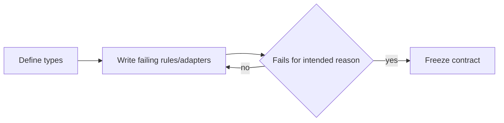
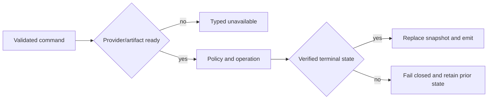
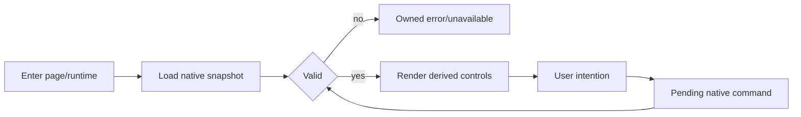
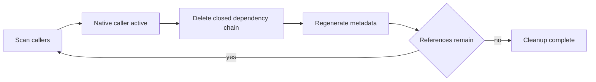
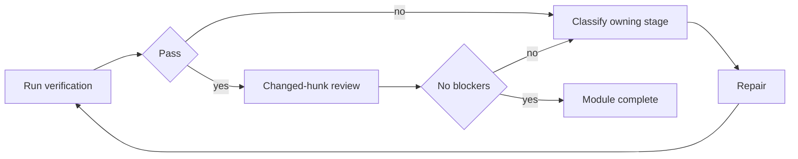

# Extensions Release And Resilience Plan

## 2026-09-16 外部分发重入计划

以下任务均来自 ER-S13..ER-S20，`product-content delta: none`。现有更新、插件、录制、ASR 页面合同保持不变。

### T06 发布脚本合同与红测试

- 为 `scripts/prepare-release-config.mjs` 编写 Node 测试：缺少渠道/公钥时拒绝；保留渠道 feature/productName；仅写入对应渠道 endpoint、Windows passive 安装模式和 `createUpdaterArtifacts: true`；不得序列化私钥环境值。
- 为 `scripts/resolve-runtime-artifacts.mjs` 编写 fixture 测试：仅允许 `ggml-org/whisper.cpp` 与 FFmpeg 官网列出的 `BtbN/FFmpeg-Builds`；要求 HTTPS、GitHub `sha256:<64hex>`、正数 size、唯一 `(artifactId, os, arch)`；官方缺失目标必须省略而非回退。
- 改动：package scripts、`.gitignore` 与上述脚本/测试。
- 验证：`node --test packages/bilibili-live-tool/scripts/*.test.mjs`。

### T07 原生 Tauri Updater Provider

- 增加桌面 `tauri-plugin-updater` 依赖并在 `AppState` 构造前初始化。
- 用 `TauriUpdateProvider::new(app.clone())` 替换 unavailable updater 的生产构造；`UnavailablePluginProvider` 保持不变。
- Provider 用一个 async mutex 独占候选 handle 与已验签 bytes。`check` 清理旧 bytes；`download` 只有在 Tauri 验签后才返回 downloaded；`install` 只能消费匹配的 handle/bytes；`skip` 只清理匹配版本。
- 增加纯 metadata mapper 测试，覆盖 notes、rollout 默认/自定义字段、pause/force/blacklist 与畸形扩展字段；保留既有 generation/install gate 测试。
- 验证：free/member Rust tests、fmt、strict Clippy、本地无 endpoint 的 fail-closed 行为。

### T08 GitHub Actions 双通道签名发布

- 新增 `.github/workflows/release-tauri.yml`，以 `app-v*` tag/manual 触发，使用最小 `contents: write`、按 ref concurrency、测试 gate 与 channel/platform matrix。
- 构建前以 `TAURI_SIGNING_PUBLIC_KEY` 生成忽略跟踪的 release config；私钥/密码只通过 Action 环境注入；Tauri Action 发布版本化 `free-v__VERSION__` / `member-v__VERSION__`、updater JSON 与 `.sig`。
- 全部平台成功后下载并验证各渠道 `latest.json`，再发布到 `updates` 分支的 `free/latest.json` 与 `member/latest.json`；部分失败不得覆盖旧 manifest。
- 验证 YAML、secret scan、endpoint/channel assertion 与 release-config dry run。真实 release 需要仓库 secrets 和 tag，作为外部运行证据记录。

### T09 官方运行资源目录

- resolver 查询 allowlist GitHub Release API，选择 Windows/Linux x64/arm64 的 LGPL-shared FFmpeg 与 CPU Whisper 资产，验证 GitHub SHA-256；可选下载并二次计算 hash，输出稳定 `runtime-artifacts.json`。
- WASM 仅接受仓库自有 release 输入和相邻签名；当前不伪造插件。macOS 或其他官方未提供可用 executable 的目标保持缺失。
- workflow 上传目录和已校验的上游包；目录只进入既有 plugin/member/media provider seam，不绕过会员、许可或权限规则。

### T10 验证、链路闭合与 Review

- 执行 Node 脚本测试、双渠道 Vitest、TypeScript、ESLint、Rust 双 feature tests、fmt、strict Clippy、双渠道 Web build 与可行的本地 Tauri build。
- 扫描私钥材料、renderer updater/fetch、非官方 host、旧 unavailable updater 构造和生成 release config。
- 审查异常 JSON/网络/404/过期候选/验签与 hash 失败；确认候选 bytes 在替换和终态清理；不引入 manager/registry/browser fallback。
- 更新 changelog、verification、review 和 state；真实 GitHub release/secrets 是唯一外部运行前置条件。

依赖顺序：`T06 -> T07 -> T08 -> T09 -> T10`。失败 Action 不更新稳定 manifest；回滚通过重新发布旧版本签名 manifest 完成。

## 摘要

按 native contract -> Rust policy/state/IPC -> frontend store/runtime/UI -> migration/cleanup -> full verification 串行执行。所有成功状态必须来自原生验证；外部材料缺失只实现 unavailable。模式深度为 Level 2 复用现有分层，局部使用纯 State/Policy/Adapter，不增加 manager/factory/event bus。

## T01 契约与红测试

- source/spec: ER-S03..11；product-content delta: none。
- files: Rust `domain/release.rs`、`ipc/release.rs` 测试骨架；TS `contracts/release.ts`、`modules/release/adapters.test.ts`。
- contract: exhaustive update/plugin statuses, channel, candidate, permissions, safe snapshots, exact commands/events; invalid/unknown/null fail fast.
- tests: rollout 0/5/100、paused、blacklist/force、forbidden resources、unsafe domain/permission、DTO invalid values、registry both channels.

## T02 Rust 状态、IPC 与韧性

- source/spec: ER-S02..04, ER-S06..11；product-content delta: none。
- files: `application/release*.rs`, `infrastructure/release.rs`, `ipc/release.rs`, `lib.rs`, `build_channel.rs`, database bootstrap/tests.
- implement: pure policy; injected unavailable updater/package/runtime ports; native snapshots/operation IDs; capability denial/audit; one-runtime crash transition; safe IPC errors/events.
- migration: enumerate exact `app.db.pre-migration*.bak` siblings, sort newest, keep 3, never touch export files/symlinks/outside directory. Failure logs degradation and does not block app.
- registry: same release/plugin commands in free/member because these are common; channel DTO comes from compile feature.

## T03 Frontend Store、Runtime 与页面

- source/spec: ER-S01/05/08/10；product-content delta: exact PRD controls/states only。
- files: release contract/adapter/store/runtime; update-log and plugin-manager pages; approved dialogs; App runtime bootstrap; locales.
- update: native bootstrap/check only, plain-text release notes, native progress, forced hides later, downloaded gates install; no `window.open`/fetch.
- plugin: native list, tabs, stable table, permission tags, native selection/review, pessimistic toggle/uninstall, source-backed confirmation, unavailable schema hides config.
- styling/accessibility: Tailwind utilities only, wrapped toolbars/scroll tables, semantic controls, focus restoration and text+color status.
- state: one immutable store snapshot; pending per command; root runtime owns cleanup/stale-event guards.

## T04 旧链删除与发布合规

- source/spec: ER-S06/10/12；product-content delta: remove unapproved browser/Electron behavior。
- delete: `src/renderer/plugins/**`, `services/update-service.ts`, old stores if replaced, `src/main/**`; adapt every caller/test/import first.
- package: remove Electron build scripts/config/dependencies and browser sandbox dependencies made unused; regenerate lockfile.
- preserve: Tauri scripts/config, existing logger UI only if its production chain is native; user-modified PRD untouched.
- scans: Electron imports/deps/scripts, `new Function`/eval, browser fetch update/plugin, `.js` plugin acceptance, arbitrary path fields, stale exports/tests.

## T05 Verification、Review 与自愈

- source/spec: all acceptance; product-content delta: none。
- automated: focused then full Vitest both modes; typecheck; lint; Rust fmt, free/member tests and strict Clippy; free/member Vite/Tauri builds.
- security: policy tests, no secrets/paths in DTO, no Electron/browser sandbox/send path, free/member registry, signature/install gates.
- resilience: backup retention/rollback, unavailable startup, crash isolation, listener disposal.
- UI: inspect update/plugin/config at 1280x800 and minimum 1024x680 where tooling permits; record external success flows not runnable.
- self-heal: verification failure -> execute; plan gap -> plan; architecture gap -> architecture-design; behavior mismatch -> spec. Stop on framework bounded/no-progress rule.

## Execute-Readiness And Review Contract

- T01-T05 are serial; no subagent/workflow parallelization is needed.
- Rust DTO is authoritative; TS preserves exact names through a dedicated adapter. `null` is explicit absence and `undefined` only pre-bootstrap.
- Functions over 150 lines or mixed validation/orchestration/I/O must split by responsibility. No new cache/timer except owned runtime lifecycle.
- No optimistic mutations, rejected promises, unhandled listeners, debug/dead/stale code, broad formatting or technology changes.
- Every hunk maps to one task and test/cleanup evidence. Review checks robustness, secret/path exposure, maintenance, listener/process cleanup, bundle impact and project conventions.
- The plan is executable without product guesses; unresolved external inputs are already constrained to unavailable adapters.
