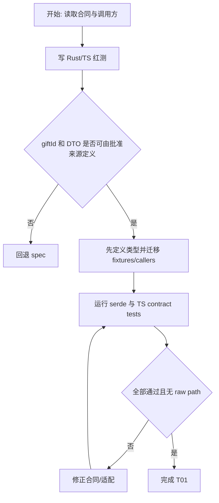
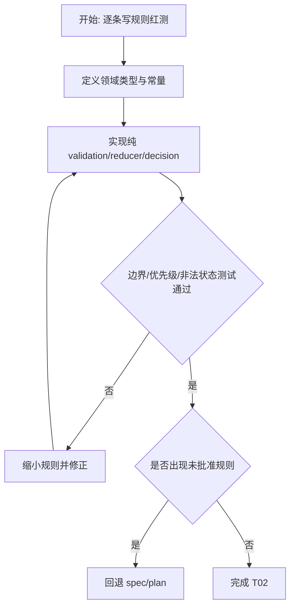
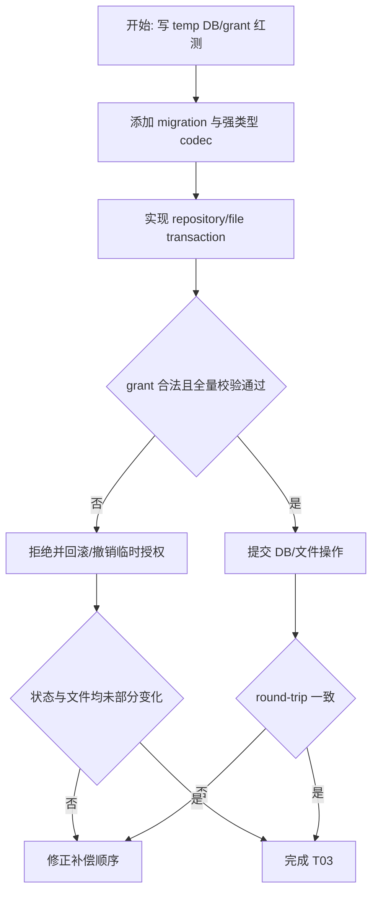
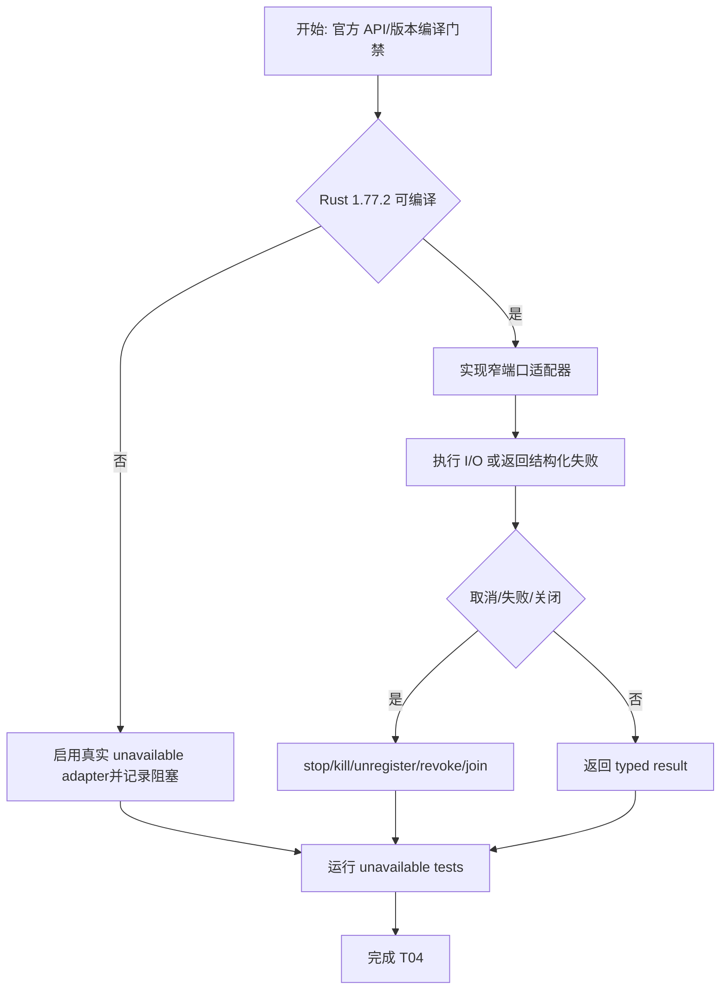
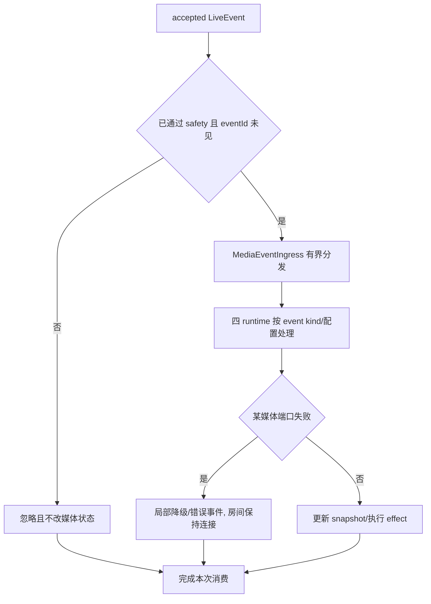
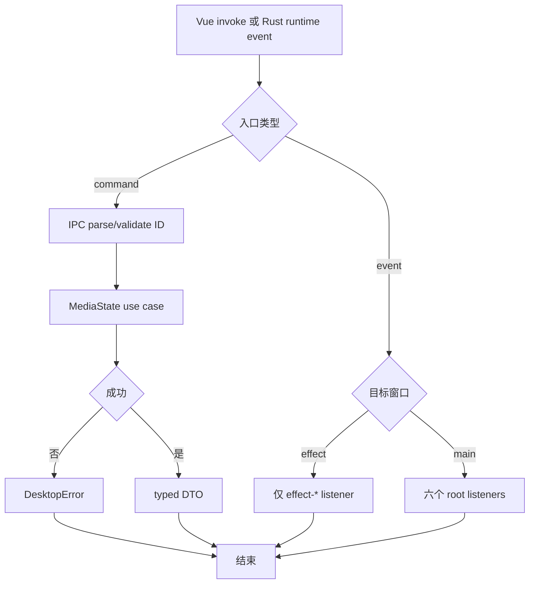
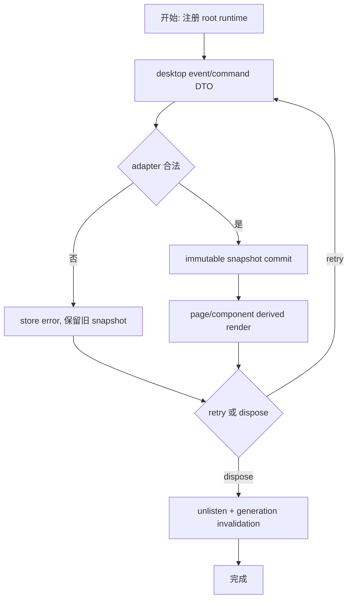
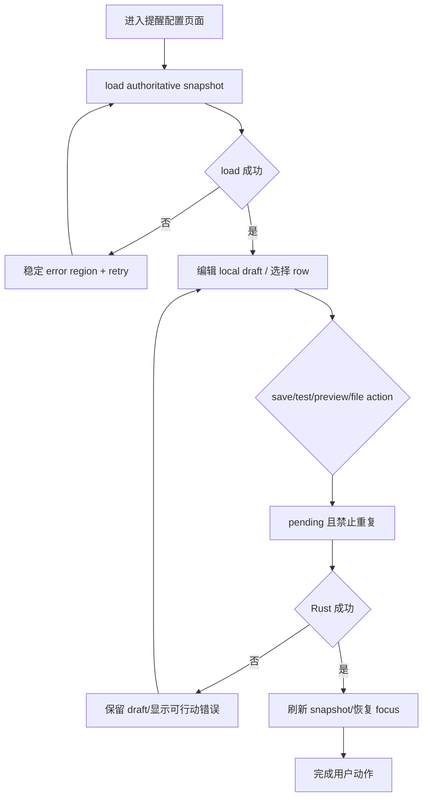
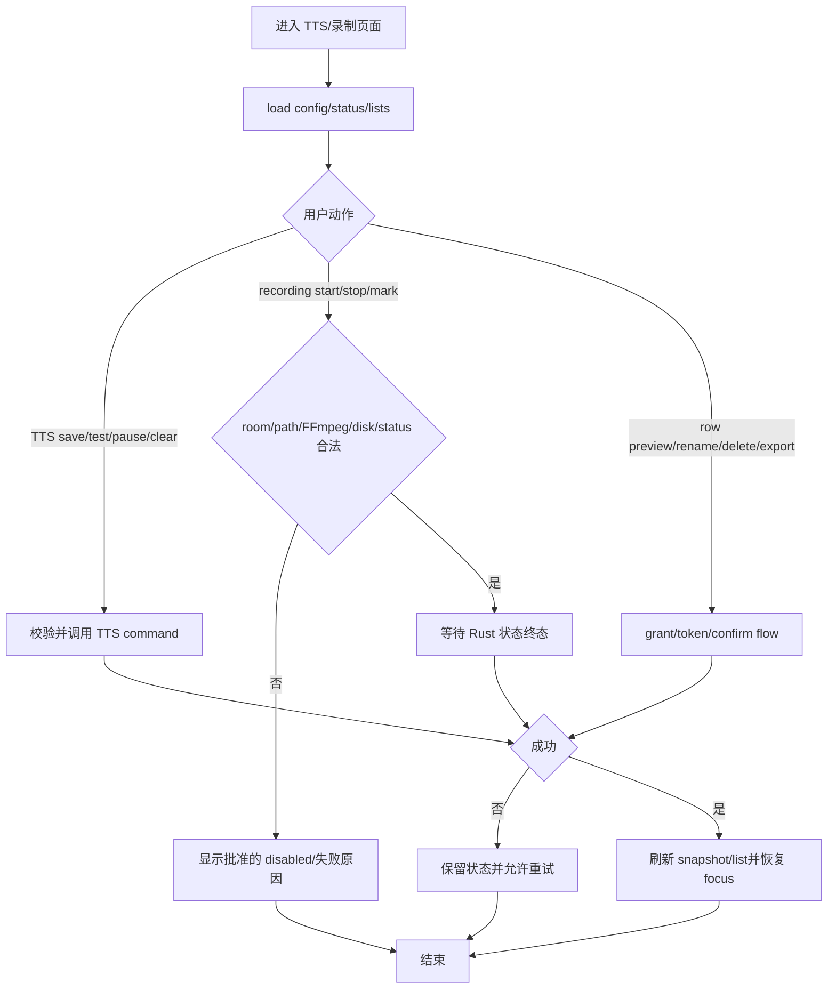
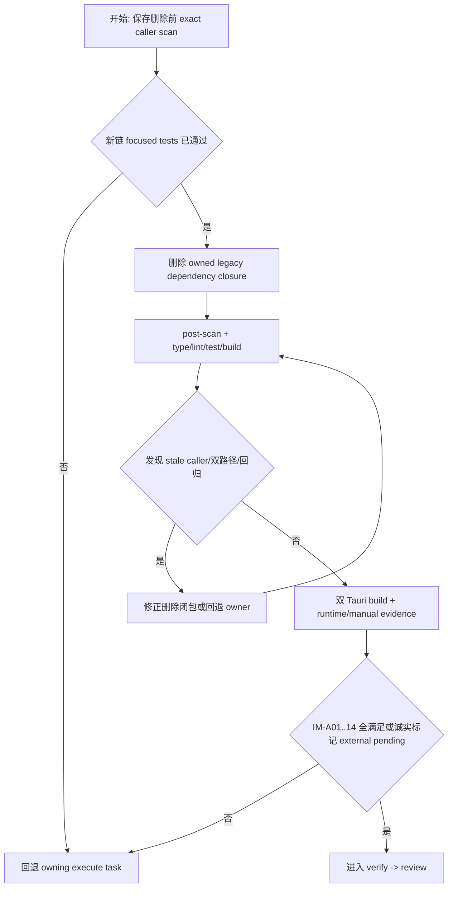

# Interaction Media 执行计划

## 交付单元标识

- request: `tauri-rust-refactor`
- module: `interaction-media`
- sequence: 3 of 6
- stage: `plan`
- source: PRD `2026-09-14-final`、已审批 `spec/spec.md`、`design/page-design.md`、`design/architecture-design.md`
- readiness: `ready for execute`

## 阅读导航

- 目标：把上舰特效、礼物提醒/音效、TTS、录制/高光迁到唯一 Rust owner，并删除旧 Electron/浏览器媒体链。
- 任务：10 个，全部串行；T01-T06 为原生能力，T07-T09 为前端迁移，T10 为删除闭包与验收。
- 高风险：T04 外部适配、T05 长生命周期运行时、T06 IPC/权限、T09 FFmpeg/预览、T10 删除闭包。
- 关键依赖：`live-data-safety` accepted event、SQLite、PathGrantStore、typed desktop transport、free/member 双通道。
- 索引：T01 合同 -> T02 规则 -> T03 持久化 -> T04 I/O -> T05 runtime -> T06 IPC -> T07 前端基础 -> T08 提醒页面 -> T09 TTS/录制 -> T10 清理验收。

## 全局摘要

范围严格等于 IM-01..IM-08。执行主线是先以失败测试固定 Rust/TypeScript 合同，再建立纯领域规则、持久化和系统端口，随后用 `MediaState` 接入 accepted event，最后迁移 Vue 页面并删除旧链。最关键状态流是 `accepted LiveEvent -> MediaEventIngress -> 四个 Rust runtime -> OS/SQLite -> typed event -> Pinia snapshot -> page/component`。最大风险是音频、窗口、快捷键和 FFmpeg 进程的并发清理，以及 raw path/重复 owner 复发。

实施前置均满足：前两模块 completed；spec/page-design/architecture-design 已审批；外部云 TTS、内置 FFmpeg 和完整特效素材明确为 unavailable/pending，不作为伪实现入口。

## 用户意图合同承接

- 字面要求：按指定 PRD 重构项目。
- 实际目标：交付可工作的 Tauri/Rust 本地媒体子系统，而非只换页面或把 Electron 藏在新 service 后。
- 成功标准：IM-A01..IM-A14 有代码和证据；free/member 公共能力一致；所有资源有 cleanup owner；旧媒体链无生产调用方。
- 禁止解释：不得恢复 renderer accepted-event projection，不得模拟录制/TTS，不得增加发送/审核/AI，不得用截图替代行为验证。
- 落实任务：T01-T06 证明 native truth，T07-T09 证明用户旅程，T10 证明无风险转移与无双路径。

## 来源锚定与禁止扩展边界

| 范围 | 来源 | 允许的 product-content delta |
| --- | --- | --- |
| Captain effect | spec IM-01；PRD 9.6；page-design Captain sections | 已列 preset/duration/position/colors/sounds/volume/combo/save/reset/preview/fallback |
| Gift reminder/sound | spec IM-02/03；PRD 9.7/9.8 | 已列配置、统计、latest 20、详情、MP3/WAV、绑定/预览/导入导出/队列 |
| TTS | spec IM-04；PRD 9.12 | 已列 engine/voice/rate/volume/选择/三模板/queue/fallback |
| Recording/highlight | spec IM-05；PRD 9.13；clarification rolling 10s | 已列配置、状态、F9、30s 前后、文件管理、quota/waterline/retry |
| Native contract/security | spec IM-06；ADR-IM-01..08；PRD 10 | `product-content delta: none`，仅 transport/owner/path normalization |
| UI | spec IM-07；page-design | 仅批准页面、字段、状态、反馈、响应式、可访问性 |
| Cleanup | spec IM-08；code-context | `product-content delta: none`，删除旧 owner/重复设置/无效测试 |

`missing-source` 的 9+ 特效名称/素材、云 TTS provider/credentials、内置 FFmpeg artifact/checksum 只能保持待提供或 unavailable。禁止加入 editable effect text、render mode、test data、礼物音效 duration/play mode/cooldown/priority、录制 pause/resume、打开目录、浏览器下载、cleanup days、礼物/上舰自动高光、重复设置项。

## 业务功能需求点与业务逻辑明细

| ID | 入口/前置 | 成功结果 | 失败/回退 | 验收 |
| --- | --- | --- | --- | --- |
| BF-01 上舰特效 | 提醒配置；配置可离线，live trigger 需 accepted captain | FIFO 单播、默认 5s fade、声音同步 | 缺声静默；窗口失败转 main overlay | IM-A01/A02 |
| BF-02 礼物提醒 | accepted gift；启用时至少一种 method | 阈值/连击触发；统计精确、latest 20 | 通知拒绝转 popup；声音失败隔离 | IM-A03 |
| BF-03 礼物音效 | `giftId`、合法 MP3/WAV grant | 原子绑定/保存/导入导出；>=10/s | missing 红色可重绑；满队列丢最旧低优先级 | IM-A04 |
| BF-04 TTS | accepted selected event/identity；有效模板/engine | captain > gift > admin > ordinary，单 speaker | system -> cloud -> local；无真实 provider 显示 unavailable | IM-A05 |
| BF-05 录制 | live room、directory grant、FFmpeg、disk > waterline | 3s 内启动；stop/finalize 确定 | stream 重试 3 次；低盘自动 stop；无 fake state | IM-A06/A08 |
| BF-06 高光 | recording 中 F9/manual 或 rolling 10s danmaku surge | 前后各 30s，5s 内响应 | 非 recording 不可达；失败不伪造 clip | IM-A07/A09 |
| BF-07 文件管理 | repository row + opaque authorization | preview/rename/delete/export 原子完成 | cancel 无副作用；失败回滚/补偿 | IM-A09 |

判断顺序固定：live-data safety acceptance -> event-id dedupe -> capability enabled/selection -> threshold/combo/priority -> bounded enqueue -> I/O effect -> typed snapshot/event。任何被 safety 拒绝的 event 不可进入媒体状态。录制状态只允许 `idle -> starting -> recording -> stopping -> finalizing -> idle`，任一步可到 `error`，`stop` 幂等；非 recording 的 highlight 不可达。TTS pause 保留 current/queue，clear 只清 pending；resume 继续单 speaker。

## 字段展示语义与交互视觉状态合同

| 字段组 | 格式/空值 | 默认与交互状态 | owner/验证 |
| --- | --- | --- | --- |
| 用户/舰长等级/动作 | normalized name；总督/提督/舰长；首开/续费；无效 DTO 拒绝 | effect 默认强调；gift detail 文本不可跳转 | adapter/surface tests |
| 礼物/数量/价值/时刻 | giftName；integer；`¥#,##0.00`；`HH:mm:ss` | row 默认可操作，hover/focus/active；无 visited | gift table/detail tests |
| session totals | CNY、donor count、gift count，0 显示 `¥0.00/0` | 信息态无 hover 强调 | reducer/formatter tests |
| 文件/音量/开关 | display name；0.0-1.0 一位；binary | raw path 不可点击；missing 为文字+图标+红色；disabled 可读 | grant/row tests |
| TTS capability/status | engine/voice/rate/volume；current null 显示批准空态 | unavailable disabled+原因；current strongest；pause 有 focus/disabled | adapter/queue tests |
| recording status/metrics | 枚举；`HH:mm:ss`；binary bytes；unknown `--` | recording 持久强调；waterline 文字+图标；非仅 hover | transition/component tests |
| filename/time/reason | name+ext；local datetime；position `HH:mm:ss`；弹幕激增/手动标记 | filename 非路径；row action 可聚焦；unknown enum 拒绝 | mapper/table tests |
| path | readonly display；未选明确为空 | 截断且可访问 full value；不可编辑/不可点击 | dialog/grant/UI tests |

所有写入为 pessimistic；loading 从 command 发出开始，在 success/error/cancel 的 `finally` 结束。dialog cancel 不报错、不写状态、不留 grant。reset/remove/delete 二次确认后才执行。文本输入仅 TTS template/rename/shortcut：template 保留原 whitespace、纯空白无效、新行/control char 拒绝、blur+submit 校验；rename trim 后为空阻断，禁止路径分隔符，保留原扩展名；shortcut 由 Rust parser 验证并在冲突时返回可行动错误。

## 执行效率与上下文预算

- Profile：`S3 broad/full`，这是跨 Rust/TS/UI/SQLite/OS/删除闭包的最低安全级别。
- 每个任务只读取其 target、直接 caller/consumer、focused tests、spec/ADR；不扫描 membership/plugin/update/ASR/AI，除非 exact import scan 显示真实影响。
- 发现新增 public command/event、共享 writable owner、跨模块 route/permission 或未列外部合同即回退 plan/spec，不扩 scope。
- scoped tests 每任务运行；T10 执行 full Rust/Vitest/type/lint/web build/free+member Tauri build 和 runtime evidence。

## 自愈闭环计划

execute 完成后必须进入 `verify -> review`。验证包含 focused/domain/integration/component tests、typecheck、lint、Rust fmt/test/clippy、双 Web/Tauri 构建、响应式截图、canvas pixel/FPS、真实 local FFmpeg 可用性探测和 cleanup 手工路径。

review 必查 requirement-mismatch、plan-gap、architecture-gap、logic-error、syntax-type-error、runtime-error、code-organization-error、maintainability-error、technical-debt-blocker。实现缺陷回 `execute`；任务合同缺口回 `plan`；行为缺口回 `spec`；owner/dependency 缺口回 `architecture-design`；产品/外部合同缺口回前置确认门。单交付单元 iteration <=7，同一 blocker/owner 连续 <=2，总失败 <=3；无新证据/修复/更窄诊断时 blocked。完成必须满足 loop compliance/assessment pass 且 remaining blockers none。

## 执行可用性合同

- 结论：`ready for execute`；产品可见细节均来自 approved spec/page-design。
- 纯技术假设：锁定 `rodio 0.20.1`（default-features=false，`mp3,wav`）、`tts 0.26.3`（default-features=false）、Tauri notification 2/global-shortcut 2；首个 Cargo 编译门禁验证 Rust 1.77.2。若 platform build 不成立，只能提供 structured unavailable adapter 并记录阻塞，不得换未经批准技术栈或 fake success。
- 外部 pending：云 TTS、内置 FFmpeg、完整 preset 素材；不阻塞 local/system/unavailable 合同实现，但阻塞对应 production claim。
- owner、DTO、34 commands、7 events、path purposes、状态/错误/cleanup/验证均由 spec/ADR 确定，无 execute 猜测项。

## 任务拆解

### IM-T01 合同镜像、giftId 与失败测试

- 目标/规格：固定 IM-01..08、ADR-IM-01/04/06 的 Rust serde、TS mirror、34 command/7 event 名、errors、fixtures；给 shared `GiftEvent` 增加 `giftId`。
- Source/delta：source-backed PRD 9.7/9.8 + code-fact-backed transport；仅 `giftId` 为批准业务字段，其余 `product-content delta: none`。
- 文件/符号：编辑 `domain/live_data/models.rs`、相关 parser/tests、`ipc/dto.rs`；拆 `platform/desktop/contracts.ts` 为 `contracts/{base,live-data,media,index}.ts` 并保持 barrel；新增 contract tests。先读 governing tsconfig/extends 和已有 generated declarations。
- 数据/边界：Rust camelCase authority；money minor units、epoch ms、integer durations/bytes、finite volume；`null` 是明确缺失，`undefined` 不替代；raw path 禁止出 DTO。
- 子项：先写 red tests；迁移所有 in-scope GiftEvent constructors/fixtures；验证 command/event count 与 free/member parity expectations；不实现 runtime。
- 完成：serde/TS contract tests green，exact caller scan 无缺 `giftId`；回退条件为 PRD/schema 对 gift identity 冲突，回 spec。

### IM-T02 Rust 纯领域规则

- 目标/规格：实现 BF-01..06 的 validation/reducer/queue/transition；覆盖 IM-A01..08。
- Source/delta：spec Function-Complete Behavior；`product-content delta: none`。
- 文件/符号：新增 `domain/media/{mod.rs,models.rs,rules.rs,tests.rs}`，编辑 `domain/mod.rs`。类型先行：config/snapshot/status、ID newtype 或等价名义类型、enums、structured domain errors。
- 纯函数：color/volume/enum/template whitelist、gift totals/latest20、event dedupe、combo、priority FIFO、overflow、rolling 10s heat、disk threshold、recording transition。输入不可变；仅 uniquely-owned Rust state 可在 lock 内更新。
- 规则：captain FIFO；gift overflow 丢 oldest low priority；TTS captain>gift>admin>ordinary 且同级 FIFO；10GB/5GB、30s/30s、3 retries 为 narrow-owner constants；无 I/O。
- 完成：red->green->refactor 的边界/negative/impossible-state tests；任何产品默认值缺失回 spec。

### IM-T03 SQLite、配置 codec 与路径授权

- 目标/规格：落实 IM-03/05/06、ADR-IM-04/07 的原子持久化和 purpose-bound 文件操作。
- Source/delta：PRD 9.8/9.13/10 + existing PathGrantStore/schema；`product-content delta: none`。
- 文件/符号：新增 `migrations/0002_interaction_media.sql`、`infrastructure/media/{mod,repository,files,tests}.rs`；编辑 database/config repository、`application/paths.rs`/`infrastructure/path_grants.rs`。
- 行为：强类型 decode `t_app_setting` configs；CRUD `t_gift_sound/t_recording/t_highlight/t_tts_config`；versioned gift import 全文校验后 transaction；export/file+DB 采用明确补偿顺序；新增四 purposes，复用 giftSoundFile/recordingDirectory。
- 安全：canonicalize 后验证 grant purpose/owner/revocation；DTO 仅 display name/grant/session；cancel/revoked/wrong-purpose/missing/partial failure 都 fail-fast。
- 完成：migration idempotency、round-trip、rollback、wrong-purpose、file/DB compensation tests green。

### IM-T04 系统 I/O 端口与具体适配器

- 目标/规格：实现 ADR-IM-03/05/07 的 audio/speech/FFmpeg/notification/window/hotkey/preview I/O，不承载业务策略。
- Source/delta：spec IM-01..06；官方 Tauri/crate API；`product-content delta: none`。
- 文件/符号：`application/media/ports.rs`；`infrastructure/media/{audio,speech,ffmpeg,notification,window,hotkey,preview}.rs`；`Cargo.toml/lib.rs`。依赖锁定 `rodio 0.20.1` MP3/WAV、`tts 0.26.3` no-default、Tauri plugin notification/global-shortcut 2。
- 行为：one-shot audio + stop handle；system TTS voices/speak/stop，cloud unavailable；local FFmpeg spawn/stdout-stderr/kill/wait，bundled unavailable；permission-aware notification；effect target/fallback window；F9 register/conflict/unregister；opaque random preview token + expiry/range/revoke。
- 并发/cleanup：blocking audio/TTS 与 process wait 不占 async mutex；所有 handle 有 dispose；preview 不泄漏 canonical path；plugin capability 不开放给 effect window。
- 完成：先 Cargo dependency compile gate，再 fake/unavailable/cleanup/range/security adapter tests；依赖不兼容则保留 port+structured unavailable 并记录 evidence，禁止替换栈。

### IM-T05 四个 Media runtime 与 accepted-event 接入

- 目标/规格：落实 ADR-IM-01/02，恢复 TTS/highlight/alert 等 accepted-event 消费且不恢复 renderer projection。
- Source/delta：spec IM-01..06；`product-content delta: none`。
- 文件/符号：新增 `application/media/{mod,state,effects,gifts,tts,recording,tests}.rs`；编辑 `application/live_data/{ports,state,tests}.rs` 和 bootstrap composition。
- owner：`MediaState` facade；EffectRuntime FIFO/window/audio；GiftMediaRuntime stats/alert/audio；TtsRuntime priority speaker/fallback；RecordingRuntime process/buffer/heat/disk/hotkey。一个 `AcceptedLiveEventConsumer` trait，测试默认 no-op。
- 状态/失败：consume only after safety accepted；event-id idempotency；media fault isolated and never disconnect room；per-operation dedupe；shutdown closes queues, cancels tasks, joins process and disposes external handles。
- 完成：fake-port tests 覆盖 accepted order、filtered exclusion、fallback、pause/clear、record transitions、three retry、waterline、highlight windows、shutdown。

### IM-T06 Tauri IPC、事件、窗口和双通道能力

- 目标/规格：实现 IM-06、IM-A09..11 与 ADR-IM-05/07 的薄 IPC。
- Source/delta：approved 34 commands/7 events；`product-content delta: none`。
- 文件/符号：新增 `ipc/media.rs`/`media_contract_test.rs`，编辑 `ipc/{mod,dto,error}.rs`、`lib.rs`、`capabilities/{main,effect}.json`、Tauri configs；`main.ts` 增加 `?surface=effect` bootstrap。
- 行为：command 只 parse/map/call facade/map error；free/member registry 完全一致；effect capability permissions 为 `[]`；six main listeners + one targeted effect listener；preview protocol 校验 token/window/range。
- 错误：所有 command 返回 `DesktopError`；cancel 作为 non-error outcome；invalid id/grant/DTO 无 panic；emit failure 有 context 且不改变 domain truth。
- 完成：surface count、capability parity、targeted delivery、zero-command effect、malformed payload/error mapping tests；free/member cargo check。

### IM-T07 TypeScript adapters、stores 与 root runtime

- 目标/规格：落实 IM-06/07、ADR-IM-06，建立一个 typed frontend path。
- Source/delta：spec API/data contract + page state；`product-content delta: none`。
- 文件/符号：新增 `modules/media/{adapters,validation,formatters,*.test}.ts`、`stores/media/{effects,gifts,tts,recording,*.test}.ts`、`composables/useMediaRuntime*`；编辑 desktop facade/barrel、App/root bootstrap。
- owner/data：adapter 拒绝 malformed DTO 并返回 immutable VM；store owns snapshot/pending/error/generation；page later owns draft；root owns six listeners and late registration cleanup。computed 只做 local derived，不保存重复 truth。
- 异步：latest-wins reads；per-operation dedupe；all rejected promises mapped；dispose 使 late event/query 无效；无 route/component listener。
- 完成：adapter/formatter/validator pure tests、store stale/dedupe/finally tests、runtime idempotent/late-cleanup tests；typecheck/focused lint。

### IM-T08 上舰特效、礼物提醒与礼物音效页面

- 目标/规格：交付 BF-01..03、IM-A01..04 的 page-design，不保留旧未批准控件。
- Source/delta：page-design Captain/Gift sections；product delta 仅 closed-world allowlist。
- 文件/符号：新增 `views/captain-effect/{index.vue,EffectWindowRoot.vue}`、`views/gift-reminder/index.vue`、`components/media/{CaptainEffectSurface,GiftDetailDrawer,GiftSoundTable}.vue`；重写 `views/gift-sound/index.vue`；编辑 routes/nav/i18n approved labels。
- 组件决策：surface/window、detail drawer、gift table 按 page-design extract；captain/reminder forms keep inline；child 只接 normalized props/emits，不 import store/transport。Canvas owns RAF/resize/dispose；无 WebGL/render selector/editor。
- UI/输入：字段顺序/默认/format/disabled/confirm/loading/empty/missing/fallback 逐项按 spec；Tailwind utility only；1024 wrap/scroll；dialog focus restore；live updates 不抢 focus/scroll。
- 完成：UI/store/component tests，canvas pixel/FPS/DPI/reduced-motion，桌面与 1024x680 screenshots，无 raw path/browser Audio/Blob。

### IM-T09 TTS、录制与高光页面

- 目标/规格：交付 BF-04..07、IM-A05..09 的完整页面/状态流。
- Source/delta：page-design TTS/Recording；product delta 仅 closed-world allowlist。
- 文件/符号：新增 `views/tts/index.vue`、`components/media/{TtsQueuePanel,RecordingStatusBand}.vue`；重写 recording page/list/highlight，新增 `RecordingSettingsDialog.vue`；移除页面 pause/resume/open-folder/download 等。
- 组件决策：queue/status/settings/list/highlight 按批准边界 extract/reuse；TTS config form inline；presentational children emit intent。preview 使用 opaque session URL，close 即 revoke。
- UI/状态：TTS blur+submit template validation；engine unavailable disabled；pause/clear stable queue。Recording primary action严格随 status；start precondition reason；stop/finalize pending；tabs 保持 table region；rename/delete/export confirm/cancel/focus 完整。
- 完成：template/priority/status/component tests、opaque preview range/revoke integration、F9/manual/highlight/low-disk/retry runtime walk、responsive screenshots。

### IM-T10 删除旧链、全量验收与交付证据

- 目标/规格：落实 IM-08、ADR-IM-08、IM-A10..14，保证无双路径和无无效 claim。
- Source/delta：code-context caller closure + approved acceptance；`product-content delta: none`。
- 删除/编辑：删除 owned renderer `services/{tts,recording,gift-sound}`、`engines/{tts-engine,web-speech-tts,edge-tts,engine-factory}`、effects managers/renderers/sound、old stores/types/utils、Electron main/preload IPC modules/channels、settings TTS/Recording duplicates、invalid tests/mocks；只在 exact production scan 无 caller 后删除。保留 ASR/AI/plugin 邻近面。
- 链路复查：入口 -> page -> store -> desktop -> IPC -> runtime -> port；imports/exports/events/watch/computed/timers/tests/mocks/comments；测试引用不算 production caller。检查无 Electron bridge、browser Audio/Blob、raw path、duplicate setting、gift/captain auto-highlight。
- 质量：changed hunks 映射到 T01-T10；无 debug/dead/stale/unused/temporary compatibility；函数职责 <150 行或明确拆分；无 hidden class strings/generic manager。
- 验证：Rust fmt/test/clippy；Vitest focused/full；typecheck/lint；free/member web + Tauri installers；runtime screenshots/canvas pixels；cleanup/app exit；记录 unavailable external assets。更新 changelog/verify/review evidence。

## 功能拆解明细

- Captain form 顺序：preset、duration 3/5/8/10、position、two hex colors、first/renew/combo sounds、volume、combo switch/window 5/10/30；save/reset/preview。preset catalog <10 为 unavailable，不能补营销名。
- Gift reminder form：enabled、threshold minor-unit input、three methods、combo/window、popup position/duration；test 不写 stats；totals + latest20 + five-field detail。
- Gift sound table：gift、sound file、volume、enabled、actions；search trim only for compare，bound-only derived；row/global save；MP3/WAV dialog；import all-or-nothing/export via Rust。
- TTS form：engine/voice/rate/volume、four event selections、four identity selections、danmaku/gift/captain templates；queue current/count/pause/clear。required template whitespace-only/invalid token/newline blocks submit；Rust retains default effective template。
- Recording：status band、start/stop/mark；recordings/highlights tabs；settings groups format/quality/path/segment/auto/heat threshold/30+30/quota/waterline/source/shortcut。records preview/rename/delete；highlights preview/export/delete；no pause/resume。

## 项目脚手架与初始化策略

不适用：复用 platform-foundation 已批准 Vue/Vite + Tauri v2 scaffold；不得引入新 starter、separate web app 或 Electron compatibility scaffold。

## API 对接与类型策略

Rust serde 是 authority，TS 保持 exact camelCase mirror，通过现有 desktop barrel 调用。无 protobuf/OpenAPI。T01 先拆 contract 文件并迁移所有 imports；T07 adapter 负责 enum/null/unit/format semantic normalization；store/page 不解析 raw DTO。34 commands/7 events 不得增加。External provider 通过 typed port 表达 unavailable，不定义虚构 request payload。

## 依赖关系

`T01 -> T02 -> T03 -> T04 -> T05 -> T06 -> T07 -> T08 -> T09 -> T10`。串行原因是每一步建立下一步的唯一 authority 和删除门禁；不启用 workflow/subagent 并行，当前 loop 已在 iteration 7，跨共享文件并行会增加 contract drift 风险。

## 变更链路审查

变更前用 exact symbol/import/event/channel scan 建 caller map，区分 production/test。owning chain 为 media pages/settings/status -> stores/services/engines -> desktop/Electron bridge -> main modules/files/process；邻近 ASR/AI/plugin/logger 只记录影响不改。变更后必须证明 required route/store/IPC/runtime/adapter 均存在、legacy owner/import/export/helper/type/state/computed/watch/listener/timer/test/mock/comment 均关闭，无 orphan/duplicate/conflict path。

## 整洁性与复杂度控制

遵守 <=45 新 production files、34 commands、7 events、6 main listeners+1 effect listener、latest20、bounded queues。禁止 catch-all utils/constants、generic MediaManager/queue framework/DI container、one-method wrapper、single-caller helper file。超过 150 行且混合职责的函数必须按 orchestration/validation/transform/effect 拆分，不因行数机械抽取。

## 局部性与文件抽取决策

Rust 四 runtime 因独立 lifecycle/test surface 分文件；ports/adapters 因真实 I/O 边界分文件。TS adapters/validation/formatters 因多 store/page 和纯测分文件；page-only filter/form mapping 留本页。共享 path/transport/error/preview primitives 复用既有 owner，不复制。所有新 shared API 写 `@see`/`@example` 对应真实 callers。

## Vue 组件抽取决策

严格采用 page-design 表：extract `CaptainEffectSurface`、`GiftDetailDrawer`、`GiftSoundTable`、`TtsQueuePanel`、`RecordingStatusBand`、`RecordingList`、`HighlightList`、`RecordingSettingsDialog`；captain/reminder/TTS forms keep inline；`MediaFileField` 不抽取；Element Plus controls 直接复用。抽取后 state 仍在 Rust/store/page，props 为 VM，emits 为 intent，无 slots/store/transport import。

## 前端专家级工程约束

每页覆盖 load/empty/error/degraded/dirty/pending/success/cancel/retry/disabled；focus restore、keyboard、semantic control、36px icon target、text+icon+color states；live updates 不抢焦点。1024x680 与 1280x800 无 overlap，toolbars wrap、grids collapse、tables horizontal-scroll、dialogs viewport-bound。异步 ownership、generation/dedupe/cleanup 全在 store/runtime，不由 template/watch 修复。

## 前端架构质量计划

ADR mapping：T01=01/04/06，T02=02，T03=04/07，T04=03/05/07，T05=01/02，T06=05/07，T07=06，T08=05/06，T09=03/06/07，T10=08。Dependency matrix 按 architecture 严格执行；cycle scan 证明 domain/application/platform/contracts leaf direction。拒绝 future plugin/provider registry 和 runtime feature flag；external unavailable 是永久明确状态，不是旧链 fallback。

## 生产代码质量与代码评审预检合同

- Robustness：external DTO/storage/grant/file/process/plugin/OS returns 全部判空/validate/catch；Promise finally；invalid/revoked/stale/timeout/partial success 明确处理。
- Maintainability：type/interface first；precise boolean/handler names；narrow constants；纯 mapper/rules；无 magic variable、wide optional props、hidden mutation。
- Performance/memory：RAF resize cleanup；queues bounded；event dedupe；no deep watch/polling；audio/speech/process/token/window/hotkey/listener/task 全部 dispose/join/revoke。
- Convention：Vue 3/Pinia/Element Plus/Tailwind utilities/typed desktop facade/Rust layered modules；不得擅换技术栈、style system、state/request convention。
- UI fidelity：金额/时间/duration/bytes/status/path/reason 各自按业务语义 format；业务强调不可降为 hover-only。

## 人工评审可通过性约束

允许 diff 仅限 architecture-design Human Review 列出的 media/native/config/capability/routes/pages/tests/owned legacy closure。禁止 PRD、membership/plugin/update/final shell/ASR/AI/logger 重构和宽泛格式化。每个非显然 hunk 映射 T01-T10/source/cleanup；pre-review 检查 debug/dead/stale/unused/mocks/compatibility。Reviewer evidence 必含实际命令、结果、未运行项原因与 remaining risk。

## 架构复用与公共逻辑抽取

复用 desktop transport/error、PathGrantStore/dialog、accepted-event trait pattern、SQLite bootstrap、RecordingStatusBand semantic API。共享 audio output/file preview mechanisms，但 gift/effect/TTS 策略保持独立。三处相同 volume validation/format 可晋升 narrow primitive；不同 path UI、queues、forms 不因形似抽取。旧 renderer manager 删除，不包装晋升。

## 函数式编程约束

validation、tokenization、priority/overflow、combo、stats、DTO mapping、formatting、transition、disk、payload 全为纯函数/mapper；输入 DTO/snapshot/props 不可 mutate。副作用仅在 Rust ports/repository/runtime、desktop transport、Pinia actions、lifecycle/event handlers。禁止新 functional library、currying/point-free/opaque reducer chain。

## Tailwind 样式约束

所有 touched authored DOM styling 用 Tailwind-style utilities；不新增 scoped CSS/module/Sass/Less/inline style object/semantic class。class value 在 formatter line width 内，禁止藏入常量/map/computed/helper；过长先降样式或按批准组件边界拆结构。Canvas 参数只管绘制，不改 DOM layout style。

## 模式决策与替代方案

复用 Level 2 ports/adapters/facade/observer/state pattern，Level 1 typed record/discriminated union/actor queue；frontend 用 functions/adapters/store actions/component boundary，Rust 生命周期允许 state structs/traits。拒绝 generic manager/factory/event bus/DI/strategy registry/compatibility facade。execute 不得现场升级 Level 3 抽象。

## 代码上下文与影响范围

核心 target 为 `packages/bilibili-live-tool/src-tauri` 与 `src/renderer` 的 named media paths。`src/main` 仅删除 owned Electron media closure；settings 仅删除 duplicate TTS/recording owner；App/router/i18n 仅加入批准入口/标签。PRD 工作树改动保持不动。

## 并行执行建议

不并行。所有任务触碰共享 DTO/registry/bootstrap/store barrel 或删除门禁，且当前 framework loop iteration 已达 7；顺序提交 focused evidence 更可审计。任务内可并行运行互不写文件的 Rust/TS checks。

## 触发与上下文准备

每任务开始读取 task section、spec matching section、ADR、target/direct callers/tests；编辑前重新检查 `git status` 并保护用户改动。T04 开始需复核 lockfile/official API；T08/T09 需启动 Vite 并用 Playwright/浏览器截图检查；T10 保存 before/after scans。

## 受影响文件或模块

按 architecture `File And Directory Structure`；额外为 `Cargo.toml/Cargo.lock`、migration、`lib.rs`、Tauri configs/capabilities、App/router/i18n/generated declarations、owned `src/main` media/preload closure 与 settings duplicates。超出清单需回 plan。

## 测试策略

- TDD：T01-T07 pure/contract/runtime 先红后绿；T08-T09 component/user flow 使用 focused Vitest 与 runtime checks。
- Rust：`cargo fmt --check`、focused/full `cargo test`、`cargo clippy --all-targets --all-features -- -D warnings`，free/member no-default feature checks/builds。
- Frontend：media/platform/live-data focused Vitest、full Vitest、`pnpm type-check`、focused/full lint、free/member web build。
- Runtime：effect nonblank canvas pixel/FPS/DPI/reduced motion；1024x680/1280x800 screenshots；dialog cancel/focus；local FFmpeg probe/record/finalize if installed；shutdown cleanup。
- Packaging：free/member Tauri installer。云 TTS/bundled FFmpeg/10+ final artwork 未提供则明确 not run/unavailable，不伪造。

## 观察与人工介入点

仅三类外部输入需要后续人工介入：完整 captain asset catalog、cloud TTS contract、approved LGPL FFmpeg bundle metadata/artifact。它们不允许阻断本地结构/不可用态，但阻断相应 production completion claim。其余 in-scope blocker 由 self-healing loop 处理。

## 回滚说明

回滚单位是整个 interaction-media delivery 的 source-control changes；不保留 runtime Electron flag。数据库 migration 只 additive，旧列不删除；若新代码回滚，schema 可安全闲置。文件/DB mutation 失败采用任务内 compensation；active process/window/audio/token/hotkey 在 rollback/shutdown 前全部 cleanup。
