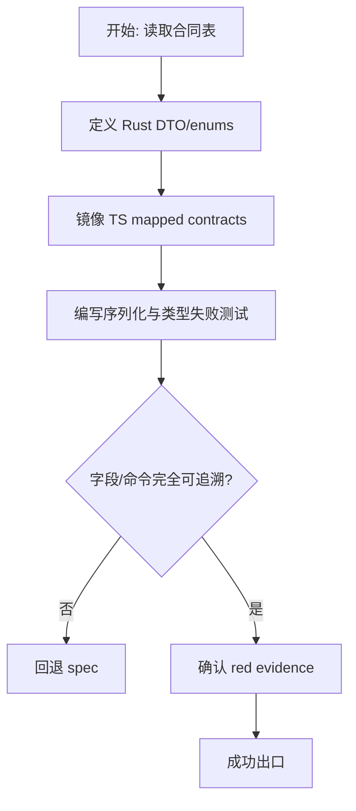
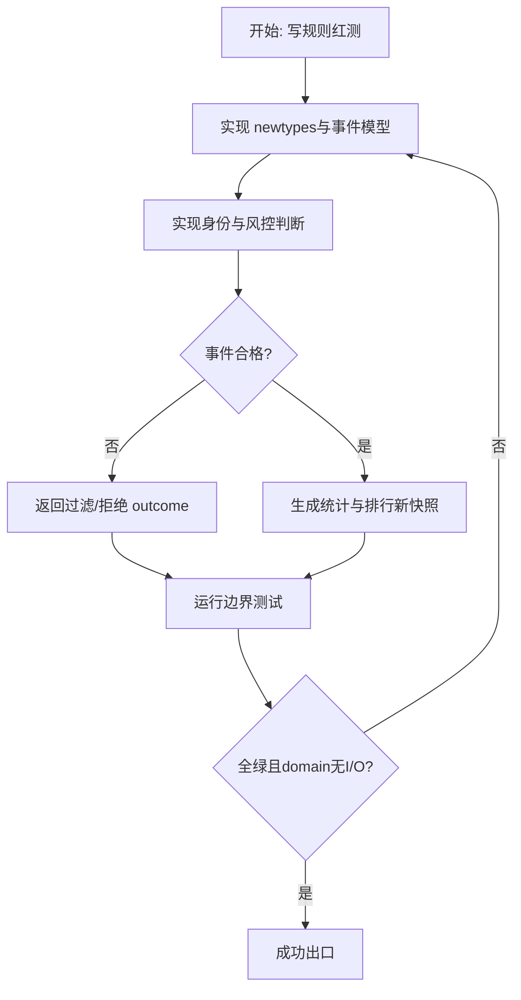
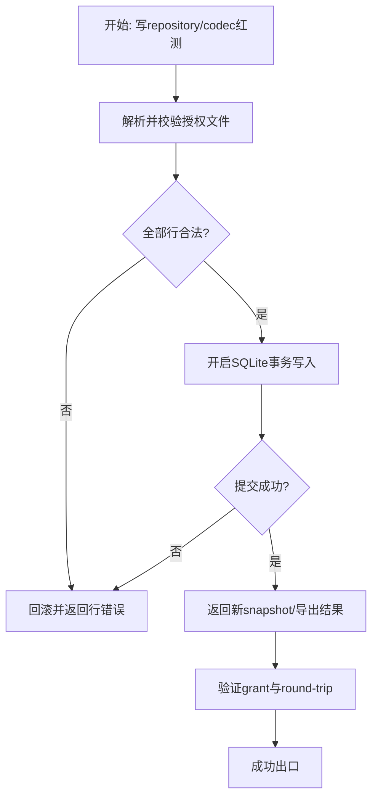
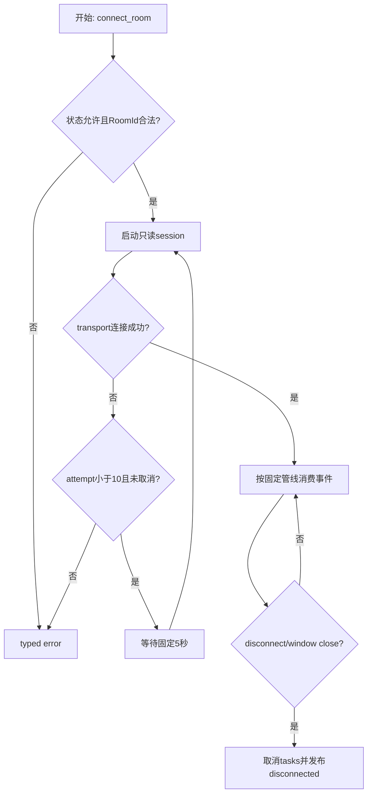
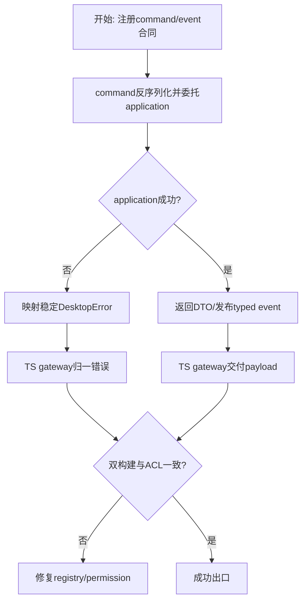
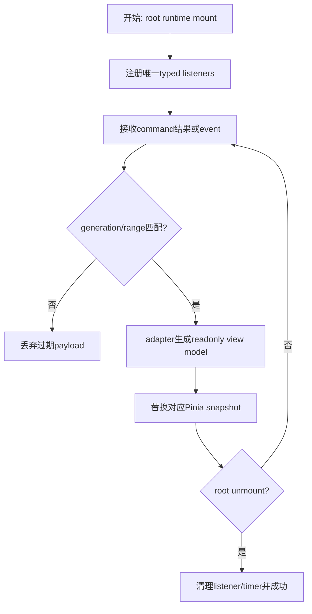
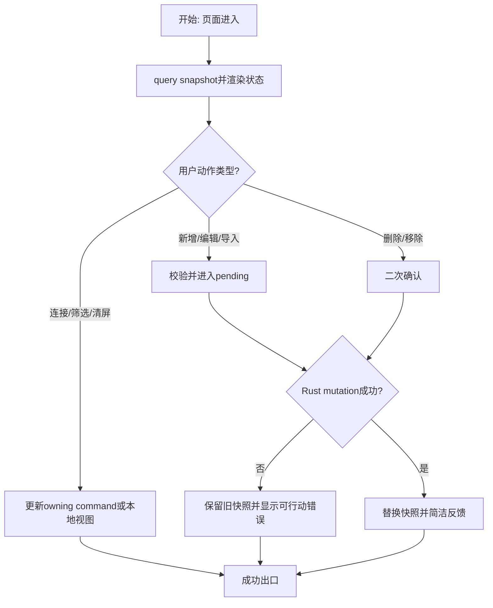
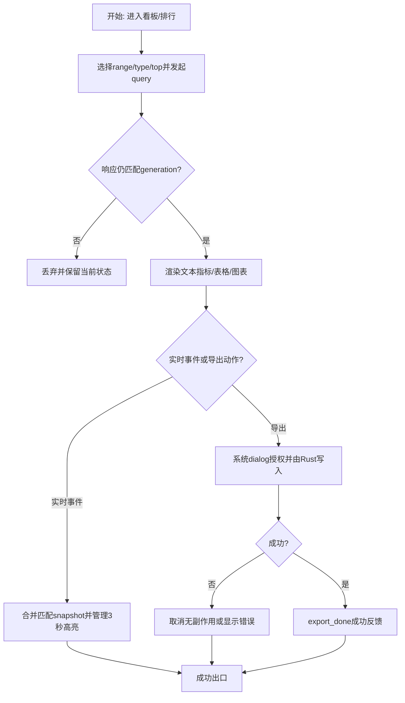
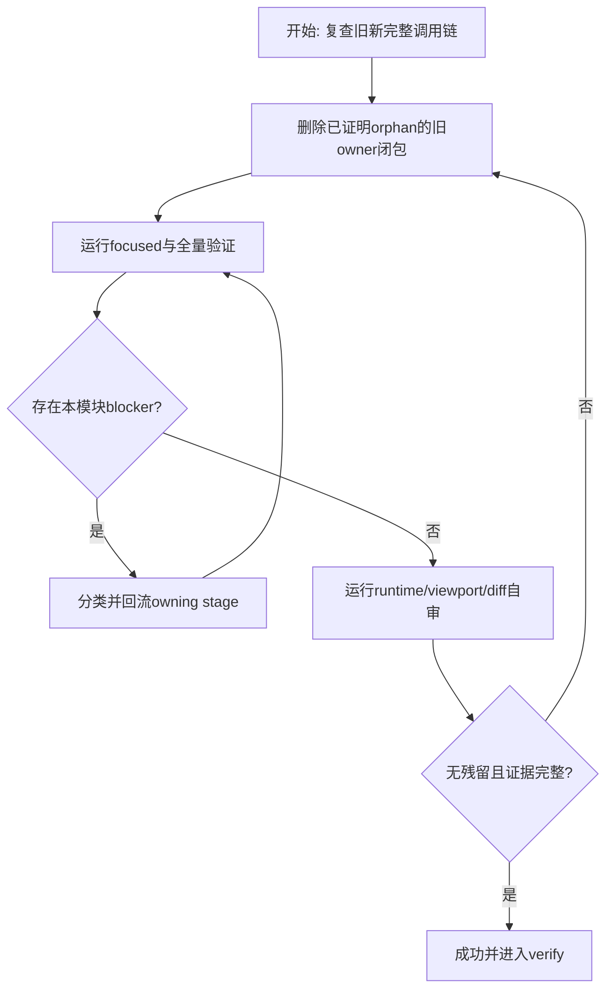

# Live Data And Safety 执行计划

## 交付单元标识

- Request: `tauri-rust-refactor`
- Module: `live-data-safety`
- 上游：已审批 `spec/spec.md`、`design/page-design.md`、`design/architecture-design.md`
- 计划结论：`ready for execute`

## 阅读导航

- 任务数：9；全部按依赖主线串行，任务内测试可并行运行，不启用多 agent workflow。
- 主线：合同红测 -> Rust 领域 -> SQLite/文件 -> 运行时 -> IPC -> Vue 投影 -> 操作页 -> 分析页 -> 删除闭包与验收。
- 高风险：LDS-T03 事务与路径授权、LDS-T04 高频事件和取消、LDS-T09 旧 renderer owner 删除闭包。
- 关键依赖：`platform-foundation` 的 `AppState`、SQLite、path grant、typed desktop gateway 和 free/member 构建通道。

## 全局摘要

本计划交付只读直播连接、四类事件、身份归一、敏感词/黑名单拦截、统计、排行榜和系统授权导出。核心主线为 `transport -> Rust 固定管线 -> repository/aggregation -> Tauri Event -> root runtime -> Pinia readonly snapshot -> Vue`。Rust 是唯一可写业务 owner；Vue 仅拥有筛选、搜索、滚动暂停、对话框和高亮计时等展示状态。真实开放平台配置缺失时必须返回可诊断 unavailable，不生成模拟数据。实施前置条件均已满足，无产品 blocker。

## 用户意图合同承接

- 字面要求：依据指定 PRD 重构项目，并按已确认建议继续。
- 实际目标：形成真实可运行的 Tauri/Rust 数据与风控底座，而不是保留 WebView 核心逻辑或只新增空壳。
- 成功标准：LDS-01..15 均有代码和证据；free/member 行为一致；旧 WebSocket、过滤、统计和 Electron DB owner 不再参与生产链。
- 禁止解释：不得伪造连接成功、保留发送能力、把过滤/聚合留在 Vue、用会员状态裁剪本模块、把缺陷发现责任转给用户。
- 落实任务：T02-T06 固定所有权；T07-T08 落实产品行为；T09 用调用链、测试、双构建和运行时证据证明没有转移风险。

## 来源锚定与禁止扩展边界

| 任务 | Spec 锚点 | 权威来源 | Product-content delta |
| --- | --- | --- | --- |
| T01 | LDS-01..15、合同章节 | approved spec / architecture | none |
| T02 | LDS-01..04、06、08..11 | PRD 9.1-9.3、9.5、9.9-9.10；确认决定 | none |
| T03 | LDS-05、07、12 | PRD 9.3、9.5、9.11；确认 CSV 口径 | approved formats/fields only |
| T04 | LDS-01、02、04、06、08、10 | PRD 9.1、9.3、9.5、9.9-9.10 | approved states/events only |
| T05 | LDS-01..14 | approved command/event tables | none |
| T06 | LDS-03、08..10、14、15 | approved architecture + code facts | none |
| T07 | LDS-01..07、13、15 | PRD + approved page design | approved controls/copy only |
| T08 | LDS-08..13 | PRD + approved page design | approved fields/copy only |
| T09 | LDS-01..15 | acceptance criteria + caller graph | none |

`missing-source` 仅包括真实 Bilibili 凭证、端点和协议细节；只能落为生产 unavailable adapter，不能变成模拟成功、测试入口或用户可见新配置。媒体、TTS、AI、录制、禁言、OAuth、支付、插件、更新、最终应用壳和设置页不进入本计划。禁止新增可配置重连、登录字段、黑名单期限、最近活动、发送能力、遥测或任意路径输入。

## 业务功能需求点与业务逻辑明细

| 功能 | 入口与前置 | 核心规则 | 成功 / 失败 / 验收 |
| --- | --- | --- | --- |
| 只读连接 | 全局房间控件；1-20 位数字 RoomId | 重复连接拒绝；断线固定 5 秒，最多 10 次；disconnect/window close 取消任务 | 状态事件驱动 UI；无效/未开播、凭证失效、重连耗尽使用 spec 文案 |
| 事件管线 | transport frame | validate -> identity -> blacklist -> sensitive -> persist/aggregate -> publish；命中即终止下游 | 四类合格事件有序到达；命中只写过滤日志，不进入 UI/TTS/AI |
| 身份 | 合格事件用户字段 | 房管、总督、提督、舰长、老爷；未知/缺失降普通；勋章异常等级不伪造 | DTO/组件按中文标签和双编码展示 |
| 敏感词 | 风控中心 | 精确/模糊、CRUD、启停、搜索/分类；悲观更新；导入整批事务；编译进度 | 成功后替换快照；任一行非法整体回滚并保留旧编译器 |
| 黑名单 | 风控中心/用户详情 | UID 唯一；重复 UID 更新 username/reason；加入后现存和后续事件立即隐藏 | 导入事务；CSV `uid,username,reason[,created_at]`；无期限字段 |
| 看板 | 页面进入、范围变化、刷新 | 五指标、三趋势；query 后只接收相同 generation/range 的 5 秒事件 | 空/过期/数据库降级可区分；图表点明细展示五指标 |
| 排行 | 页面进入、榜种/TOP/范围变化 | 礼物金额、弹幕条数、舰长累计购买/续费人民币金额；10 秒事件 | TOP10/20/50/100；位次变化 3 秒展示，不改权威快照 |
| 导出 | 共享导出弹窗 | 系统对话框产生 purpose grant；Rust 查询并写文件；cancel 无副作用 | 无数据、权限、磁盘失败可恢复；成功发布 `export_done` |

### 业务状态与分支

- Connection：`disconnected -> connecting -> connected -> reconnecting -> connected | error -> connecting`；disconnect 从任意活动态回 `disconnected`。`attempt` 仅在 reconnecting 有值且为 1..10。
- Mutation：`idle -> pending -> success | error -> idle/pending`；pending 只禁用 owning control，所有分支在 `finally` 结束。
- Query：`idle/loading -> ready | empty | stale | database-degraded | error`；generation 不匹配的响应/事件丢弃。
- Import：解析/校验/事务/编译任一步失败都不交换内存快照；成功提交后原子交换并通知 UI。
- Export：dialog cancel 直接返回；无 grant、purpose 不符、无数据、写入失败均不得发布完成事件。

### 校验、权限与不可做事项

- Rust 执行最终校验；TS 只做相同的即时反馈。RoomId/UID trim 后为 1-20 位 ASCII 数字；username/word 去控制字符后 trim，长度分别 1-50/1-100；纯空格归一为空并拒绝。
- `reason` 可为空；输入 trim，控制字符移除；不补默认原因。搜索只改变本地/查询条件，不写业务数据。
- 所有本模块功能 free/member 共有；没有会员隐藏、只读差异或升级提示。
- 删除敏感词和移除黑名单必须二次确认；连接、保存和导出 pending 时防重复提交；对话框 Escape 取消且恢复焦点。

## 字段展示语义与交互视觉状态合同

| 字段 | 格式/空值 | 交互与视觉 | Owner / 验证 |
| --- | --- | --- | --- |
| 连接状态/RoomId | 中文状态；重连 `attempt/10`；RoomId 原数字串 | 绿/黄/红 + 文本；按钮按状态禁用；focus ring | `ConnectionStatus` / store+component test |
| 身份/用户名/等级/勋章 | 固定中文身份；用户名原文；`Lv.N`；勋章名+等级 | 身份默认强调；用户名默认可点击且有 hover/focus/active；无 visited | adapter + `AudienceIdentity` |
| 事件时间/内容 | `HH:mm:ss`；内容原文；非法事件不显示 | 时间 tabular；内容只读可选择 | `formatClockTime` + pipeline negative test |
| 礼物/舰长金额 | `¥#,##0.00`，整数分转人民币 | 业务语义色不是链接态 | `formatCny` + DTO/UI test |
| footer | 总条数整数、速率最多 1 位小数、过滤数整数 | 过滤数默认有可聚焦跳转意图 | stream store/UI test |
| 词库/黑名单列 | spec 指定列；缺可选值显示 `-`；发生时刻精确到秒 | 删除/移除 destructive；启停使用 switch | table + mutation tests |
| 看板指标/趋势 | 整数/金额两位；点详情五指标；无数据 `暂无数据` | 核心值文本可读；canvas 不作为唯一表达 | analytics adapter/chart checks |
| 排名 | 排名整数、金额两位、条数整数；无上次排名为无变化 | 上升/下降/新入榜文本+图标，3 秒后恢复 | ranking store/timer tests |
| 导出路径 | 只显示 Rust 返回的 displayPath | 不可编辑、不可作为授权输入；取消无变化 | dialog/gateway test |

只复用 `formatClockTime`、`formatCny`、`formatCount` 三个语义稳定且有 3+ caller 的 formatter。不得用通用日期 formatter 改变事件发生时刻精度，也不得用 hover 替代来源要求的默认身份/变化强调。

## 执行效率与上下文预算

- `S3 broad` / full，是覆盖跨 Rust 网络、领域、SQL、IPC、Pinia 和五个页面的最低安全档位。
- 每任务只读取目标、直接 caller/consumer、相关测试和合同；不扫描后续模块内部，除非旧 caller search 证明迁移所需。
- 不读取真实支付/OAuth/AI/插件实现；它们不是本模块 owner。
- 若需要 schema 变更、公开命令超过 15、事件超过 9、出现第二 transport provider 或页面壳语义，升级回 architecture/spec。
- scoped 测试随任务运行；T09 才运行全量 fmt/clippy/type/lint/test/free-member web/Tauri build 和 runtime smoke。

## 自愈闭环计划

- execute 后自动进入 `verify -> review`，用户不承担缺陷发现。
- requirement-mismatch -> spec；plan-gap -> plan；architecture-gap -> architecture-design；logic/syntax/runtime/organization/maintainability -> execute；结构性技术债 -> architecture-design，否则 execute。
- 单交付单元 iteration `<=7`；同 blocker/owner 连续失败 `<=2`，同 blocker 总失败 `<=3`；无新证据、修复或更窄诊断则 blocked。
- 每次修复后复查测试、类型/lint/build、功能链、diff、删除闭包、可维护性和技术债。
- 完成要求：`self-healing loop compliance: pass`、`self-healing loop assessment: pass`、remaining blockers `none`。

## 执行可用性合同

- 结论：`ready for execute`；业务功能、规则、字段、状态、错误、权限、文件和验证均已定义。
- 批准的纯技术假设：使用 Tokio paused time 或注入 clock 取测试成本更低者；事件可单条或有界 batch，但必须保持顺序、<100ms 和公开语义。这些选择不可用户感知。
- `SqliteDatabase` 由一个 `Arc` 同时实现 foundation `DatabasePort` 与本模块 repository，禁止双实例和双连接真相。
- path grant store 由 `PathState` 与导入导出共同使用；导出 purpose 使用 save dialog；raw path 永不作为 command 输入。
- 生产 transport 只有真实 configured adapter 或 unavailable adapter；测试 fake 只能存在于 Rust 测试。
- 执行禁止补猜：未知外部协议、未列字段/文案、自动禁言、发送、最近活动、黑名单期限均不得实现。

## 任务拆解

### LDS-T01 合同镜像与失败测试

- 目标：先固定 Rust DTO/command/event/error 与 TS mapped contracts，建立 red tests。
- 映射：LDS-01..15；delta `none`；串行；readiness `ready`。
- 文件：编辑 `src-tauri/src/ipc/{dto,mod}.rs`、`src/renderer/platform/desktop/contracts.ts` 及两侧 focused tests；不实现业务 effect。
- 子项：闭合枚举、camelCase、nullable 语义、分单位金额、毫秒时间、DataRange/custom interval、9 个事件与不超过 20 个 command；fixture 覆盖四类事件、状态、空值和错误。
- 完成：测试因未实现 registry/application 而红，但 contract 编译；无 `any`、`Record<string, unknown>` 业务 DTO 或额外 public name。
- 风险/回退：发现 spec 字段缺失回 spec；不得在测试中发明默认值。

### LDS-T02 Rust 领域规则与聚合器（TDD）

- 目标：实现无 I/O 的验证、身份、固定风控管线决策、统计和排行规则。
- 映射：LDS-01..04、06、08..11；delta `none`；前置 T01。
- 文件：新增 `domain/live_data/{mod,models,validation,pipeline,analytics,safety}.rs` 和同模块 tests；复用 `domain/validation.rs` 可兼容规则。
- 子项：RoomId/UserUid/newtypes；四类 `LiveEvent`；身份降级；blacklist 优先于 sensitive；精确/模糊 matcher；五指标/三趋势；三榜、TOP 集合、舰长人民币累计和 rank change。
- 函数式边界：输入不可变、返回新 snapshot/outcome；无 Tokio/SQLx/Tauri；规则级重复只保留一个 owner。
- 完成：边界、非法值、命中不下游、金额/范围/排序 tie-break 和 empty 测试全绿；单函数不混合解析/I/O/聚合。

### LDS-T03 SQLite Repository、事务 Codec 与 Path Grant（TDD）

- 目标：实现持久化、原子导入和 purpose-bound 文件读写。
- 映射：LDS-05、07、12；delta 为已批准 CSV/JSON/TXT 字段和简洁错误；前置 T02。
- 文件：编辑 `infrastructure/database.rs`、`application/{ports,paths}.rs`、`infrastructure/path_grants.rs`；新增 `infrastructure/live_data/{repository,file_codec}.rs`；必要时只使用现有 schema，先证明 `t_event_log` 足够后才允许回 architecture 讨论 migration。
- 子项：一个共享 `Arc<SqliteDatabase>`；词库/黑名单 CRUD 与 query；事务导入；duplicate UID update；CSV escaping/UTF-8；词库 csv/json 与 TXT JSONL round-trip；save-file grant；空数据/权限/磁盘错误。
- 原子性：DB commit 成功后才允许 application 交换内存索引；codec parse 与 SQL effect 分离；raw path 不跨 IPC。
- 完成：临时库 CRUD/rollback/round-trip/purpose mismatch/cancel tests 全绿；失败不改变数据库或旧 snapshot。

### LDS-T04 LiveDataState、连接会话与固定事件管线（TDD）

- 目标：建立唯一 Rust runtime owner，完成连接、取消、重连、风控、持久化、聚合和 cadence。
- 映射：LDS-01、02、04、06、08、10；delta 为 approved states/events；前置 T03。
- 文件：新增 `application/live_data/{mod,state,service,ports}.rs`、`infrastructure/live_data/transport.rs`；编辑 `application/mod.rs` 和 composition root。
- 子项：`LiveDataState` 注入 transport/repository/files/events/clock；生产 unavailable adapter；测试 fake；固定 5 秒最多 10 次；一个 session generation；disconnect/drop 幂等取消；5 秒 stats/10 秒 rank；有界队列并保持单 session 顺序。
- 性能：禁止 page polling/deep watch；listener/event burst 目标 <100ms；队列满使用已定义 bounded failure/log，不静默伪成功；所有 task/timer 有 owner 和 cleanup。
- 完成：paused-time/fake integration 测试覆盖成功、重复连接、重连成功/耗尽、过滤隔离、late event 丢弃、disconnect/window close 清理。

### LDS-T05 Tauri Commands、Events、权限与 Typed Gateway（TDD）

- 目标：把 application 精确暴露到唯一 desktop boundary，free/member 同构。
- 映射：LDS-01..14；delta `none`；前置 T04。
- 文件：编辑 `ipc/{commands,dto,error,mod}.rs`、`lib.rs`、`build_channel.rs`、`permissions/*.toml`、`capabilities/main.json`、`platform/desktop/{contracts,transport,index}.ts` 及 tests。
- 子项：thin command delegation；所有 common commands 同时进入两构建 registry；9 个 event type；DesktopError 稳定映射；save/open dialog permission 最小化；event publisher 不暴露 secret/raw path。
- 完成：Rust command-name/serde tests、TS invoke/listen/error/unsubscribe tests、capability inspection 和 free/member registry assertions 全绿；frontend 无 direct invoke/listen 旁路。

### LDS-T06 Root Runtime、Pinia Snapshots 与兼容投影（TDD）

- 目标：建立一个 native listener owner，并把后端 DTO 映射为页面只读状态。
- 映射：LDS-03、08..10、14、15；delta `none`；前置 T05。
- 文件：新增 `modules/live-data/{types,adapters,formatters}.ts`、`composables/useLiveDataRuntime.ts` 和 scoped stores；编辑 `main.ts`、`App.vue`、旧 danmaku/gift caller。
- 子项：root 一次注册/幂等解绑；stores 管 pending/error/generation；adapters 只归一 DTO；共享 formatter；rank 3 秒 presentation timer；danmaku store 暂存 readonly media projection，注明 `interaction-media` cleanup trigger。
- Anti-DRY：共享 formatters/range/identity 因 3+ 稳定 caller 抽取；各 store request lifecycle 因并发和错误不同保持分离；单页 helper 就地保留。
- 完成：listener cleanup、stale response、immutable replacement、highlight expiry、filtered event absence 测试全绿；store 不 import runtime，component 不 import transport。

### LDS-T07 连接、弹幕、敏感词与黑名单页面

- 目标：实现操作主链和全部可恢复 UI 状态。
- 映射：LDS-01..07、13、15；delta 仅 closed-world 控件及 spec 精确/简洁中文文案；前置 T06。
- 文件：编辑 `App.vue`、connection/login、`views/danmaku-list/index.vue` 和 router；新增 feature-owned connection controls、identity/user detail、sensitive/blacklist pages/dialogs。单用组件保持页内；有独立生命周期/3+ caller 才单文件。
- 交互：App 始终挂载壳，不再由登录页阻断；连接控件 pending 防重复；列表四类筛选/搜索/暂停/继续/清屏；用户名打开详情；加入黑名单后清除现存行；CRUD 悲观更新；删除/移除二次确认；import compiling 独立态。
- 表单：词语必填，trim/去控制字符后 1-100；类别/匹配类型取闭合选项；UID 必填 1-20 数字；username 1-50；reason 选填且不补默认值。blur/submit 校验，Enter 提交合法表单，Escape 取消。
- 表格：敏感词按 spec 列、分类/搜索；黑名单 `UID/用户名/原因/加入时间/操作`；loading/empty/filtered-empty/error 独立；横向滚动，1024px toolbar 可两行。
- 完成：组件/纯状态测试、键盘/焦点/accessible name 检查；无帮助面板、发送输入、时长字段、可配置重连或未批准文案。

### LDS-T08 看板、排行榜与共享导出

- 目标：实现分析主链、字段精度、实时更新和导出交互。
- 映射：LDS-08..13；delta 仅五指标/三趋势/三榜/导出控件及批准文案；前置 T07。
- 文件：重写 `views/dashboard/index.vue`、leaderboard view；新增 feature-owned `DataRangeControl`、`DataExportDialog`、图表/指标/排行组件；复用 `modules/live-data` formatter/types。
- 看板：范围 live session/today/last 7 days/custom；五项指标稳定布局 3+2；三条全宽趋势，min-height 280px；tooltip 同点五指标；刷新不生成本地数据；stale/database-degraded 明示。
- 排行：礼物/弹幕/舰长 tabs；TOP10/20/50/100；用户名可点；金额两位、条数整数；变化文本+图标默认强调，3 秒结束；无变化不伪造箭头。
- 导出：选择批准的数据类型/范围/格式，系统 save dialog；cancel 无副作用；`暂无数据可导出`；pending 只禁用弹窗动作；成功以 `export_done` 的 displayPath 反馈。
- 完成：adapter/store/component tests、ECharts option 数据断言、1024x680 和常用桌面 viewport 截图检查；核心数据有相邻文本，不依赖 canvas。

### LDS-T09 旧链删除、全量验证与自审

- 目标：关闭旧 owner 依赖链，生成 execute 证据并进入 verify/review。
- 映射：LDS-01..15；delta `none`；前置 T08。
- 操作前链路：复查 App/connection/login -> `DanmakuService` -> renderer client/manager/parser/blacklist/sensitive -> danmaku/gift/dashboard/leaderboard stores/views -> Electron DB；区分生产与 test-only caller。
- 删除：无生产 caller 后移除 `DanmakuService`、renderer WebSocket/manager/parser、旧 blacklist/sensitive/聚合 owner、`window.electronAPI` DB chain、旧 timer/deep watch/recent activity、相关 imports/types/tests/mocks/comments；保留媒体兼容投影并标明真实 caller 和下模块 trigger。
- 验证：Rust fmt/clippy/test free+member；TS type/lint/Vitest；free/member web build和 Tauri build；`tauri dev` unavailable/UI smoke；源码检索 direct Tauri/Electron/WebSocket/SQL/send/旧 symbol；diff/caller/permission/registry review。
- 回退：失败只修复 owning task；不可恢复协议缺口保持 unavailable，不恢复旧路径或双活 feature flag。

## 功能拆解明细

- 表单、表格、展示、交互和流程细目已分别落在业务逻辑、字段合同及 T07/T08；execute 不得省略其中任何字段或分支。
- 弹幕列表使用有界展示队列；暂停只冻结自动滚动，不停止 Rust 接收、过滤、日志或聚合；清屏只清 view snapshot，并显示 `已清屏，日志仍保留`。
- 搜索/筛选无结果为 filtered-empty；原始集合为空为 empty。实时数据不得抢焦点、移动用户阅读位置或逐条 aria announce。
- 用户详情仅显示 spec 字段与黑名单动作；禁言入口留给 membership 模块，本任务不得放占位按钮。

## 项目脚手架与初始化策略

不适用：项目和 Tauri v2 foundation 已存在。本模块只在批准目录内增加业务实现，不运行新 starter、不替换框架。

## API 对接与类型策略

- Rust serde DTO 是 IPC canonical；TS contract 精确镜像，view adapter 只做显示归一，不重算业务规则。
- command/event 名称严格取 spec 表；若实现需要超过上限，回 architecture 而非临时加公共命令。
- upstream Bilibili 类型只存在 infrastructure adapter 内；domain 不依赖外部字段。生产缺配置返回 unavailable，测试 fake 不编译进生产入口。
- `null` 只表示明确缺失；空串、0 和 missing 不互换；金额以整数分跨层，时间以 epoch ms 跨层。

## 依赖关系

`T01 -> T02 -> T03 -> T04 -> T05 -> T06 -> T07 -> T08 -> T09`。T07 内的敏感词和黑名单页面可在 contract 稳定后交替实现，但共享 store/dialog 和删除闭包，仍由同一执行者串行提交。无需启用 workflow 或子 agent。

## 变更链路审查

- 每次编辑前用 `rg`/RTK 查 imports、exports、callers、watchers、timers、events、tests 和 mocks；每次删除后重复检查。
- 删除闭包包括 import/helper/constant/type/request/state/computed/watch/test/mock/comment。仅测试引用不构成生产 owner。
- 最终只能存在一个 connection/session owner、一个 filter/aggregation owner、一个 Tauri listener owner；兼容投影不能连接 transport 或写业务状态。

## 整洁性与复杂度控制

- 遵守 architecture 预算：Rust production files target <=16、frontend <=20、commands <=20、events <=9。
- 禁止 generic CRUD repository、manager/factory/service locator、动态 pipeline、schema-driven UI、catch-all utils 和仅一 caller 的 helper 文件。
- 混合 orchestration/I/O/validation/rendering 或超过 150 行的函数必须按责任拆分；单一连贯流程不机械碎片化。

## 局部性、Vue 组件与公共抽取决策

- `adapters.ts` 是 DTO/view 边界且有独立合同测试；`formatters.ts` 有 3+ 真实 caller；range/identity components 有 3+ 页面语义复用。
- page-specific filter、confirm、toolbar helper 保持同文件。列表、dialog、chart 仅因独立生命周期、焦点或性能边界抽成组件。
- 共享组件只接 normalized props/emits，不 import store；stores 不 import root runtime；platform 不 import feature adapters。

## 前端专家级工程、架构与生产质量约束

- Vue 3 + TS strict + Pinia + Router + Element Plus + Tailwind utility + ECharts；不替换技术栈，不新增 scoped CSS/inline DOM style。
- class 值留在模板且保持 formatter 行宽；状态色同时提供文本/图标；icon-only 控件有 tooltip/accessible name，目标至少 36px。
- 外部/IPC 数据完整校验；所有 Promise rejection 和异常态显式结束；无 `any`、runtime unwrap、silent catch 或 debug code。
- 高频事件使用 Rust cadence/有界队列和一次 root subscription；所有 listener/timer/task/dialog/request 有 dispose/cancel owner。
- Review 必查 robustness、display semantics、函数责任、magic values、依赖方向、删除闭包、free/member 一致性和临时 projection owner/trigger。

## 函数式编程与副作用边界

- Pure：validation、identity mapping、pipeline decision、aggregation、ranking、codec row mapping、DTO adapter、formatter、state derivation。
- Effects：transport、SQLite transaction、filesystem、Tauri emit/invoke/listen、Pinia assignment、dialog/focus/timer。
- Pure 函数不读取 store/window/router/localStorage；输入不突变，输出为新值。Effect orchestration 使用明确动词和 guard clause。

## Tailwind 样式约束

新增/修改 DOM 只使用可审查的 Tailwind utility；不新增 scoped CSS、CSS module、Sass/Less 或隐藏 class 常量。ECharts option 颜色仅限 canvas 配置，并有相邻文本提供等价信息。

## 模式决策与替代方案

- Level 3 ports/adapters：真实 I/O、unavailable/fake、事务与测试边界充分。
- Level 2：typed facade/adapter、Observer via Tauri events、固定 pipeline、enum dispatch strategy。
- Level 1：Rust/TS discriminated state，rank highlight presentation state。
- 拒绝动态责任链、event-bus wrapper、DI container、generic repository、class-based Vue service 和双 active runtime。

## 代码上下文与影响范围

- Rust：`src-tauri/src/{domain,application,infrastructure,ipc}`、`lib.rs`、feature registry、permissions/capabilities、focused tests。
- Frontend：`platform/desktop`、`modules/live-data`、root runtime/stores、App/router、danmaku/safety/dashboard/leaderboard/shared components、旧 caller/tests。
- 邻近媒体仅允许 readonly compatibility adaptation；AI/TTS/recording 的业务实现由后续模块处理。

## 触发与上下文准备

- Trigger：module `spec_approved=true`、本 plan 审批后 `stage=execute`。
- 每任务先读取目标、direct callers/tests 和上游合同；先 red，再 green/refactor，再更新 task board/changelog。
- T09 完成后生成 `execution/changelog.md`，随后进入 verify/review 自愈闭环。

## 测试策略

- Rust：pure unit、fake-port integration、temp SQLite、paused time、serde/registry/ACL；free/member 分别 test+clippy+build。
- TS：contract/adapter/formatter/store/runtime tests；type-check、lint、Vitest、free/member Vite build。
- Runtime：Tauri dev 无凭证降级、页面操作/焦点/empty/error、1024x680 与常用桌面截图；禁止模拟成功。
- 关键命令：`rtk cargo test --manifest-path packages/bilibili-live-tool/src-tauri/Cargo.toml --no-default-features --features free`（member 同理）、`rtk cargo fmt --manifest-path ... -- --check`、`rtk cargo clippy ... -- -D warnings`、`rtk pnpm --dir packages/bilibili-live-tool type-check`、`lint:check`、Vitest、`build:web:free/member`、Tauri free/member build。

## 观察与人工介入点

- 自动观察：event latency/queue、task cleanup、transaction rollback、listener count、generation discard、free/member registry、ACL、bundle/source symbol scans。
- 只有真实上游连接被验收强制要求但缺少凭证/协议，或现有 schema 无法表达已批准语义且必须迁移时，才回上游门；当前均有安全降级或现有表可验证路径。

## 回滚说明

- 单任务失败只撤销该任务新增且可证明由本任务拥有的变更，保留用户 PRD和无关工作树修改。
- 导入失败事务回滚且旧内存 snapshot 不交换；连接失败取消任务并保留 error；导出失败不发布完成事件。
- 旧 renderer owner 一旦完成迁移不得作为回滚路径；用 unavailable 状态修复新链，不创建双活 feature flag。
