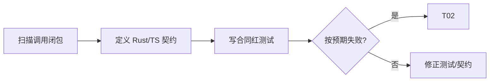
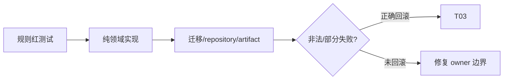
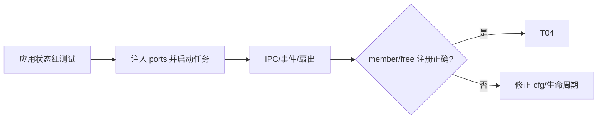
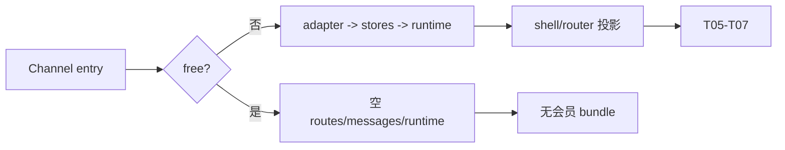
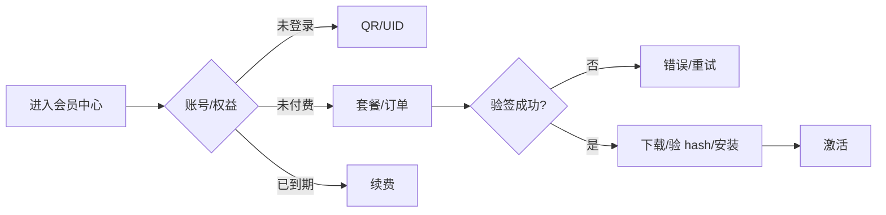
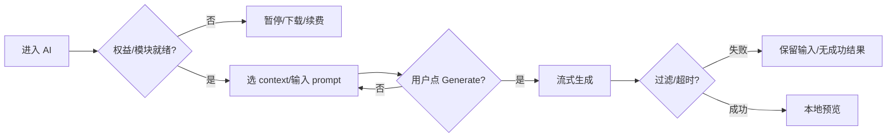
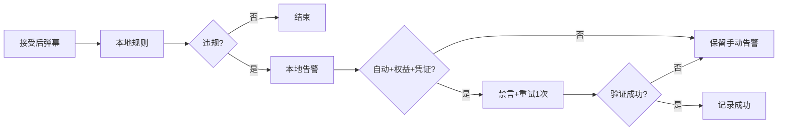
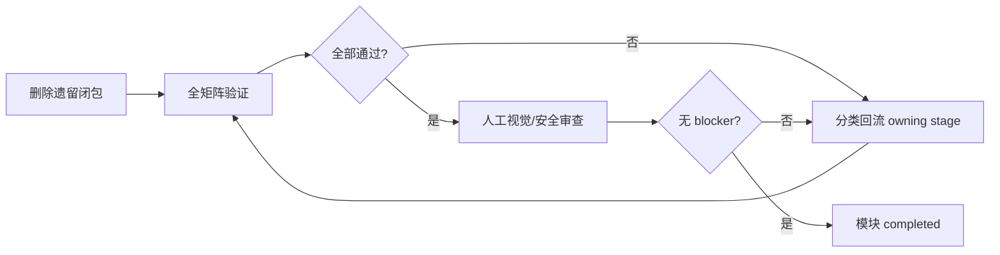

# Membership Intelligence Implementation Plan

## 全局摘要

- 范围：仅 `membership-intelligence`，承接 MI-S01..MI-S14 与 ADR-MI-01..07。
- 执行顺序：T01 -> T02 -> T03 -> T04 -> (T05, T06, T07) -> T08。本地执行可依次完成 T05-T07，不改变依赖。
- 方法：每个可测行为先写失败测试，再最小实现，然后重构与完整性扫描。
- 产品闭世界：只允许 spec allowlist 的字段、状态、动作和文案；外部缺口必须是 `external_service_unavailable`，不允许演示数据成功路径。
- 技术锚点：Tauri v2/Rust/SQLx/Tokio + Vue 3/Pinia/Vue Router/Element Plus/Tailwind-style utilities/Vitest；不更换栈。

## 业务逻辑明细

- 可用性判定顺序：构建通道 -> 账号 -> 签名令牌 -> 到期/离线窗口 -> 模块就绪。任一失败不得下推 active。
- 登录：每次二维码是唯一 session；2s 轮询、180s/90 次上限、5 次连续失败、取消中止、旧 session 事件丢弃。UID 提交去首尾空白并校验非空十进制，无长度猜测。
- 付费/模块：仅服务目录 `plan_id`；支付成功不等于激活；验签、hash、路径限定、原子提升和 DB 提交后才就绪。到期保留文件，续费复用同版本。
- AI：仅显式 Generate；prompt 或 context 至少一项；传输保留 raw prompt；单 generation ID 和递增 sequence；过滤后按 Unicode 字符截断；敏感命中无预览；无任何发送链。
- ASR：首次许可证确认 -> 已验签模型 -> 麦克风 -> Sidecar；任一失败将开关恢复 off，人工 AI 仍可用。
- 风控：默认 off；首次自动需四点风险+勾选；本地检测使用 PRD 默认值；禁言失败重试 1 次；未验证成功不移除告警；Cookie/API/到期都关闭 auto 且保留本地告警。

## T01 - 契约、红测试与变更链基线

### 目标与范围

- 先扩展 Rust/TS 安全类型契约和合同测试，不先写业务实现。
- 读取当前 command registry、desktop contracts/gateway、router/App/shell、legacy stores/services/types/tests 的直接调用闭包，追加 `artifacts/code-context.md` 的 membership refresh。
- product-content delta: none。来源：MI-S01..MI-S14，ADR-MI-01/02/05/07。

### 目标文件与符号

- `src-tauri/src/domain/member/{mod.rs,models.rs}`：不透明 ID、状态枚举、snapshot 类型。
- `src-tauri/src/ipc/member.rs`、`member_contract_test.rs`：DTO 外形和注册预期。
- `src/renderer/platform/desktop/contracts/member.ts`、`contracts/index.ts`：readonly discriminated unions、branded IDs、command/event map。
- 先写 Rust/TS 红测试：状态串行化、unknown enum 拒绝、free/member registry 差异、无 send command。

### 执行约束与测试

- Rust DTO 是桌面契约源，TS 保留字段意义；`null` 表示显式缺失，`undefined` 只表示前端未初始化。
- 读取 governing tsconfig 和直接 declarations，不全仓扫 `.d.ts`。
- 运行 focused Rust contract test 和 Vitest adapter contract test；红测试必须因缺实现失败，不得因 import/语法错失败。

## T02 - Rust 领域规则、持久化与安全机制

### 目标与范围

- 实现纯规则、三类 repository 数据语义、追加 migration、路径/hash/验签边界。
- product-content delta: none；仅实现 MI-S02/04/05/07/08/09/10/12 技术与业务规则。

### 实现步骤

- `domain/member/rules.rs`：QR 状态映射、token 时间/离线判定、capability 派生、module transition、AI input/filter/Unicode truncate、风控窗口/相似度/计数。
- `application/member/ports.rs`：按 auth/membership/artifact/LLM/moderation/repository/clock/event 分组 trait；不做 mega port。
- `infrastructure/member/repository.rs`：使用 SQLx 和 public account file；凭证不返回 Vue。
- `0002_membership_intelligence.sql`：增量补齐告警/忽略/误判白名单/安全字段，不改 `0001`。
- `artifacts.rs`：限定 modules root，拒绝 `..`/绝对路径/非允许资源，hash 通过后才原子提升。
- `external.rs`：Ed25519 verifier 可注入 key；缺 key 不可用；其他外部 port 失败关闭。

### 测试与边界

- 纯函数覆盖边界时刻、篡改、7 天内/外、非法转移、多字节截断、敏感拒绝、PRD 风控默认值和 fixture 指标。
- repository 覆盖事务、密钥不序列化、非法 row/enum 失败；artifact 覆盖 traversal/hash/部分提交/损坏临时清理。
- 模式：Level 1 纯函数/枚举状态表 + Level 2 repository/port；不用 class/factory/workflow engine。

## T03 - Rust 应用状态、事件扇出、IPC 与双通道注册

### 目标与范围

- 实现 `MembershipState`/`AiState`/`ModerationState`、长任务取消，将 28 个操作与事件接入 Tauri member registry。
- product-content delta: none；操作与状态仅来自 spec API table/allowlist。

### 实现步骤

- `application/member/state.rs`：三 owner 独立 lock/task handle，共享只读 capability getter；bootstrap/hourly/pre-command 验证；shutdown 终止所有 task/Sidecar。
- QR 任务使用 session generation + cancellation；Bilibili auth adapter 使用独立 cookie client，只输出公开身份。
- order/install/generation/ASR/mute 使用 opaque operation ID，重复调用幂等/去重，旧事件丢弃。
- `AcceptedLiveEventFanout` 保证 media/member 都收到一次，单消费者失败不截断其他链。
- `ipc/member.rs`：command 仅 DTO 校验/调用/错误映射；event sink 去敏。`lib.rs` 只在 member cfg 初始化/持有/注册/关闭。
- `build_channel.rs` 成为注册真值源；free 数组为空，member 精确列出。

### 测试与评审合同

- Tokio paused-time 测 QR/expiry/retry/stale/cancel/shutdown；生成流 sequence；禁言一次重试；consumer failure isolation。
- 失败 port 不能改写 success state，不吞 promise/error；无凭证/path/密钥在 DTO/log/Debug。
- 函数混合职责或 >150 行时按状态 action 拆分；轮询/定时/事件/task 都有 cleanup。

## T04 - 前端构建入口、适配、Stores 与 Runtime

### 目标与范围

- 建立免费空贡献/会员真实贡献，将 native snapshots/events 适配为三个 Pinia owner，连接 App 与 router/shell。
- product-content delta: 新增 member routes/navigation labels/status projection，精确对应 allowlist Routes/Account/Membership/AI/Moderation。

### 实现步骤

- `vite.config.ts` 为 channel entry 选 `channel.free.ts`/`channel.member.ts`；free 输出 empty routes/messages/no-op runtime，不 import 真实 member source。
- `adapters.ts` 作 unknown -> readonly view model 的唯一语义归一边界；unknown enum/missing required 失败，不兜底 active。
- 替换 `stores/ai.ts`/`moderation.ts`，新增 `membership.ts`，将 ASR 折叠进 AI owner；每 store 一 snapshot + pending operation set + safe error，无 localStorage/fetch/browser engine。
- `useMemberRuntime.ts` 只注册一组 listen，按 typed event 分发，start/stop 去重，unlisten 全部执行。
- App 从 channel runtime 获取 reactive `MemberShellStatus`，不在 shell store 重复写会员状态；router 加 member records，非法/过期路由回到已批准恢复面。
- member locale 文案只由 member channel 贡献；无 missing-source 空文案。

### 测试与边界

- adapter/store/runtime/router/navigation 红绿测试：unknown/null、pending dedupe、stale ID/sequence、dispose、free no routes、active/expired/readiness matrix。
- 无 computed/watch 做 DTO 修复，无新的 memo/debounce/virtualization；流式仅按 sequence 增量更新局部 result。
- 模式：Level 2 gateway/store + build Adapter，Level 1 union/mapper/runtime composable；禁止通用事件总线/管理器。

## T05 - 会员中心、登录、支付与模块 UI

### 目标与产品内容

- 实现 logged-out/unpaid/payment/install/active/expired/unavailable 互斥页面与对话框。
- product-content delta: allowlist 的 Account/Membership fields/actions/copy 全部；无额外套餐、广告、空状态文案。来源 MI-S02..05/11..13。

### 组件与交互

- `views/membership/index.vue` 只编排 store snapshot、section 和对话框。内联账号/状态摘要。
- 按 page-design 抽取 `MemberLoginDialog`、`MembershipPlanGrid`、`MembershipPaymentDialog`、`ModuleDownloadDialog`、`ModuleManagementDialog`、`MembershipOrderDrawer`；单 caller 来自内聚业务/焦点/测试边界，不是为缩短文件。
- props 仅 view model；emits 仅 generate/cancel/refresh/query/bind/select/renew/update/cleanup/logout 意图；无 slots/store/gateway。
- UID input 在 submit 显示关联错误；QR 状态、取消/刷新可用性、支付取消、下载不可关闭精确对应 spec。
- 字段格式：UID 原样、到期 `YYYY-MM-DD`、剩余整天、验证 currency/minor amount、精确 module version/status/progress；unknown 是 error/unavailable，非虚假值。

### 样式、可访问与测试

- Element Plus 语义控件 + Tailwind utilities；无 scoped CSS/内联 style/长 class 常量。状态文本+图标，focus restore/live region/dialog footer/1024x680 overflow。
- 组件测试覆盖所有状态、键盘、disabled、loading 终止、取消/重试、无空文案、无乐观激活。

## T06 - AI/ASR 页面、配置、流式结果与日志

### 目标与产品内容

- 实现显式生成、本地预览、人设、ASR 模型、日志和到期暂停。
- product-content delta: allowlist AI fields/actions/copy，来源 MI-S06..08/11/12；严禁 send 与额外 preset/provider/model 数据。

### 组件、字段与状态

- `views/ai/index.vue` 内联 prompt/result orchestration；接入 accepted danmaku/ASR/manual contexts；`log.vue` 仅显示 spec/SQL 允许列。
- 抽取 `AiPersonaConfigDialog`、`AsrModelDownloadDialog`、`AiContextList`，复用 `MembershipPausedNotice`；props/emits/focus/draft 按 page-design。
- 自由文本保留 raw 空白/换行并无未授权长度校验；style 只有四值；provider/model/range 缺契约时 save disabled/unavailable。
- Generate 仅 prompt.trim 非空或 context 非空；pending 去重；delta 按 generation/sequence；失败保留 input；Copy/Clear/Regenerate 无隐式发送。
- ASR 许可证勾选才下载，进度/hash/错误受 native snapshot 驱动；麦克风/启动失败恢复 off。

### 测试

- 覆盖不主动生成、prompt/context 组合、stale delta、限流/timeout/敏感/截断、copy 失败、clear 不删 log，许可证/麦克风/模型失败，到期恢复。
- 扫 UI/TS/Rust registry/request/task 不存在 send-danmaku 语义。

## T07 - 本地风控、风险确认、告警与操作日志 UI

### 目标与产品内容

- 实现 moderation ready/expired/unavailable，告警、规则、风险、手动/自动禁言、忽略、误判、日志。
- product-content delta: allowlist Moderation fields/actions/exact risk/error copy，来源 MI-S09..12；无缺契约的解禁/申诉传输成功。

### 组件与状态

- `views/moderation/index.vue` 编排 persistent warning/controls/counts/alerts；`log.vue` 用户/时间筛选与误判标记。
- 抽取 `ModerationRiskDialog`、`ModerationRulesDialog`、`ModerationAlertList`、`ModerationUserDrawer`，复用 paused notice。对话框仅本地 draft/focus，store 保存 snapshot/action。
- 风险弹窗四点原文、checkbox 关联、未勾选 Confirm disabled；Cancel/close 不开 auto。
- 规则默认值精确；缺 native ranges 时不猜范围。禁言时长只 10m/1h/permanent；loading 从 command 开始到 verified terminal。
- 失败两次保留告警；ignore 持久化成功后移除；过期仍保留本地检测/告警/忽略/黑名单。

### 测试

- 风险 gate/focus/keyboard、default off、权益/Cookie/API 关闭、一次重试、不假成功、ignore 回滚、日志筛选/误判、告警响应式堆叠和非颜色信号。

## T08 - 遗留链清理、集成验证与评审准备

### 清理闭包

- 操作前再扫描 legacy AI/ASR/moderation 入口 -> stores -> services/engines/composables/types -> localStorage/browser/Electron -> tests/mocks。
- 删除被替代的生产调用、import/export/helper/constants/types/state/computed/watch/tests/mocks/comments；仅测试引用不是保留理由。
- 保留任何 helper 时记录实际生产 caller。不动 extensions/release 邻近实现。
- product-content delta: 删除未授权 legacy presets/actions/storage behavior，对应 MI-S14 和禁止解读；无新内容。

### 验证矩阵

- Rust：fmt check；free/member unit+integration tests；strict clippy both features；command registry and dependency/source scans。
- Frontend；free/member Vitest；typecheck；lint；free/member Vite build；bundle scan 无 free member routes/copy/commands；source scan 无 send/localStorage/legacy callers。
- Tauri；free/member full bundle build，记录 MSI/NSIS 产物、大小和时间；dev server HTTP 200。
- 手工；1024x680 和宽屏/高缩放查看 member center/AI/moderation；键盘、focus、dialog、loading/error/expired/unavailable；无重叠/溢出。
- 性能/security；controlled fixtures 证明 <=5min/<=1min/<=500ms/5s/<2s/准确率指标；path/hash/signature/secret/event/task cleanup 证据。真实外部指标不得在 unavailable adapter 下宣称。

### 评审与回流

- 每个 changed hunk 标记 T01..T08/清理/测试适配；清理 debug/dead/stale/temporary/unused/churn。
- verify 失败按需求/architecture/plan/code 分类回流 spec/architecture-design/plan/execute；review blocker 回 execute；不超过现有 loop 边界，无新证据则停止空转。
- 评审报告必须记录 spec/source/pattern/intent/change/removal/production/human/expert/field/functional/architecture/reuse/styling/API/TS/self-healing/code-review verdict。

## 依赖与并行性

- T01-T04 严格串行。T05-T07 只在 T04 契约/stores/runtime 通过后可并行，但共享 locale/channel/runtime 文件由 T04 唯一拥有，子页不同时编辑共享文件。T08 最后串行。

## API 与类型策略

- 每个 command 的 Rust request/response 和 TS map 在 T01 先定义；外部 raw DTO 留在 infrastructure。
- Bilibili 按 PRD 接口；其他外部契约缺失时 unavailable。无 protobuf/OpenAPI/backend TS 可复用。
- adapter 处理 enum/null/时间/金额/秘密脱敏；template/computed 不进行数据契约归一。

## 样式与字段合同

- T05-T07 完整承接 spec 字段表；到期日期、整天余额、minor amount+currency、状态默认强调、可点击 focus/active/disabled 不使用通用 formatter/默认 hover 猜测。
- 所有 class 可就地审阅，超宽时简化 markup 或使用已批准组件边界，不藏入 JS 常量。

## 代码评审预检合同

- 健壮性：所有网络/SQL/文件/进程/事件/clipboard/props/form 值都验证并捕获 rejected promise；部分成功不转 success。
- 可维护性；>150 行且混合职责必须拆分；常量仅用于 2s/180s/90/5/7d/500ms/5s 等稳定领域规则；一次性值就地。
- 性能/内存；轮询、hourly timer、流式事件、accepted event、Sidecar、Tauri listen 有 dedupe/cancel/dispose；无证据不加 debounce/cache/virtualization。
- 项目规范；不更换框架/组件库/样式/store/request 边界；新 Rust crate 仅为明确 crypto/network/QR/hash/archive 能力且会验证双通道影响。

## Execute-Readiness 与自动审批

- 范围、业务顺序、字段语义、输入空白、状态/错误/loading/取消/重试、所有者、文件、契约、清理目标、测试命令类别和回流均已明确。
- 没有 missing-source 被包装为成功任务；外部缺口仅生成 unavailable 路径。
- 模式、Anti-DRY、Vue 抽取、locality、副作用、复杂度预算、评审证据与产品闭世界均与 spec/architecture 对齐。
- Framework plan approval: pass。进入 `execute`，保留 `loop`。
