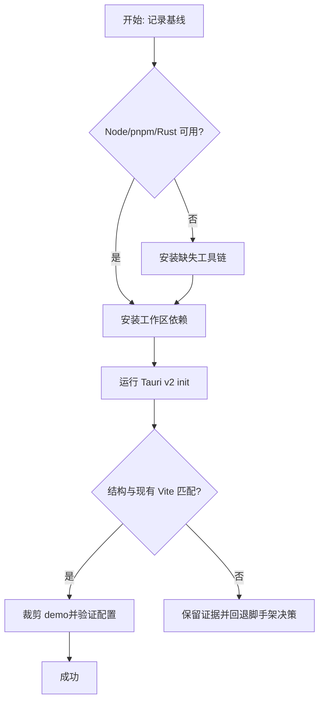
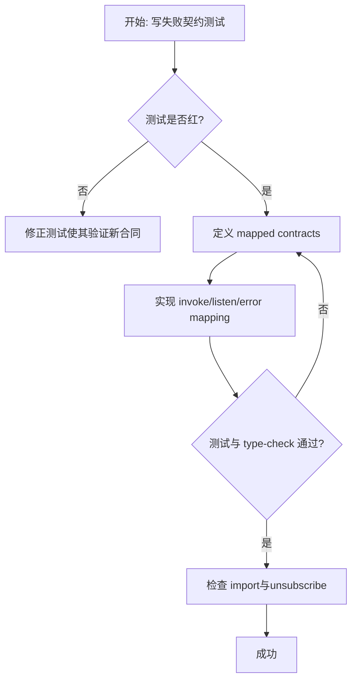
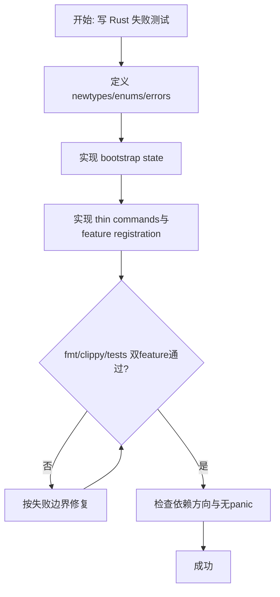
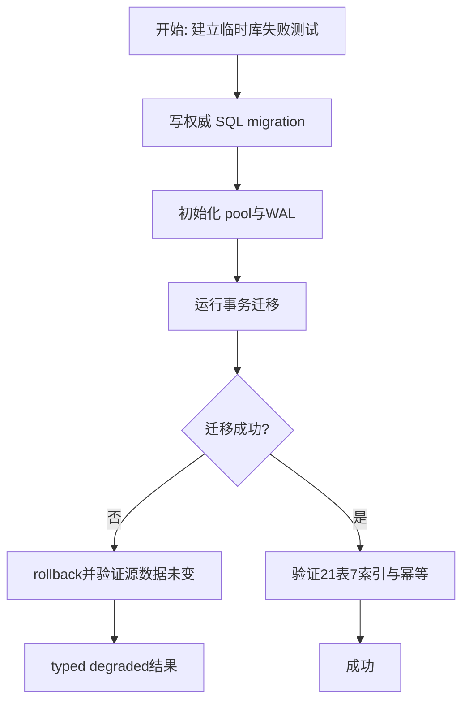
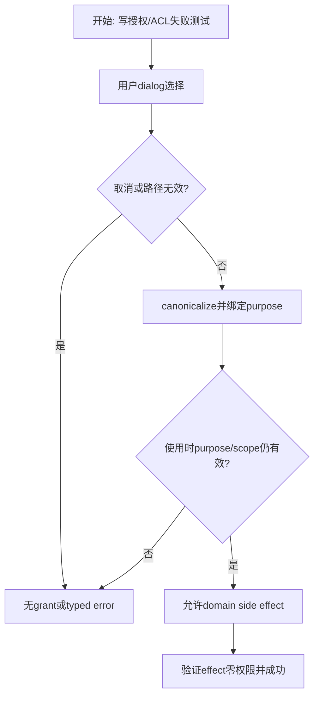
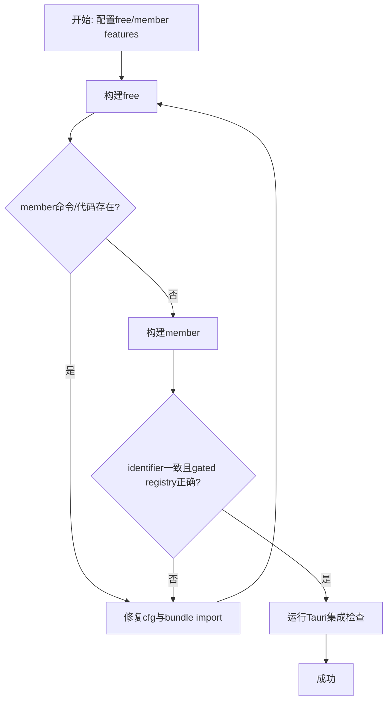
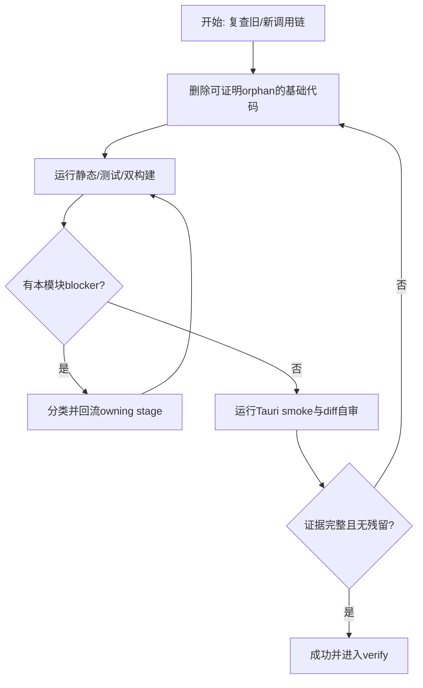

# Platform Foundation 执行计划

## 交付单元标识

- Request: `tauri-rust-refactor`
- Module: `platform-foundation`
- 上游：已审批 spec + architecture design
- 计划结论：`ready for execute`

## 阅读导航

- 任务数：7，全部串行；不启用 workflow 并行。
- 主线：基线/脚手架 -> typed gateway -> Rust contract/state -> SQLite -> path/capability -> 双构建 -> 清理与验证。
- 高风险：PF-01 原生工具链、PF-04 schema/迁移、PF-06 free/member 编译隔离。
- 每个任务的产品内容变化均为 `none`；本单元没有页面或可见文案授权。

## 全局摘要

本计划把现有 Vue/Vite 应用挂接到 Tauri v2，并实现后续模块共享的 Rust、IPC、SQLite、安全和构建底座。业务状态主线只有初始化：`uninitialized -> initializing -> ready | degraded`；失败可重试，迁移失败必须回滚且不得损坏旧数据。实施前必须安装工作区依赖和 Rust stable，并保存基线失败证据。

## 用户意图合同承接

- 字面要求：按 PRD 重构项目。
- 实际目标：得到可运行、可扩展、由 Rust 掌管原生能力的 Tauri 产品，而非给 Electron 套壳。
- 成功标准：Tauri 开发运行、双 feature 构建、SQLite/Capability/typed IPC 可验证。
- 禁止：Electron 继续做生产 host、免费包仅靠隐藏 UI、任意文件 API、弹幕发送、伪造外部服务成功。
- PF-02/PF-03/PF-05/PF-06 落实边界；PF-07 通过源码、registry、bundle、测试与 runtime smoke 证明风险没有转移。

## 来源锚定与禁止扩展边界

| 任务 | Grounding | Spec/architecture 来源 | Product-content delta |
| --- | --- | --- | --- |
| PF-01 | source-backed + code-fact-backed | scaffold decision, ADR-PF-001 | none |
| PF-02 | source-backed | Command/Event Gateway, ADR-PF-001/006 | none |
| PF-03 | source-backed | Validation/Bootstrap/Build Channels, ADR-PF-002/004/006 | none |
| PF-04 | source-backed | SQLite/Migration, ADR-PF-003 | none |
| PF-05 | source-backed | Path Grants/Capabilities, ADR-PF-005 | none |
| PF-06 | source-backed + confirmed technical decision | Build Channels/Scaffold, ADR-PF-004 | none |
| PF-07 | code-fact-backed + source-backed | Acceptance Criteria/Handoff | none |

外部 OAuth、支付、Cookie API、manifest、公钥和 Sidecar artifacts 为 `external-interface-pending`，只允许不可用状态，不得成为模拟成功实现。模块 2-6 的页面、业务规则和可见内容不进入本计划。

## 业务功能需求点与业务逻辑明细

### PF-BR-01 初始化状态

- 角色：应用运行时；对象：共享平台状态。
- 入口：Tauri setup 或 `app_bootstrap`。
- 前置：可解析 app data 路径。
- 规则：并发调用共用一个初始化；成功为 `ready`；存储/迁移失败为可诊断 `degraded`；不允许 panic 或伪成功。
- 终态：`ready` 或可重试 `degraded`。重试不能并发执行第二次迁移。
- 验收：bootstrap 状态、幂等和失败测试。

### PF-BR-02 桌面边界

- TypeScript 请求经精确 command map 序列化，Rust serde DTO 校验后委托应用层。
- listener 注册成功后返回 unsubscribe，owner cleanup 后不得再更新状态。
- 错误统一为 `DesktopError`；details 不含 secret/无限制路径。
- 任意 channel、任意 SQL、任意文件 API 和弹幕发送 contract 都是不可达状态。

### PF-BR-03 输入校验

- Room/UID：先 trim，必须是 1-20 个 ASCII 数字；空白归一后为空即拒绝。
- Username/word：移除控制字符再 trim；长度分别 1-50/1-100，内部普通空格保留；长度按归一值计算。
- Volume：有限浮点 0-1（含边界）；threshold：非负整数。
- 枚举/模板变量：closed allowlist，未知值 fail closed。
- Rust 是授权 owner；TS 预校验仅用于后续 UX。

### PF-BR-04 数据库与迁移

- 数据库位于共享 app data，启用 WAL。
- 迁移按版本串行、幂等、事务执行；实际迁移前完成 preflight/backup，失败 rollback 并保留 source。
- schema 以 PRD 显式 SQL 为准：21 tables + 7 indexes。
- WebView 不执行 SQL；敏感值不得以 plaintext result 返回。

### PF-BR-05 路径授权

- 只有 dialog 选择且 Rust 校验的路径可形成 opaque grant。
- grant 绑定 purpose；cancel 不产生 grant；stale、wrong-purpose、scope escape/symlink escape 均拒绝。
- `modules/` 由 Rust 独占，renderer 不指定。

### PF-BR-06 构建隔离

- 默认/free 仅编译共享底座；member feature 增加 member gated core/registry。
- Free registry 不存在 PRD 指定的六个 member commands，也不得包含 auth/module-download implementation。
- 两个配置使用相同 identifier/data contract；前端 channel 与 Cargo feature 必须一致，不一致构建失败。

## 字段展示语义与交互视觉状态合同

不适用：本模块不添加可见字段、页面、链接、状态标签或样式。`buildChannel`、`schemaVersion`、bootstrap/error DTO 仅供后续模块 adapter 消费，本计划禁止直接在 template 显示或自行创造文案。

## 执行效率与上下文预算

- `S3 broad` / full：跨 package、Rust、构建、迁移和删除闭包。
- 最小执行闭包：package/root manifests、pnpm catalog/lock、Vite/TS config、renderer IPC/preload/main entry、new `src-tauri`, focused tests and direct IPC callers.
- 不读取业务页面细节，除非静态 caller search 证明它直接依赖 foundation boundary。
- 若发现新的业务语义、shared owner 反向依赖、Tauri ACL 无法满足 effect 隔离或 schema 冲突，回退 architecture/spec。
- 验证同时含 focused 与 package-wide checks；基线旧测试失败单独记录。

## 自愈闭环计划

- Execute 后自动进入 `verify -> review`；缺陷发现不交给用户。
- 缺陷路由：syntax/type/runtime/logic/code-organization -> execute；plan-gap -> plan；architecture-gap -> architecture-design；requirement-mismatch -> spec；missing product source -> requirement-analysis/intake。
- `technical-debt-blocker` 只要影响本模块验收必须当场修复。
- 单模块迭代 `<=7`；同 blocker/owner 连续失败 `<=2`，同 blocker 总失败 `<=3`。没有新证据、修复或更窄诊断时停止并报告 blocked。
- 每轮复查 focused tests、fmt/clippy/type/lint/build、runtime smoke、diff、caller/removal closure 和 dependency direction。
- 完成条件：所有 task done，`self-healing loop compliance: pass`、`self-healing loop assessment: pass`、remaining blockers `none`。

## 执行可用性合同

- `ready for execute`；产品语义缺口为 none。
- 已批准技术选择：Tauri v2 existing-frontend scaffold、SQLx SQLite/Tokio、函数式 typed facade、Cargo features；都不增加可见行为。
- 精确文件/符号、状态、DTO、失败路径、顺序与验证见任务 PF-01..07。
- `null`/optional 只表示 spec 许可的缺失；required invalid data 必须报错。
- 不得现场替换 Vue/Pinia/Router/Element Plus/Tailwind、Tauri、SQLx 或目录/依赖方向。

## 任务拆解

### PF-01 工具链、基线与 Tauri 脚手架

- 目标：建立可重复的依赖/工具链基线并生成唯一 Tauri backend。
- 规格映射：Project Bootstrap、Scaffold Alignment；ADR-PF-001。Grounding `source-backed/code-fact-backed`; product-content delta `none`。
- 范围：`package.json`, app `package.json`, `pnpm-workspace.yaml`, lockfile, `vite.config.ts`, generated `src-tauri` skeleton. 保留 Vue renderer；不改业务页面。
- 前置：记录 `node/pnpm/rustc/cargo` 版本与现有 type/build/test 失败；安装 pnpm deps、Rust stable 和 Tauri CLI v2 compatible dependency。
- 实现：先运行 CLI help 固定参数；用 existing-frontend init；配置 Vite dev URL/dist；删除 demo command/sample；不手写替代生成器。
- 测试：生成目录检查、Tauri config parse、Vite standalone build。失败则保留生成证据并回退 scaffold task，不继续手工拼装。
- Pattern：Level 2 reuse official scaffold；拒绝 second Vue starter。

### PF-02 TypeScript Typed Desktop Gateway（TDD）

- 目标：用 mapped types/discriminated errors 建立唯一 invoke/listen facade。
- 规格映射：Command/Event Gateway；ADR-PF-001/006。Grounding `source-backed`; delta `none`。
- 文件：新增 `src/renderer/platform/desktop/{contracts,transport,index}.ts` 与 focused test；保留 `utils/ipc.ts` 作为未迁 caller 临时面，本任务不批量改业务 caller。
- 先测：command request/result 约束、rejected value -> `DesktopError`、listener payload/unsubscribe；测试失败后实现。
- 合同：六个 foundation commands、两个 events、error guard；transport adapter 接受可注入 invoke/listen 以便测试，无 ambient mutable state。
- 副作用：仅 transport 调用 Tauri；映射函数纯；caller owns unsubscribe。
- 完成：新 facade 无 `any`/feature-private imports；direct `@tauri-apps/api` 只出现于 transport。
- Pattern：Level 2 typed Facade/Adapter；单 facade 是多 caller 的真实边界。

### PF-03 Rust Domain、错误、状态与 Command 骨架（TDD）

- 目标：落实 ADR-PF-002/004/006 和 PF-BR-01..03。
- Grounding `source-backed`; delta `none`。
- 文件：`lib.rs`, `main.rs`, `build_channel.rs`, `ipc/*`, `application/{bootstrap,ports}.rs`, `domain/validation.rs` 及 module-local tests。
- 先测：所有边界/非法校验、DesktopError 序列化/脱敏、bootstrap 幂等/失败状态、free/member capability derivation。
- 实现：validated newtypes/enums first；thin commands delegate；`AppState` owns initialization state; no runtime `unwrap` on external values。
- 状态：`uninitialized -> initializing -> ready|degraded`; only degraded may retry, and one inflight initializer wins。
- Performance：no polling/watcher/sidecar; Tokio primitives only where concurrency exists。
- 完成：domain has no Tauri/SQLx; functions <150 lines or single responsibility; both feature test configurations compile。
- Pattern：Level 3 ports/adapters composition, enum state machine; reject class/manager/registry DSL。

### PF-04 SQLite、配置与迁移（TDD）

- 目标：落实 PF-BR-04 和 ADR-PF-003。
- Grounding `source-backed`; delta `none`。
- 文件：`src-tauri/migrations/0001_initial.sql`, infrastructure database/migrations/config repository, application config, integration tests。
- 先测：temp DB WAL、21 table/7 index exact set、defaults/nullability representative checks、idempotent rerun、forced failure rollback、config get/set optional semantics。
- 实现：SQLx pool + connection pragmas + embedded ordered migration；SQL row private；config commands only non-secret values。
- 迁移：preflight/backup interface exists; full legacy mapping deferred to module 6. Test fixture source hash unchanged on failure。
- Failure：locked/corrupt/newer schema maps typed error; no silent fallback to in-memory success。
- 完成：no SQL in IPC/WebView；pool/migration side effects isolated。
- Pattern：Level 2 repository/migration adapter；do not create 21 generic repositories/CRUD APIs。

### PF-05 Path Grants 与 Capability（TDD）

- 目标：落实 PF-BR-05、ADR-PF-005 和 effect zero-command 权限。
- Grounding `source-backed`; delta `none`。
- 文件：application paths, infrastructure path grants, dialog plugin wiring, `permissions/foundation.toml`, `capabilities/{main,effect}.json`, tests。
- 先测：cancel/no grant、valid purpose, wrong purpose, revoke, missing/stale path, traversal/canonical escape/symlink case；capability JSON/ACL asserts effect has no permissions。
- 实现：opaque UUID-like id generated in Rust, closed `PathPurpose`, canonicalization before use, managed dirs not renderer-selectable。
- API：`path_select`/`path_revoke`; result display path is informational only and not accepted back as authority。
- Failure：dialog/plugin error mapped; no path contents/secret leak。
- Pattern：Level 2 access-control Proxy/Adapter as a concrete security boundary; reject broad filesystem scope。

### PF-06 双构建、脚本与完整集成

- 目标：实现 PF-BR-06，并让 Tauri 成为 package 开发/构建入口。
- Grounding `source-backed/confirmed technical decision`; delta `none`。
- 文件：Cargo features/deps, `tauri*.conf.json`, package/root scripts, Vite env typing/config, capability/command registration tests, lockfiles。
- 实现：default `free`, opt-in `member`; two config overlays share identifier; `VITE_BUILD_CHANNEL` matches Cargo feature; commands conditionally compiled and registered。
- Free exclusion：六个 member commands absent; no member auth/module downloader module in free dependency graph. Member only compiles gated stubs/ports, returns unavailable until module 5 integrations。
- Commands：add `dev`, `build:free`, `build:member`, Rust checks; remove Electron as default launcher but defer deleting business source until caller migration.
- 验证：free/member cargo test/build, frontend build under both channels, registry/symbol/bundle searches, config identifier equality。
- Pattern：Level 1 compile-time strategy; reject runtime-only flag and forked repos。

### PF-07 删除闭包、自审与验收

- 目标：清理 foundation 范围内的旧入口/占位并形成 reviewer-ready evidence。
- Grounding `source-backed/code-fact-backed`; delta `none`。
- 变更前链路：复查 package script -> Vite plugin -> main/preload -> `utils/ipc.ts` -> direct callers；测试引用只作适配面。
- 清理：删除 scaffold demo、foundation 已替代且无生产 caller 的 Electron启动/IPC片段；保留未迁业务模块并记录 owner/trigger。移除 orphan imports/types/mocks/comments/debug code；不做 logger/页面顺手重构。
- 变更后复查：Tauri is default host, no duplicate foundation path, no new arbitrary IPC/fs API, no send-danmaku symbol/command, no reverse dependency/cycle。
- 验证命令：Rust fmt/clippy/tests/build both features; pnpm type/lint/focused tests/build both channels; schema/capability checks; `tauri dev` smoke; git diff/status and caller search。
- 证据：`execution/changelog.md`, verify/review artifacts; baseline unrelated failures separated with exact command/output summary。
- Pattern：Level 0 direct cleanup; no new abstraction.

## 功能拆解明细

- 流程型能力已由 PF-BR-01..06 和任务子项完整覆盖。
- 表单/表格/纯展示/样式/Vue 组件：不适用，本模块禁止新增。
- 异步 loading owner：Rust bootstrap state；开始于首次初始化，终止于 ready/degraded。路径 dialog 的等待由 command future 所有，cancel 是非成功无副作用终态。
- 错误信息：传输使用 stable code/diagnostic fallback；本模块不批准用户可见 copy。

## 项目脚手架与初始化策略

- 采用官方 Tauri v2 CLI existing-frontend init，执行前读取本地安装版本的 `tauri init --help`。
- 初始化入口：app package 内 `pnpm tauri init --ci`，参数固定 app/window name、`dist/renderer`、Vite dev URL 和 before commands；确切 flag 以已安装 v2 help 为准并记录。
- 裁剪：greet/demo、重复 frontend、无用权限；补层次目录、migrations、features、overlays。
- 不得转用 `create-tauri-app` 生成第二前端或自建非标准 bootstrap。

## API 对接与类型策略

- 契约源：本 module spec 的 six commands/two events/DesktopError；Rust serde DTO 为 canonical 字段名。
- TS mapped types 镜像 Rust；无服务端 TS/proto/OpenAPI 可复用。
- transport facade 只做 serialize/listen/error normalization；业务 view model 不在本单元。
- External services only unavailable port; no request layer/network call task。

## 依赖关系

`PF-01 -> PF-02 -> PF-03 -> PF-04 -> PF-05 -> PF-06 -> PF-07`。PF-02 与 PF-03 理论上可并行，但共享合同与生成文件，保持串行减少漂移。

## 变更链路审查

- 操作前用 `rg`/graph 检查 package scripts、Vite plugins、Electron main/preload, IPC wrappers/direct callers, tests/mocks and side effects。
- 每次删除检查 import/export/helper/constant/type/request/state/computed/watch/test/mock/comment closure。
- 仅测试引用不构成生产保留理由；测试改为新 contract 或按非本模块范围保留基线失败说明。
- 操作后标准：无重复 host/transport owner、无 orphan symbol、无未授权邻近行为、所有保留 legacy caller 有 later-module owner/cleanup trigger。

## 整洁性与复杂度控制

- 遵守 architecture 24 个 hand-authored file、6 commands、2 events、3 frontend operations 和五层最大深度预算。
- 不新增通用 CRUD、service locator、manager/factory、mega DTO、catch-all utils。
- Function 混合职责或超过 150 行则按 command/orchestration/validation/I/O 分解，不按任意行数拆一函数一文件。

## 局部性与文件抽取决策

严格采用 architecture 表：transport/contracts、validation、migration、config repository、path grants 因多 caller/contract/I/O/test boundary 单独文件；one-call conversion colocation。Execute 不得新增其他 helper 文件。

## Vue 组件抽取决策

不适用：禁止新增或拆分 Vue SFC。

## 前端专家级工程与架构质量约束

- Rust is sole writable owner for build/bootstrap/db/grants; frontend holds readonly projection only。
- Request DTO -> Rust validation -> application -> infrastructure -> response DTO；无 template normalization。
- Bootstrap dedupe/retry and listener cleanup are tested；no watcher/polling/reactive fan-out。
- 落实 ADR-PF-001..006、dependency matrix、extension seam rejection、complexity budget 和 all cleanup triggers。
- Verify 必须记录 `expert frontend engineering compliance` 与 `frontend architecture quality compliance`。

## 生产代码质量与代码评审预检合同

- Robustness：serde/external/dialog/storage values require validation/null handling; every invoke/future rejection handled; no runtime input unwrap/panic/silent success。
- Maintainability：types first, pure validators/mappers, explicit command effects; precise names and narrow constants。
- Performance/memory：no high-frequency UI work; bootstrap dedupe, no polling; listener/future/pool resource owners explicit。
- Stack consistency：Vue 3/TS/Vite/Pinia/Router/Element Plus/Tailwind + Tauri v2/Rust/SQLx only；no framework/library substitution。
- Review hygiene：each hunk maps to PF task; no debug/dead/stale/temporary/unrelated formatting; no broad `any`/unsafe assertion。

## 架构复用与公共逻辑抽取

- Extract/replace: typed transport, DesktopError mapping, validation primitives, pool/migration, path grant, compile channel source。
- Keep separate: domain repositories and business DTO adapters because semantics/lifecycle/permissions vary by more than three axes。
- Public shared APIs receive doc comments/`@see` or examples and behavior tests。
- Shared mechanisms accept policy/input by parameter or port and never import feature-private types/global state。

## 函数式编程约束

- Pure: normalize/validate, error mapping, capability derivation, DTO conversions, migration preflight decision。
- Immutable: DTOs, function args, config snapshots。
- Side effects: Tauri lifecycle/command, repository/migration, dialog/filesystem/secure-store only。
- No FP library, mutation of inputs, clever currying or hidden cache。

## Tailwind 样式约束

不适用：本模块没有 authored styling；发现样式需求即回退 spec/page-design。

## 模式决策与替代方案

- Foundation: Level 3 ports/adapters due real runtime/I/O ownership change。
- TS: Level 2 typed facade/adapter; Rust state: Level 1 enum state machine; build: Level 1 compile strategy; cleanup: Level 0 direct。
- Reject generic command pattern/service locator/factory/class hierarchy and runtime-only build flags。
- Execute 不得改变这些模式层级；发现新的变化轴回退 architecture-design。

## 代码上下文与影响范围

- TS governed by app `tsconfig.json`/`tsconfig.eslint.json`: strict, bundler resolution, ESNext, `@` alias, noUnused。
- Affected: root/app manifests and lock, app Vite/scripts, new renderer platform gateway, new `src-tauri`, direct tests/declarations。
- Adjacent only: current stores/services/views, Electron business modules, logger cycles and root stale tests。

## 并行执行建议

不建议。生成器、manifest、Cargo config、DTO 和 registry 均有写依赖；串行成本更低且审查路径更清晰。

## 触发与上下文准备

- Trigger：state `stage=execute`, plan approved。
- Context：读 task target/direct callers/tests immediately before edit；每次运行脚手架/依赖命令记录版本和 diff。
- Handoff：PF-07 完成后生成 changelog，进入 verify/review。

## 受影响文件或模块

- Edit: root/app `package.json`, `pnpm-workspace.yaml`, lockfile, app `vite.config.ts`, relevant TS declarations/tests。
- Add: app `src-tauri/**`, renderer `platform/desktop/**`, module execution artifacts。
- Conditionally delete: only foundation-owned Electron scaffold/demo/bridge symbols proven orphan；business Electron modules remain until owner module migration。

## 测试策略

- TDD: PF-02..05 red -> green -> refactor。
- Rust: module unit tests + temp-SQLite integration + both feature builds/clippy。
- TS: transport injection/error/listener tests + type-check/lint/Vite builds。
- Static: exact schema/index set, command registry/symbols, capability permissions, `@tauri-apps/api` imports, Electron/direct fs/search, danmaku send absence。
- Runtime: Tauri dev cold bootstrap smoke, no Sidecar start, readiness/degraded evidence。

## 观察与人工介入点

- 自动观察：install/build output, native linker/WebView errors, schema diff, command/capability leakage。
- 仅以下情况需要上游介入：Tauri ACL cannot enforce zero-command effect window; source schema cannot migrate without semantic change; external contract is required to pass a source-backed behavior rather than return unavailable。

## 回滚说明

- Scaffold/config failure：revert only task-owned generated changes through explicit patches; preserve user PRD and unrelated worktree changes。
- Migration failure：transaction rollback, legacy source unchanged, backup retained。
- Feature leakage：fail build/verification; do not ship runtime-hidden compromise。
- External missing：retain typed unavailable adapter; free/common base remains operational。
