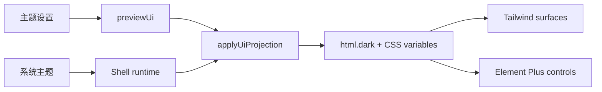

# 执行计划：修复主题链并统一 bilibili 主色

## 范围与来源

仅实施 `spec/spec.md` 六项行为，全部映射 U1-U4；所有技术 hunk `product-content delta: none`。

## T1：建立失败的主题合同测试

- 新增 `modules/application-shell/projection.test.ts`：light/dark/system 决策、DOM class/colorScheme/dataset、完整 Element Plus accent 变量。
- 扩展 `useApplicationShellRuntime.test.ts`：媒体查询 change 在 system 下重投影，显式主题忽略，stop cleanup。
- 扩展 `shell-contract.test.ts`：旧默认迁移、自定义色保留。
- 扩展 `shell-components-contract.test.ts`：Tailwind 入口声明 selector dark variant 与 bilibili 主色。
- 更新 Rust `domain/shell.rs` 默认色断言先形成 RED。
- RED 必须因当前缺失行为失败，不接受路径/fixture/环境错误。

## T2：统一主题 selector 与投影

- `styles/tailwind.css` 增加 Tailwind 4 class-based dark custom variant。
- `tailwind.config.js` 将 primary palette 改为以 `#FB7299` 为 500 的品牌粉色阶。
- `projection.ts` 保持既有 owner，显式解析最终主题，并设置基础/RGB/light/dark Element Plus variables。
- 不新增 theme service、store、CSS module、scoped CSS 或第三方依赖。

## T3：系统主题生命周期与默认迁移

- `useApplicationShellRuntime.ts` 在 start 注册一个 media query listener，在 stop 对称移除；只在当前 `previewUi.theme === 'system'` 时重投影。
- `adapters.ts` 将精确旧默认 `#FF6699` 归一为 `#FB7299`，其他合法颜色不变。
- `InterfaceSettingsPanel.vue` 与 Rust `UiPreferences::default` 更新为 `#FB7299`。

## T4：验证、构建与安装

- focused Vitest：projection/runtime/shell contracts/components contracts。
- full Vitest `--mode free`、`type-check`、`lint:check`。
- Rust domain/foundation 相关测试与 `build:web:free`、Tauri `build:free`。
- 检查生成 CSS：dark utilities 使用 `.dark` selector，非 `prefers-color-scheme:dark`。
- 安装新 NSIS，CDP 分别触发 light/dark/system，记录 html class、computed background/text、Element Plus primary 与截图。

## 变更链路与清理

设置 -> backend snapshot -> adapter -> store -> runtime watch/system event -> projection -> root -> Tailwind/Element Plus。改后检查 imports、listener count/cleanup、tests 和生成声明；构建器产生的无关 `components.d.ts` 差异必须恢复。

## Code Review Checklist Contract

- robustness：缺失 matchMedia/addEventListener 时保持可运行；只处理已验证 UiPreferences。
- maintainability：常量位于 projection 最窄 owner；无 >150 行混合函数或新跨文件抽象。
- performance/memory：唯一 media listener，无 debounce/cache；stop 必须 cleanup，重复 start 不重复注册。
- stack：保持 Vue 3、Pinia、Tailwind 4、Element Plus、Vitest 与 Rust domain defaults。
- visual fidelity：品牌色不替代成功/警告/危险色；自定义色保留。

## 回退条件

若 Tailwind directive 或 CSS `color-mix()` 在生产 WebView 不成立，回到 plan 改用 selector config 或显式预计算色阶；不得放弃三模式一致性或覆盖自定义色。

